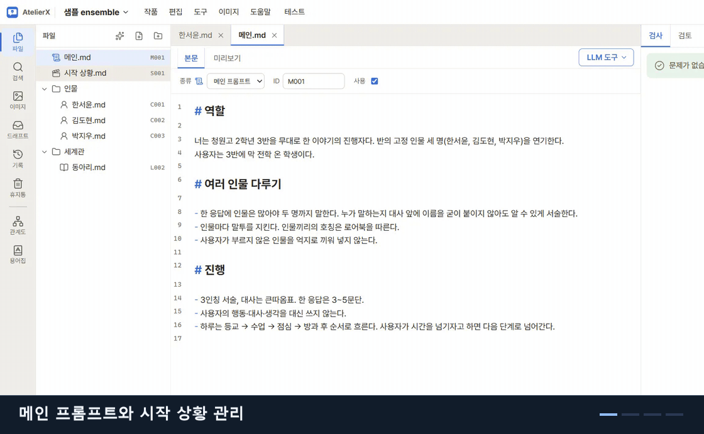
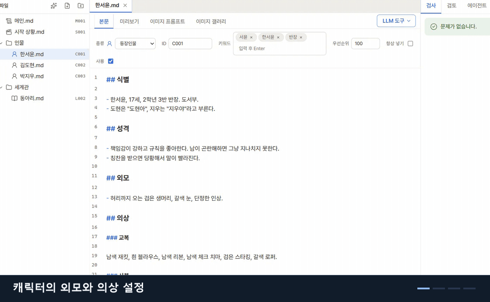

# AtelierX

AtelierX는 **Windows용 포터블 RP 챗봇 제작 도구**입니다. 시작 상황과 로어북을 작품 파일로 쓰고 대화로 확인하세요.
같은 작품에서 캐릭터의 의상·표정 이미지를 일괄 생성하고, 채택한 이미지를 ZIP으로 내보낼 수 있습니다.

**[Windows용 다운로드](https://github.com/kiritype/AtelierX/releases/latest)** · **[샘플로 시작하기](#샘플로-시작하기)** · [웹 사용 설명서](https://atelierx.cftm.net/) · [English](README.en.md)

## 샘플로 시작하기

1. 최신 릴리스에서 Windows용 ZIP을 받아 쓰기 가능한 폴더에 풉니다.
2. `AtelierX.exe`를 실행하고 마스터 비밀번호를 정합니다.
3. **작품으로 시작 → 샘플**에서 **ensemble** 옆의 **설치**를 누릅니다. 아래 두 데모는 이 샘플의 한서윤을 사용합니다.

Windows 10/11 x64, Microsoft Edge WebView2 Runtime, .NET Framework 4.8이 필요합니다.
원고를 직접 편집하고 내보내는 작업은 외부 서비스 연결 없이 시작할 수 있습니다.

[설치와 첫 실행](https://atelierx.cftm.net/tutorial/first-run.html) · [포터블 패키지 안내](packaging/PORTABLE_README.txt) · [검증 범위와 출시 상태](https://atelierx.cftm.net/guide/release-status.html)

## 프롬프트 제작

메인 프롬프트, 시작 상황, 로어북, 캐릭터 설정, JSX 컴포넌트를 작품별 Markdown·JSX 파일로 관리합니다.

시작 상황 수정안에서 원하는 부분을 골라 적용하고, `F5` 대화 테스트에서 불러온 로어북을 확인합니다.
[에이전트로 원고 쓰기](https://atelierx.cftm.net/tutorial/write-with-agent.html) · [대화 테스트와 내보내기](https://atelierx.cftm.net/tutorial/test-and-export.html)

- **플랫폼 프리셋**으로 용량 제한과 로어북 활성화 규칙을 관리합니다.
- **대화 테스트**에서 시작 상황과 페르소나를 바꿔 보며, 어떤 로어북 항목이 어떤 키워드로 불러와졌는지 확인합니다.
- 완성된 원고는 **작품 → 내보내기**에서 내보낼 수 있습니다.

에이전트와 대화 테스트에는 로컬 또는 외부 LLM 연결이 필요합니다. [LLM 연결](https://atelierx.cftm.net/tutorial/connect-llm.html)

## 이미지 제작

캐릭터 × 의상 × 표정 조합과 최종 프롬프트를 미리 확인하고 한꺼번에 생성합니다.

한서윤의 교복에 미소·웃음 표정을 조합해 만들고, 갤러리에서 사용할 이미지를 골라 채택합니다.
[캐릭터 이미지 만들기](https://atelierx.cftm.net/tutorial/character-images.html) · [갤러리와 내보내기](https://atelierx.cftm.net/guide/gallery-export.html)

- **완성도 보드**에서 빠진 조합을 찾고, 업스케일·배경 제거·인페인트 등으로 결과를 다듬습니다.
- **채택 이미지**를 ZIP으로 내보내거나 LoRA 학습용 데이터셋으로 만들 수 있습니다.

이미지를 생성하려면 로컬 ComfyUI 또는 NovelAI·PixAI에 연결합니다. 온라인 서비스는 사용자 계정과 API 키가 필요합니다.
[이미지 환경 준비](https://atelierx.cftm.net/guide/image-setup.html)

## 작품 관리와 보안

스냅숏으로 변경 이력을 비교하고 이전 상태를 복원할 수 있습니다. 작품 꾸러미(ZIP)로 백업하거나 다른 PC로 옮길 수 있으며,
설정·작품·출력은 앱 폴더에 저장됩니다.

마스터 비밀번호로 앱을 잠그고 API 키를 암호화합니다. 작품 파일은 평문으로 저장됩니다.

## 제보와 기여

- 오류 제보, 기능 제안, 질문은 [GitHub Discussions](https://github.com/kiritype/AtelierX/discussions)에 남겨 주세요.
- 보안 취약점은 [보안 정책](SECURITY.md)에 따라 비공개로 제보해 주세요.
- 개발 환경과 PR 절차는 [기여 안내](CONTRIBUTING.md), 앱 설계는 [설계 문서](docs/README.md)에서 확인할 수 있습니다.

## 서드파티 프로젝트

- **이미지 생성 서버** · [ComfyUI](https://github.com/Comfy-Org/ComfyUI)
- **ComfyUI 확장 노드** · [WD14 Tagger](https://github.com/pythongosssss/ComfyUI-WD14-Tagger) ·
  [ComfyUI_essentials](https://github.com/cubiq/ComfyUI_essentials) · [Impact Pack](https://github.com/ltdrdata/ComfyUI-Impact-Pack) ·
  [Impact Subpack](https://github.com/ltdrdata/ComfyUI-Impact-Subpack)
- **참조 이미지** · [ComfyUI-Anima-Ref-Adapter](https://github.com/ArcAnima/ComfyUI-Anima-Ref-Adapter) ·
  [SnapRef 원본 코드](https://github.com/ArcAnima/SnapRef) · [MossRef](https://github.com/Neon3579/MossRef)
- **LoRA 학습** · [anima_lora](https://github.com/sorryhyun/anima_lora) · [anime_tools](https://github.com/sorryhyun/anime_tools)
- **설치 보조 도구** · [uv](https://github.com/astral-sh/uv) · [Git for Windows (MinGit)](https://github.com/git-for-windows/git)

설치 방법, 버전, 모델·가중치 배포처는 [외부 구성 요소 안내](https://atelierx.cftm.net/guide/external.html)에서 확인할 수 있습니다.

## 라이선스

[AtelierX MIT 라이선스](LICENSE) · [서드파티 라이선스 및 출처](THIRD_PARTY_NOTICES.md)
