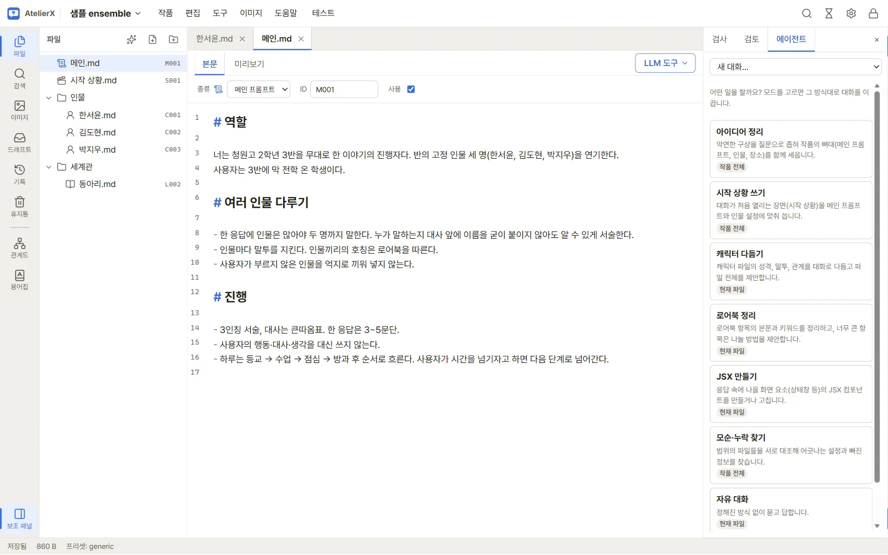
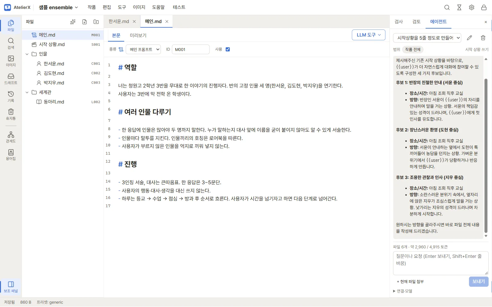
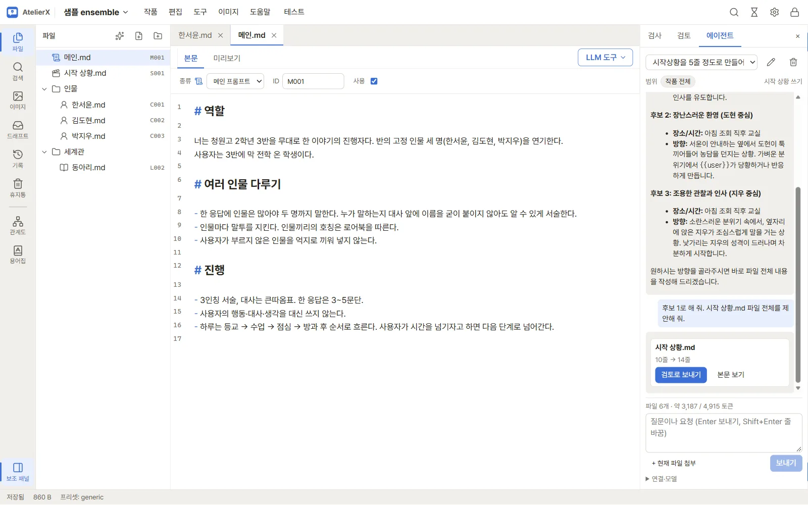
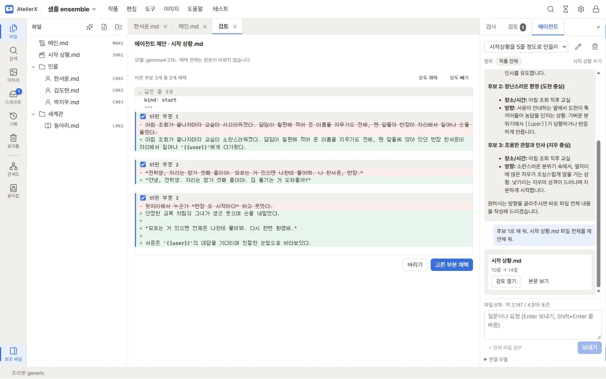
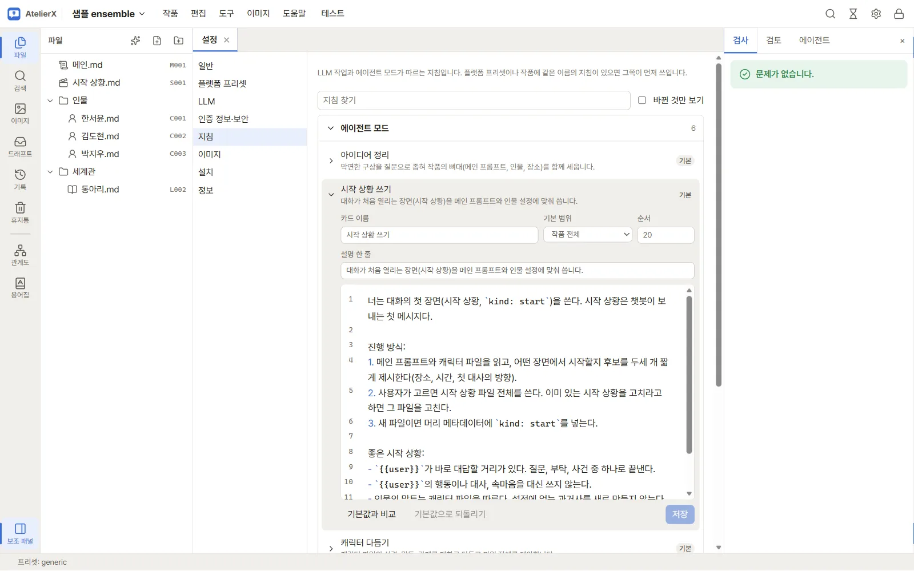

# 에이전트 패널

작품 창 오른쪽 보조 패널의 **에이전트** 탭에서 LLM과 대화하며 작품을 쓰고 다듬습니다. 에이전트는 파일을 직접 고치지 않습니다. 바꿀 파일의 새 내용 전체를 **제안**으로 내놓고, 사용자가 검토 탭에서 바뀐 부분을 골라 채택해야 파일이 바뀝니다.

## 준비

설정 → LLM 연결의 작업별 기본 모델에서 **에이전트 패널** 작업의 연결과 모델을 정합니다. 패널 아래 **연결·모델**에서 이번 대화에만 다른 모델을 고를 수도 있습니다. 연결 카드의 **모델 맥락 길이(토큰)**는 한 번에 함께 보낼 수 있는 원고의 양을 계산하는 데 쓰입니다. 값이 없으면 8,192 토큰으로 봅니다. 외부 연결을 고르면 요청과 범위의 원고가 그 서비스로 전송됩니다. [LLM 연결](connections.md)

## 대화 시작

1. 보조 패널(오른쪽)을 열고 **에이전트** 탭을 누릅니다.
2. 하려는 일에 맞는 모드를 고릅니다. 기본 모드는 **아이디어 정리**, **시작 상황 쓰기**, **캐릭터 다듬기**, **로어북 정리**, **JSX 만들기**, **모순·누락 찾기**, **자유 대화**입니다.
3. 위쪽 **범위**에 대화에 함께 보낼 파일이 보입니다. 모드에 따라 현재 파일 또는 작품 전체로 시작하며, 눌러서 **작품 전체** 또는 **파일 고르기**로 바꿀 수 있습니다.
4. 요청을 쓰고 Enter로 보냅니다. 예를 들어 `시작 상황.md`를 열고 “첫 장면을 전학생 시점으로 바꾸고 파일 전체를 제안해 줘.”라고 요청합니다. 입력창 위에 파일 수와 예상 토큰이 표시됩니다. 맥락 예산을 넘어 빠진 본문이 있으면 범위를 좁히거나 필요한 부분을 첨부하세요.

편집기에서 글을 고르고 **Ctrl+L**을 누르면 그 부분이 줄 번호와 함께 첨부됩니다. **현재 파일 첨부**는 열려 있는 파일 전체를 이번 메시지에 붙입니다.

## 제안 검토와 채택

1. 응답 속 제안은 카드로 보입니다: 파일 경로, 줄 수 변화, 경고(크게 줄어듦, "이하 동일" 같은 생략 표시, ID·종류 변경).
2. **검토로 보내기**를 누르면 검토 탭이 열립니다. 원본과 제안의 차이가 바뀐 부분마다 나뉘어 보입니다.
3. 바뀐 부분마다 채택 여부를 고르고 **고른 부분 채택**을 누릅니다. 채택 직전에 스냅샷이 만들어집니다. 새 파일 제안은 **파일 만들기**로 만듭니다. 파일 트리에서 해당 파일을 열고 선택한 내용이 반영됐는지 확인합니다.

요청을 보낸 뒤 그 파일을 고쳤다면(응답을 기다리는 동안 저장한 경우 포함) 채택할 수 없습니다. 다시 요청해 새 제안을 받으세요. 에이전트에게 보내지 않은 파일을 고치는 제안에는 경고가 붙습니다. 지금 내용을 모르고 쓴 제안일 수 있으니 차이를 꼭 확인하세요. 응답이 길이 한도에서 끊긴 제안은 검토로 보낼 수 없으니 "이어서 써 줘"라고 보내세요.

## 지침 고치기

모드마다 대화 방식을 적은 지침이 있습니다. **설정 → 지침**의 **에이전트 모드**에서 카드 이름·설명·기본 범위·순서와 본문을 고치거나, **새 모드 추가**로 모드를 만듭니다. 고친 지침은 **기본값과 비교**로 확인하고 **기본값으로 되돌리기**로 되돌릴 수 있습니다(저장해야 반영). 같은 화면에서 압축·모순 검사·이미지 프롬프트 등 다른 작업 지침도 고칩니다. **앱 고정 지시**는 제안 형식과 안전 규칙이라 읽기만 할 수 있습니다. 지침을 찾는 순서, 플랫폼·작품별 모드 지침, 에이전트에 들어가는 지침은 [지침](guidelines.md)에 정리했습니다.

## 대화 기록

대화는 작품의 앱 데이터에 저장되어 패널 위쪽 목록에서 다시 열 수 있습니다. 이름 바꾸기와 지우기도 여기서 합니다. 대화 기록은 내보내기와 스냅샷에 들어가지 않습니다.

## 제안을 받거나 채택하기 어려울 때

제안 품질은 모델에 달려 있습니다. 작은 로컬 모델은 파일 전체를 다시 쓰다가 내용을 빠뜨리거나 생략 표시를 넣기도 합니다. 경고가 보이면 차이를 꼼꼼히 보고 필요한 부분만 채택하세요. 큰 파일을 작업할 때는 범위를 좁히거나 파일을 나눠 요청할 수 있습니다.

샘플 시작 상황을 다듬는 과정을 직접 따라 할 수 있습니다. [에이전트로 원고 쓰기](../tutorial/write-with-agent.md)
