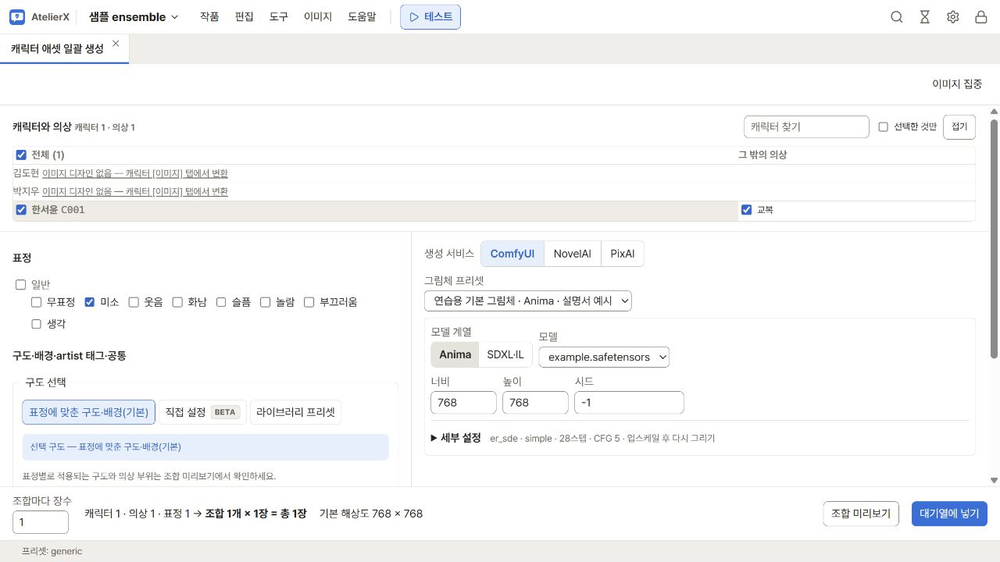
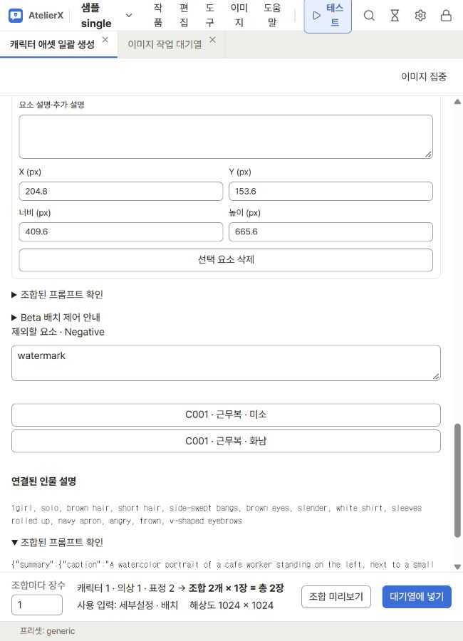
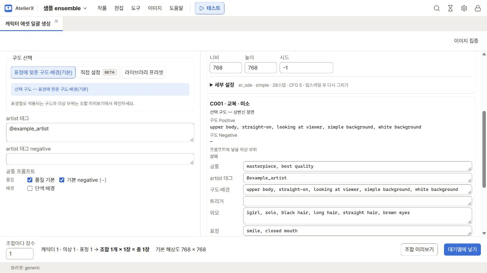

# 캐릭터 애셋 일괄 생성

**이미지 → 캐릭터 애셋 일괄 생성**에서 등록한 캐릭터의 의상·표정 조합으로 이미지를 만듭니다. 한 조합으로 시험하거나 여러 조합을 함께 대기열에 넣을 수 있습니다. 캐릭터 파일에 ID를 지정하고 **이미지 프롬프트** 탭에서 외모와 의상을 먼저 저장하세요. [캐릭터 이미지 설계](character-images.md)

## 대상과 설정 고르기

1. 위쪽 **캐릭터와 의상** 표에서 만들 칸을 선택합니다. 행은 캐릭터, 열은 의상입니다. 캐릭터 이름을 누르면 그 캐릭터의 의상 전체를, 의상 이름을 누르면 그 의상을 가진 캐릭터 전체를 선택합니다. 왼쪽 위 **전체**는 모든 칸을 선택하거나 해제합니다. 예를 들어 모든 캐릭터의 평상복을 만들려면 평상복 열 머리를 누릅니다.
2. **표정**에서 하나 이상을 고릅니다. 고른 캐릭터·의상마다 선택한 표정 수만큼 조합이 만들어집니다. 예를 들어 교복을 고른 캐릭터 한 명에 미소·웃음을 체크하면 두 조합이 생깁니다.
3. 오른쪽에서 **생성 서비스**와 해당 서비스용 **그림체 프리셋**을 선택합니다. 프리셋의 모델 계열·설정, 지정한 기본 공통 프롬프트, **artist 태그**가 적용됩니다. 이번 생성용 문구는 왼쪽의 **artist 태그**와 **artist 태그 negative**에서 수정합니다. **프리셋 없이**로 돌아가면 이전에 가져온 입력을 확인하고 필요한 값을 직접 바꿉니다.
4. 왼쪽의 **구도 선택**과 **공통 프롬프트**를 확인합니다. 기본 구도는 **표정에 맞춘 구도·배경(기본)**입니다. **다른 대상용 N개 보기**를 펼치면 현재 모델 계열·서비스와 맞지 않는 공통 프롬프트도 볼 수 있습니다. [구도 선택](composition.md) · [프롬프트 라이브러리](image-library.md)
5. 모델·크기·시드를 확인하고, 필요하면 **세부 설정**에서 샘플러·LoRA·업스케일 등을 조정합니다. [ComfyUI 생성 설정](generation.md) · [인터넷 이미지 서비스](image-services.md)

같은 배포 코드의 의상은 캐릭터가 달라도 코드 순서로 같은 열에 모입니다. 코드가 없으면 같은 이름끼리 모이고, 어디에도 묶이지 않는 의상은 **그 밖의 의상**에서 선택합니다. **캐릭터 찾기**와 **선택한 것만**으로 표를 좁히거나 **접기**로 접을 수 있습니다. **이미지 디자인 없음** 안내를 누르면 해당 캐릭터 파일이 열립니다.

캐릭터 화면의 생성 바로가기로 열면 해당 캐릭터의 의상이 먼저 선택됩니다. [완성도 보드](gallery-export.md)에서 넘긴 경우에는 **완성도 보드에서 넘어온 조합**을 확인하고 3번부터 진행합니다. 표에서 새로 고르려면 **직접 고르기로 돌아가기**를 누릅니다.

## MOSS-Image Beta 배치 템플릿

모델 계열에서 **MOSS Beta → 세부설정 · 배치**를 선택하면 대상 선택표 아래에 공통 박스 편집기가 열립니다.
인물 박스의 **인물 설명 연결**을 **현재 생성 대상**으로 설정하세요. 고른 캐릭터·의상·표정 조합의 외모와
의상·표정 설명이 작업마다 채워집니다. 추가 인물·물체·문자는 직접 설명할 수 있습니다.
편집 조작과 필요한 모델은 [단일 이미지 생성](single-generation.md)에 설명되어 있습니다.

**조합 미리보기**를 누르면 편집기 아래에 조합 목록과 선택한 조합의 인물 설명이 나타납니다. 조합을 바꾸어도
원본 템플릿은 변하지 않습니다. 최종 프롬프트를 확인한 뒤 하단의 `조합 수 × 장수 = 총 장수`와
**사용 입력**을 보고 대기열에 넣으세요. Layout 모드에서는 기존 항목별 overrides 대신 박스 설명을 편집합니다.

템플릿 하나를 모든 조합에 적용합니다. **배치 사본 저장**으로 단일 생성과 공유할 수 있으며,
템플릿에는 특정 인물의 적용 당시 문구를 저장하지 않습니다. 일괄 배치 초안은 브라우저의 작품별 저장소에
자동 보관됩니다. 접수한 작업에는 템플릿·재료·설정이 복사되므로 이후 라이브러리 변경이 재시도에 섞이지 않습니다.
여러 템플릿 조합, 조합별 박스 변경, 여러 캐릭터 디자인 자동 연결은 제공하지 않습니다.

## 조합을 확인하고 대기열에 넣기

1. 하단 **조합 미리보기**를 누릅니다. 조합별 최종 Positive·Negative, 구도와 실제 포함된 의상 부위, 빠진 공통·구도 조각의 경고를 확인합니다. 미리보기에는 처음 200개 조합까지 표시됩니다.
2. 조합이 하나라면 공통, 작가, 구도, 트리거, 외모, 표정, 의상, negative 문구를 나누어 직접 고칠 수 있습니다. 바꾼 뒤에는 **조합 미리보기**를 다시 눌러 최종 문구를 확인합니다. 예를 들어 현재 조합의 negative에만 `blurry`를 추가할 수 있습니다.
3. **조합마다 장수**(1~50)와 출력 크기를 확인합니다. 하단에 `조합 N개 × M장 = 총 X장`으로 총 장수가 표시됩니다. 예를 들어 두 조합에서 세 장씩 만들면 총 여섯 장입니다. PixAI는 요청의 비율과 크기 등급을 표시합니다. 창 높이가 낮으면 실행 줄이 화면 내용 끝에 놓입니다.
4. **대기열에 넣기**를 누릅니다. 알림 또는 **이미지 → 이미지 작업 대기열**에서 진행 상태를 확인합니다. 완료되면 해당 캐릭터의 **갤러리** 또는 **이미지 → 갤러리·검수**에서 이미지를 열어 생성 기록과 결과를 확인하고 채택할 수 있습니다.

ComfyUI로 한 번에 500장을 초과해 요청하면 총 장수를 다시 확인합니다. NovelAI·PixAI는 확인창에 서비스와 요청 장수를 표시하고 **설정 → 이미지 → 인터넷 이미지 서비스**에서 정한 **한 번에 넣을 수 있는 장수**를 따릅니다. 공용 대기열에 자리가 부족하면 작업이 끝난 뒤 접수하거나 요청을 나누세요.

자동 검수가 켜져 있으면 생성 화면에서 검수용 LLM을 고를 수 있습니다. 이미지 생성에 쓸 모델은 위 **생성 서비스**에서 따로 선택합니다. [LLM 연결](connections.md) · [갤러리와 이미지 내보내기](gallery-export.md)
