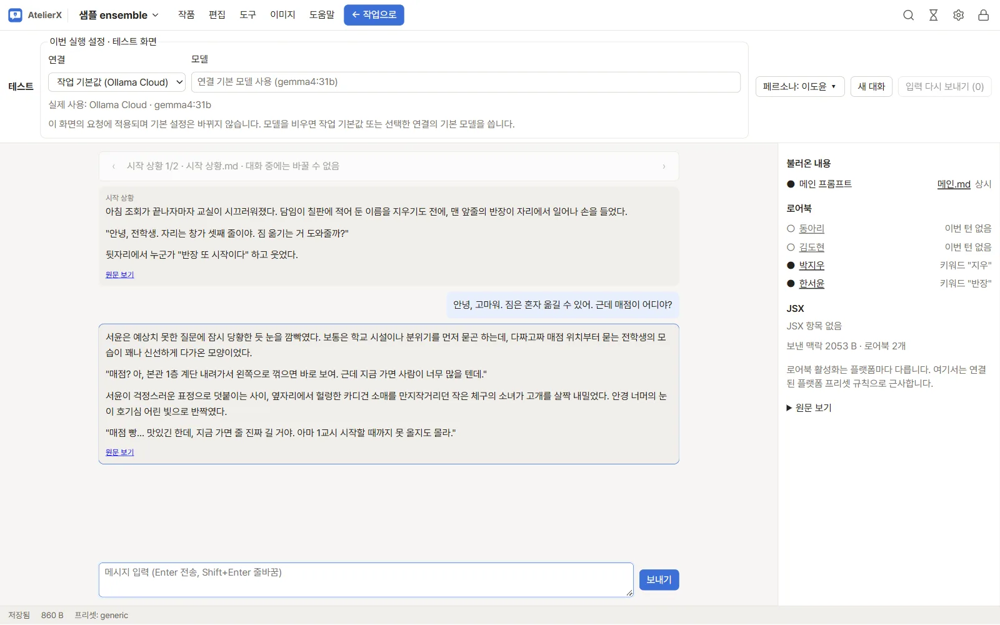
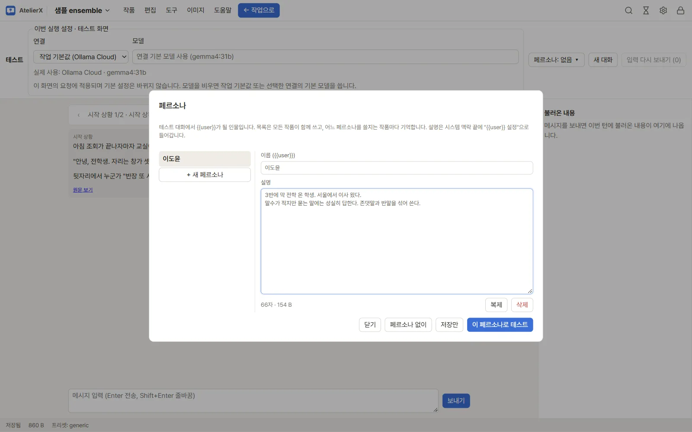

# 대화 테스트

## 준비

사용할 **메인 프롬프트**를 하나만 켜고 테스트할 시작 상황과 로어북을 저장합니다. **설정 → LLM → 작업별 모델**에서 **테스트 화면**의 연결과 모델을 정합니다. 외부 연결을 선택하면 대화와 요청 맥락이 해당 서비스로 전송됩니다. [LLM 연결](connections.md)

## 테스트 시작

1. 작품 창 상단의 **테스트** 또는 `F5`를 누릅니다.
2. 시작 상황의 좌우 화살표로 장면을 고릅니다. 내가 첫 말을 하려면 **시작 상황 없이 (사용자가 먼저)**를 선택합니다.
3. **이번 실행 설정**에서 실제 사용할 연결과 모델을 확인합니다. 예를 들어 샘플 ensemble에서 “반장에게 도서부 위치를 묻는다.”를 입력하고 **보내기**를 누릅니다.
4. 응답이 오면 오른쪽 **불러온 내용**에서 이번 턴의 메인 프롬프트, 로어북과 등장인물, JSX 호출을 확인합니다. 응답의 **원문 보기**를 누르면 모델이 보낸 텍스트를 볼 수 있습니다.
5. 대화를 이어 가거나 **새 대화**를 누릅니다. 새 대화가 비어 있을 때 **입력 다시 보내기 (N)**를 누르면 지난 대화의 내 입력을 순서대로 보냅니다. **작업으로** 또는 `F5`를 누르면 편집기로 돌아갑니다.

## 페르소나

테스트에서 `{{user}}`가 될 인물은 위쪽 막대의 **페르소나: … ▾** 버튼으로 정합니다.

1. 버튼을 누르면 페르소나 창이 열립니다. **새 페르소나**를 누르고 이름과 설명을 씁니다. 설명은 여러 줄로 쓸 수 있습니다.
2. **이 페르소나로 테스트**를 누르면 목록이 저장되고 이 작품의 테스트에 쓰입니다. **페르소나 없이**를 고를 수도 있습니다.
3. 목록은 모든 작품이 함께 씁니다. 어느 페르소나를 쓸지는 작품마다 기억합니다.

이름은 대화의 `{{user}}` 자리에 들어가고, 설명은 시스템 맥락 끝에 `{{user}} 설정` 절로 들어갑니다. 페르소나는 테스트에만 쓰고 내보내기에는 들어가지 않습니다.

## 테스트 세트로 바꾸기 전후 비교하기

같은 질문으로 원고나 모델을 바꾸기 전후의 응답을 비교하려면 **테스트 세트**를 씁니다.

1. 테스트 화면에서 몇 번 대화한 뒤 위쪽 **테스트 세트** → **지금 대화로 새 세트**를 누르면 보낸 입력, 지금의 시작 상황과 페르소나로 세트가 만들어집니다. 이름을 붙이고 입력을 고친 뒤 **저장**합니다. **빈 세트**로 처음부터 쓸 수도 있습니다.
2. 세트의 **실행**을 누르면 입력 수를 확인한 뒤 대화를 새로 시작해 입력을 차례로 보냅니다. 외부 연결이면 입력 수만큼 요청이 나갑니다. **중지**를 누르면 남은 입력은 보내지 않습니다.
3. 원고나 모델을 바꾼 뒤 다시 **실행**합니다. 실행마다 쓴 모델과 원고 시점(스냅숏)이 기록됩니다.
4. **기록**에서 실행 두 개를 고르고 **나란히 비교**를 누르면 입력마다 두 응답이 나란히 보입니다. 점수는 매기지 않습니다.

## 결과 해석

**불러온 내용**에서 메인 프롬프트는 **상시**, 선택된 로어북과 등장인물은 **상시** 또는 맞은 **키워드**로 표시됩니다. 해당 턴에 빠진 항목에는 **이번 턴 없음**, **예산 초과**, **최대 개수 초과** 등이 표시됩니다. 선택 규칙은 작품에 연결한 프리셋을 따르며 실제 플랫폼의 로어북 동작과 차이가 있을 수 있습니다. [플랫폼 프리셋](platforms.md)

테스트에서는 페르소나와 1:1 작품의 대화 상대 설정으로 `{{user}}`와 `{{char}}`를 치환합니다. 내보낸 파일에는 원래 참조 표현이 남습니다.

## 문제 해결

- 응답이 실패하면 **설정 → LLM**에서 주소, 인증 정보, 기본 모델을 확인하고 **응답 테스트**를 실행합니다.
- 로어북이 빠지면 해당 파일의 **사용**, **키워드**, **항상 넣기**와 **불러온 내용**의 제외 사유를 확인합니다.
- JSX가 글자로 보이면 **원문 보기**를 열어 호출이 코드 블록 안에 있는지, 속성 값이 따옴표로 감싸져 있는지 확인합니다. 호출 형식은 [파일과 편집기](editing.md)를 참고하세요.

## 다음 단계

응답을 확인했으면 원고를 [테스트와 내보내기](../tutorial/test-and-export.md)의 순서대로 내보냅니다.
