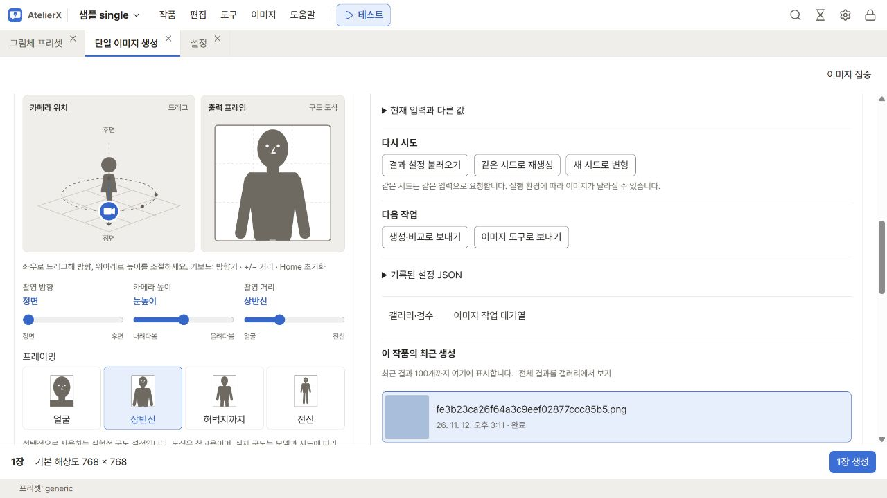

# 구도 선택

단일 이미지 생성과 캐릭터 애셋 일괄 생성의 **구도 선택**에서 프롬프트에 넣을 카메라 방향·프레이밍·배경을 정합니다.

| 선택 | 적용 내용 |
|---|---|
| **구도 추가 안 함** | 단일 생성의 기본입니다. 직접 입력하거나 적용한 재료의 프롬프트를 사용합니다. |
| **표정에 맞춘 구도·배경(기본)** | 일괄 생성의 기본입니다. 선택한 표정에 연결된 구도·배경을 조합별로 사용합니다. |
| **직접 설정** · **BETA** | 카메라 방향·높이·거리를 조작하거나 프레이밍을 골라 구도 문구를 추가합니다. |
| **라이브러리 프리셋** | 저장한 구도·배경 조각의 Positive·Negative를 사용합니다. |

## 카메라로 구도 잡기

1. **직접 설정**을 선택합니다.
2. **카메라 위치**를 좌우로 드래그해 촬영 방향을, 위아래로 드래그해 높이를 바꿉니다. 아래 슬라이더로 방향·높이·촬영 거리를 바꿀 수도 있습니다.
3. **얼굴**, **상반신**, **허벅지까지**, **전신** 중 하나를 고릅니다. 예를 들어 얼굴은 머리와 어깨가 중심이 되는 가까운 구도입니다. 카드를 선택하면 촬영 거리가 함께 바뀌고, **출력 프레임**은 현재 서비스의 출력 비율에 맞춰 선택한 구도를 보여 줍니다.
4. **적용 프롬프트 보기**를 펼쳐 **구도 Positive**와 **구도 Negative**를 확인합니다. 예를 들어 측면은 옆모습, 후면은 뒤통수와 등이 보이도록 문구를 추가합니다.

키보드로 조작하려면 Tab으로 카메라에 이동하고, 방향키로 방향·높이, `+`·`−`로 거리를 조절합니다. **구도 초기화** 또는 `Home`을 누르면 기본 구도로 돌아갑니다. Tab으로 선택 그룹에 이동한 뒤 방향키로 항목을 바꿀 수 있습니다. 다른 모드를 사용하다 직접 설정으로 돌아오면 마지막으로 조작한 구도가 나타납니다.

직접 설정은 ComfyUI·NovelAI·PixAI에 텍스트 프롬프트로 전달되는 실험 기능입니다. 실제 프레이밍·각도·자세는 모델과 시드, 함께 보낸 프롬프트에 따라 달라집니다.

## 구도 프리셋 만들고 적용하기

[프롬프트 라이브러리](image-library.md)의 **구도·배경**에서 프레이밍과 배경을 태그로 저장합니다. 예를 들어 `upper body, straight-on, library interior`를 저장한 뒤 **구도 선택 → 라이브러리 프리셋**에서 고릅니다. 현재 서비스·계열에 맞는 조각인지 **사용 대상**을 확인하세요.

일괄 생성에서는 프레이밍에 맞춰 의상 부위를 고릅니다. 직접 설정의 **얼굴**은 의상 부위 태그를 넣지 않으며, **상반신**과 **허벅지까지**에는 해당 범위의 부위와 한 벌 의상을, **전신**에는 등록한 모든 부위를 넣습니다. 라이브러리 프리셋은 **이 구도에서 보이는 부위**와 **의상 없음** 설정을 따릅니다. 단일 생성에서는 적용한 구도 문구를 직접 입력과 합칩니다.

일괄 생성의 **조합 미리보기**에서 조합별 구도 문구, 포함된 의상 부위와 최종 프롬프트를 확인합니다. 한 조합에서 문구를 직접 고쳤다면 **조합 미리보기**를 다시 눌러 반영 여부를 확인하세요. 단일 생성은 **조합된 프롬프트 확인**을 펼칩니다. 단일 결과의 설정을 불러오면 생성 당시 구도 문구를 사용하며, 구도를 다시 고르면 현재 구도 문구가 적용됩니다.
