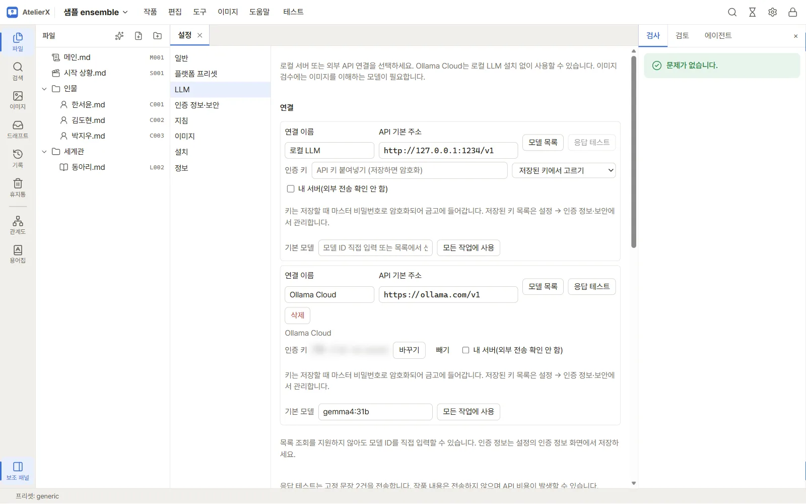
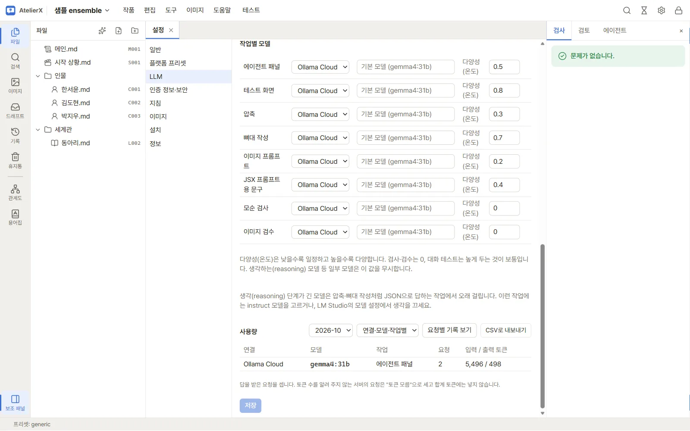

# LLM 연결

## 제공자 추가

로컬 서버를 쓸 때는 서버를 켜고 모델을 준비합니다. 외부 서비스를 쓸 때는 서비스 계정의 인증 정보와 모델 ID를 준비합니다.

1. 작품 창 오른쪽 위 **설정 → LLM**을 엽니다.
2. **로컬 LLM** 카드를 수정하거나 **서비스 프리셋**을 고르고 **연결 추가**를 누릅니다. 선택지는 Ollama Cloud, Google Gemini API (AI Studio), Google Vertex AI (OAuth), OpenRouter, DeepSeek, **직접 입력 (OpenAI 호환)**입니다.
3. 카드의 주소와 인증 정보를 확인하고 **저장**합니다. 로컬 주소 입력 예시는 `http://127.0.0.1:1234/v1`입니다.

일반 호환 연결은 서비스의 API 주소, 인증 정보, 기본 모델을 입력합니다. **인증 키**에 직접 붙여 넣거나 **저장된 키에서 고르기**를 선택합니다. 저장한 키는 **설정 → 인증 정보·보안**에서 확인·교체할 수 있습니다. Vertex AI는 프로젝트 ID와 위치를 입력해 주소를 구성하고 Vertex OAuth 액세스 토큰을 인증 정보로 넣습니다. 토큰 만료 시 직접 갱신해야 합니다. 자동 갱신, Express API 키, 서비스 계정 JSON은 지원하지 않습니다. 모델 ID는 `google/모델ID` 형식입니다.

## 입력값

| 항목 | 입력 방법 |
|---|---|
| 연결 이름 | 구분하기 쉬운 이름. 예: 개인 Gemini |
| API 기본 주소 | 프리셋 기본값을 사용하거나 호환 서버의 기본 주소 입력 |
| 인증 정보 | 키 붙여넣기 또는 저장된 키 선택. Vertex는 OAuth 액세스 토큰 |
| 기본 모델 | 해당 계정에서 사용할 수 있는 모델 ID. 목록 조회 없이 직접 입력 가능 |
| Vertex 프로젝트 ID·리전 | Google Cloud 프로젝트 ID와 `global` 또는 모델이 제공되는 리전 |

Gemini API는 AI Studio API 키, Vertex는 Google Cloud OAuth 토큰을 사용합니다. 서로 바꿔 사용할 수 없습니다. 새 연결은 외부 전송 동의가 필요한 상태로 생성됩니다.

## 이 PC의 GPU 사용

연결 카드의 **이 PC의 GPU 사용**은 그 연결의 모델이 이미지 생성과 같은 GPU에서 도는지 정합니다. 주소가 이 PC(`127.0.0.1`, `localhost`)면 기본으로 켜집니다.

- 켜진 연결의 요청은 진행 중인 이미지가 끝난 뒤 시작하고, 응답이 끝날 때까지 새 이미지·VLM 검수·LoRA 학습은 기다립니다. 기다리는 동안 대화 테스트와 에이전트 패널에 **GPU를 기다리는 중**과 무엇을 기다리는지가 보입니다.
- 같은 네트워크의 다른 PC에서 도는 서버라면 끕니다. 이 PC의 GPU를 쓰는데 주소가 다르면(예: 다른 이름으로 연결) 켭니다.
- 꺼진 연결(외부 서비스 등)은 GPU를 기다리지 않고, 설정의 동시 요청 수(기본 2개)만큼 함께 보냅니다.

## 모델 맥락 길이

연결 카드 아래쪽 **모델 맥락 길이(토큰)** 에 그 연결로 쓰는 모델(기본 모델과 작업별 모델)이 나옵니다. **맥락 길이 읽기**를 누르면 서비스에 물어 값을 채웁니다. Ollama Cloud, Gemini API, OpenRouter, LM Studio는 서비스가 알려 주고, Vertex AI와 DeepSeek은 앱에 들어 있는 기본 표로 채웁니다. 값 옆에 출처(서비스에서 읽음·앱의 기본 표·직접 입력)가 보이고, 칸에 직접 고쳐 쓸 수도 있습니다. 채운 뒤 **저장**해야 반영됩니다.

에이전트는 이 값을 보고 원고를 얼마나 넣을지 정합니다. 모델이 100만 토큰을 읽을 수 있어도 다 채우면 느리고 비용이 들므로, 작업 표 아래 **에이전트 맥락 상한**(기본 131,072)까지만 씁니다.

## 연결 확인

1. 연결 값을 바꿨다면 먼저 **저장**합니다.
2. **모델 목록**을 눌러 목록을 불러온 뒤 **기본 모델**을 고릅니다. Vertex AI처럼 자동 조회를 지원하지 않는 연결은 모델 ID를 직접 입력합니다.
3. 다시 **저장**하고 **응답 테스트**를 누릅니다. **일반 응답 · 스트리밍 정상**이 표시되면 선택한 모델로 두 방식 모두 응답을 받았습니다.

응답 테스트는 작품 내용 없이 고정 문장 2건으로 일반 응답과 스트리밍을 확인하며 API 비용이 발생할 수 있습니다. 모델 목록이 열려도 실제 답변을 받을 수 있는지는 **응답 테스트**에서 확인합니다. 시험 버튼이 비활성화되어 있으면 **저장** 상태와 **기본 모델**을 확인합니다. 오류가 나면 주소, 키 또는 토큰, 모델 ID, 계정의 모델 접근 권한을 확인합니다.

## 작업별 기본 모델

화면 하단 **작업별 모델**에서 **테스트 화면**, **압축**, **뼈대 작성**, **이미지 프롬프트**, **JSX 프롬프트용 문구**, **모순 검사**, **이미지 검수**, **에이전트 패널**마다 연결과 모델을 선택합니다. 모델 칸을 비워 두면 제공자의 기본 모델을 씁니다. 연결 카드의 **모든 작업에 사용**은 그 연결을 전체 작업에 지정합니다. 마지막에 **저장**을 눌러 변경 내용을 보존합니다.

## 실행할 때 연결 바꾸기

편집기의 LLM 도구, 캐릭터 이미지 프롬프트 변환, 뼈대 작성, 관계 추출·일관성 검사, JSX 프롬프트 창과 대화 테스트 화면에서 **이번 실행 설정**을 선택할 수 있습니다.

1. 처음에는 **작업 기본값**으로 해당 작업에 저장된 연결과 모델을 사용합니다.
2. 다른 연결을 선택하면 그 연결의 기본 모델로 바뀝니다. 모델 ID를 직접 입력해 지정할 수도 있습니다.
3. 표시된 연결·모델을 확인한 뒤 실행합니다. 선택은 이 화면의 요청에만 적용되며 설정의 작업별 기본값을 바꾸지 않습니다.
4. 기본 설정으로 돌아가려면 연결에서 **작업 기본값**을 다시 선택합니다.

대화 테스트에서는 화면에서 고른 모델을 이후 메시지와 입력 다시 보내기에 사용합니다. 기존 대화 기록은 유지되므로 같은 입력을 비교하려면 대화를 초기화한 뒤 다시 보내세요. 응답 중에는 선택을 변경할 수 없습니다.

외부 연결은 선택한 작업의 입력과 문맥을 서비스로 보낼 수 있습니다. 제공자의 데이터 정책과 요금을 확인하고 사용하세요. **사용량**에서 월별 요청과 입출력 토큰을 확인합니다. 세부 집계는 [설정](settings.md)을 참고하세요.

이미지 자동 검수가 켜져 있으면 이미지 생성 화면에도 검수용 선택기가 표시됩니다. 이 선택은 생성된 이미지를 평가할 LLM을 정하며, 그림을 만드는 체크포인트·LoRA 설정과는 별개입니다. 갤러리의 수동 통과·실패 표시는 LLM을 호출하지 않습니다.

## 다음 단계

[대화 테스트](chat-test.md)를 실행하거나, 이미지 기능이라면 [이미지 환경 준비](image-setup.md)를 확인하세요.
