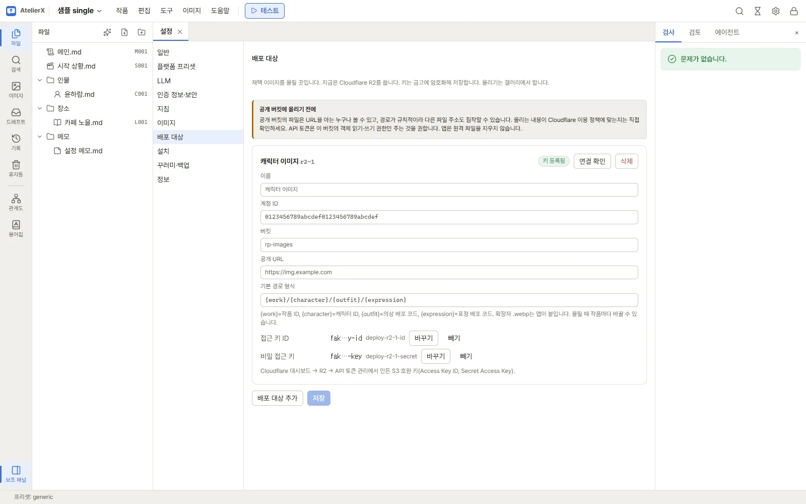
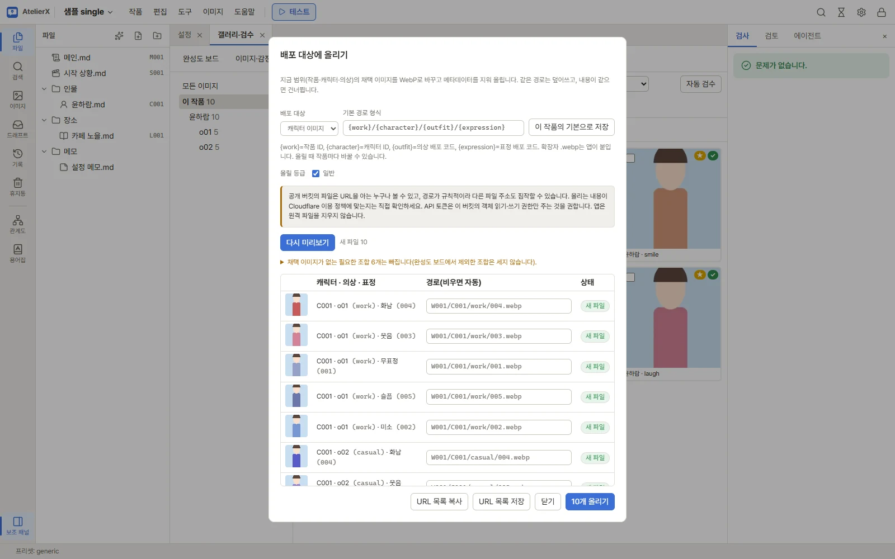
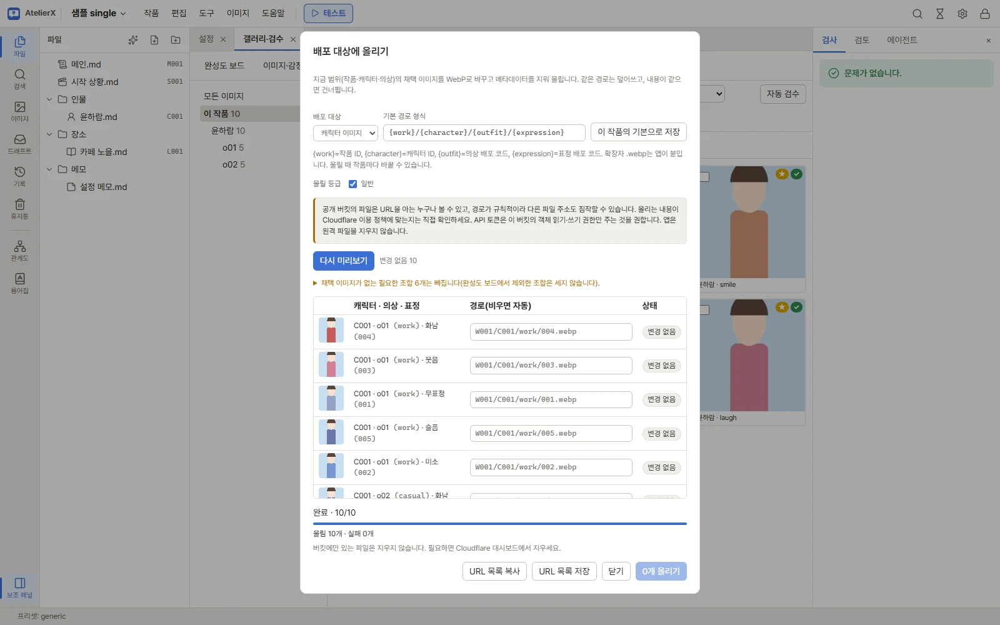
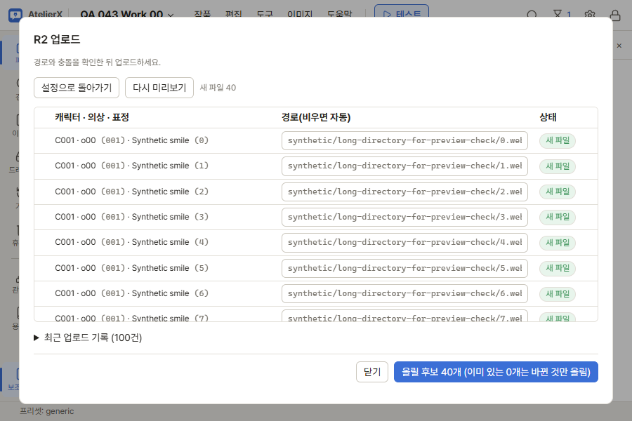
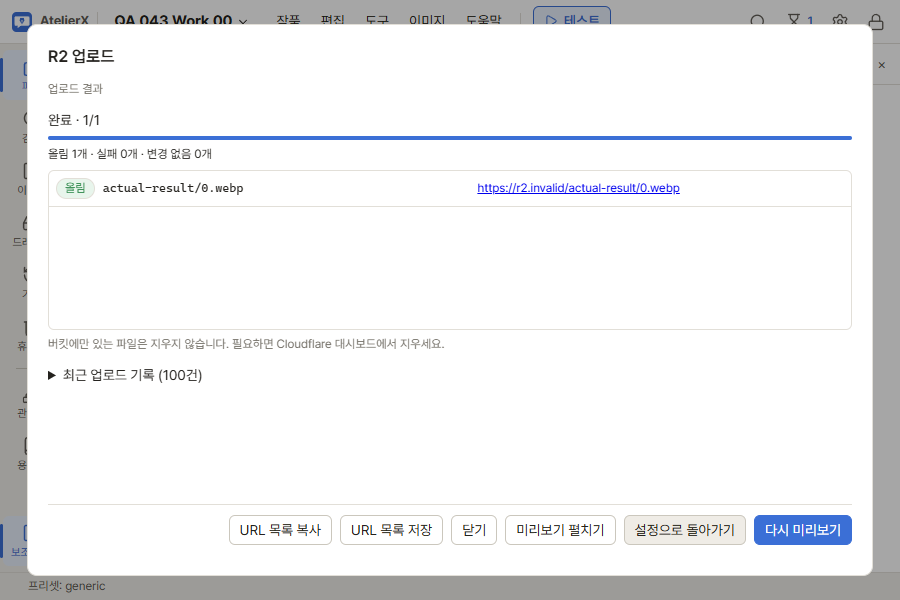

# R2 업로드

채택한 캐릭터 이미지를 Cloudflare R2 버킷에 올리고, 결과 URL을 프롬프트·로어북·JSX에 넣어 사용합니다. 업로드 전에 [갤러리와 검수](gallery-export.md)에서 사용할 이미지를 채택해 둡니다.

## 준비

### 1. R2 버킷과 키

Cloudflare 대시보드에서 합니다.

1. **R2**에서 버킷을 만듭니다. AtelierX는 기본 R2 S3 엔드포인트를 사용하므로 별도 관할권을 지정하지 않은 버킷을 사용합니다. [R2 엔드포인트](https://developers.cloudflare.com/r2/api/tokens/)
2. 외부에서 이미지를 열려면 버킷에 사용자 도메인(예: `img.example.com`)을 연결하거나 **Public Development URL**을 켭니다. `r2.dev`는 개발용으로 요청 속도 제한이 있고 캐시 제거 기능을 사용하려면 사용자 도메인이 필요합니다. [R2 공개 버킷 설정](https://developers.cloudflare.com/r2/buckets/public-buckets/)
3. **R2 → API 토큰 관리**에서 이 버킷으로 범위를 지정하고 **Object Read & Write** 권한을 선택합니다. 토큰을 만든 뒤 **Access Key ID**와 **Secret Access Key**를 복사합니다. [R2 API 토큰 만들기](https://developers.cloudflare.com/r2/api/tokens/)
4. 대시보드에 보이는 **계정 ID**를 확인합니다.

### 2. 설정 → 배포 대상

1. **설정 → 배포 대상 → 배포 대상 추가**를 누릅니다.
2. **이름**, **계정 ID**, **버킷**을 적습니다. URL이 필요하면 **공개 URL**에 `https://img.example.com`처럼 사용자 도메인 또는 `r2.dev` 주소를 넣습니다.
3. **기본 경로 형식**: 올린 파일의 경로입니다. 기본은 `{work}/{character}/{outfit}/{expression}`이고 확장자 `.webp`는 앱이
   붙입니다.
   - `{work}` 작품 ID(`W001`), `{character}` 캐릭터 ID(`C001`), `{outfit}` 의상 배포 코드, `{expression}` 표정 배포 코드.
   - 예: `W001/C001/casual/002.webp`. 고정 폴더를 앞에 붙일 수도 있습니다(`chat/{character}/{expression}`).
4. **접근 키 ID**와 **비밀 접근 키**를 입력하고 **저장**합니다. 키는 금고에 암호화해 저장합니다.
5. **연결 확인**을 누릅니다. **연결을 확인했습니다. 버킷을 읽을 수 있습니다.**가 표시되면 등록한 키로 버킷 목록을 읽을 수 있습니다. 쓰기와 공개 URL은 아래 업로드에서 확인합니다.

배포 대상은 이름으로 표시되며, 이름이 비어 있으면 버킷 또는 대상 ID로 구별할 수 있습니다. 업로드 미리보기에서는 작품·캐릭터·의상 이름과 실제 경로를 함께 확인합니다.

### 3. 배포 코드

경로의 의상·표정 자리에는 **배포 코드**가 들어갑니다.

- **표정**: 프롬프트 라이브러리 → 표정에서 정합니다. 기본 표정은 `001`~`008`을 갖고 있습니다. → [프롬프트 라이브러리](image-library.md)
- **의상**: 캐릭터 문서의 이미지 프롬프트 탭 → 의상의 **배포 코드**. → [캐릭터 이미지](character-images.md)

자릿수·문자 종류 제한은 없고(`/ \ : * ? " < > |`만 불가), 같은 코드도 쓸 수 있습니다. 같은 경로가 되면 올릴 때 충돌로 알려 줍니다.

## 올리기

1. **이미지 → 갤러리·검수**에서 왼쪽 트리로 범위(작품, 캐릭터, 의상)를 고르고 **R2 업로드**를 누릅니다. 미리보기와 올리기, 실패한 것 다시 올리기는 모두 이 범위의 채택 이미지만 대상으로 합니다.
2. **배포 대상**과 **경로 형식**을 확인합니다. 이 작품만 다른 형식을 쓰려면 고친 뒤 **이 작품의 기본으로 저장**을 누릅니다.
3. **올릴 등급**: 기본은 모든 등급입니다. 빼고 싶은 등급의 체크를 끕니다. 모두 끄면 올릴 이미지가 없으므로 미리보기와 올리기 버튼이 꺼집니다.
4. **미리보기**를 누릅니다. 채택 이미지마다 경로와 상태가 나옵니다.

| 상태 | 뜻 |
|---|---|
| 새 파일 | 버킷에 없는 경로. 올립니다 |
| 이미 있음(올릴 때 비교) | 같은 경로의 파일이 있습니다. 올릴 때 변환해서 비교하고 바뀐 경우만 덮어씁니다 |
| 변경 없음 | 같은 경로에 같은 파일이 있음. 건너뜁니다 |
| 코드 없음 | 의상·표정 배포 코드가 비어 경로를 만들 수 없음. 올리지 않습니다 |
| 경로 충돌 | 다른 이미지와 같은 경로. 올리지 않습니다 |

- **경로** 칸에 직접 적으면 그 이미지만 다른 경로로 올립니다. 고친 뒤 **다시 미리보기**로 상태를 확인하세요.
- 설정으로 돌아가 대상·경로 형식·등급을 바꿔도 선택한 범위와 입력한 경로는 유지됩니다. 바꾼 설정이나 경로는 **다시 미리보기**로 확인해야 업로드할 수 있습니다.
- 채택 이미지가 없는 필요한 조합은 경고로만 알려 줍니다(완성도 보드에서 제외한 조합은 세지 않음).
5. **올릴 후보 N개 (이미 있는 M개는 바뀐 것만 올림)**을 누릅니다. 한 장씩 변환한 뒤 비교하며, 새 파일과 바뀐 파일만 올립니다. 각 행에 변환 중·업로드 중·올림·덮어씀·변경 없음·실패가 표시되고 취소할 수 있습니다. 상단 작업 패널에도 보입니다.

6. 결과 화면에서 성공·실패 수와 파일별 상태·URL을 확인합니다. 이전 미리보기는 **미리보기 펼치기**로 볼 수 있습니다. 실패한 파일은 원인이 나오고 **실패한 것만 다시 올리기**로 다시 보냅니다.
7. **URL 목록 복사** 또는 **URL 목록 저장**을 누릅니다. 공개 URL이 설정되어 있다면 목록의 URL 하나를 브라우저에서 열어 예상한 이미지가 보이는지 확인한 뒤 프롬프트·로어북·JSX에 넣습니다.

올리는 파일은 WebP(품질 95)로 바꾸고 프롬프트·워크플로 메타데이터를 지웁니다. 크기는 그대로입니다.

## 다시 올리기와 캐시

이미지를 다시 채택했거나 후처리했다면 같은 경로에 다시 올립니다. 결과에 **덮어씀**이 표시되고 공개 주소는 그대로 쓰면 됩니다. 이전 이미지가 보이면 업로드 결과의 덮어쓴 URL을 Cloudflare의 **Purge Cache → Custom Purge → URL**에 넣어 해당 캐시를 지웁니다. [Cloudflare에서 URL별 캐시 제거](https://developers.cloudflare.com/cache/how-to/purge-cache/purge-by-single-file/)

## 업로드가 막힐 때

| 증상 | 확인할 곳 |
|---|---|
| **연결 확인** 실패 | **계정 ID**, **버킷**, 키 값과 버킷에 부여한 권한을 확인합니다. PC 시계 오류가 표시되면 Windows 시간을 동기화한 뒤 다시 확인합니다. |
| **코드 없음** 또는 **경로 충돌** | 의상·표정 배포 코드를 지정하거나 행의 **경로**에 고유 경로를 직접 적습니다. **다시 미리보기**에서 경로를 확인합니다. |
| 일부 파일만 실패 | 결과 화면의 각 행에 표시된 원인을 확인하고 **실패한 것만 다시 올리기**를 누릅니다. |
| 업로드는 됐지만 URL이 열리지 않음 | 공개 URL이 버킷에 연결된 주소인지 확인하고, Cloudflare의 버킷 설정에서 공개 접근 상태와 해당 객체 경로를 확인합니다. |

## 주의

- 공개 버킷의 파일은 URL을 아는 누구나 볼 수 있습니다. 경로가 규칙적이라 다른 이미지의 주소도 짐작할 수 있습니다.
- 올리는 이미지가 Cloudflare 이용 정책에 맞는지는 직접 확인하세요.
- 앱은 버킷의 파일을 지우지 않습니다. 경로를 바꿔 다시 올리면 옛 파일은 남으므로, 필요하면 Cloudflare 대시보드에서 지우세요.
- 실제 R2 연결은 사용자 계정으로만 확인할 수 있습니다. 문제가 있으면 [유지 관리와 문제 해결](maintenance.md)의 안내에 따라 제보해 주세요.

## 업로드 기록과 임시 파일

미리보기에서는 WebP를 변환하지 않습니다. 지난 성공 기록과 현재 원본·버킷이 일치할 때만 미리 변경 없음으로 표시합니다. 업로드 창의 **최근 업로드 기록 (100건)**에서 이전 결과와 실패 원인을 확인할 수 있습니다. 기록은 작품의 `.atelierx/deploy-log.jsonl`에 남아 재시작 후에도 볼 수 있습니다.

변환한 WebP는 메모리에서만 사용하고 디스크에 남기지 않습니다. 이전 버전의 앱 폴더에 `state/deploy/webp/`가 남아 있다면 앱을 종료한 뒤 해당 폴더만 삭제해도 됩니다. 원본 이미지와 업로드 기록은 삭제하지 마세요. 취소하면 진행 중인 네트워크 요청은 끝날 수 있지만 다음 파일을 올리지 않습니다. 기록 저장에 실패하면 원격 업로드 결과와 별도로 경고합니다.

## R2 업로드 화면 예시

아래는 합성 데이터로 확인한 0.4.3 화면입니다. 미리보기에서는 경로와 상태를 목록으로 확인하고, 업로드 후에는 결과와 URL을 중심으로 표시합니다. 실제 R2 버킷 전송 캡처는 아닙니다.

