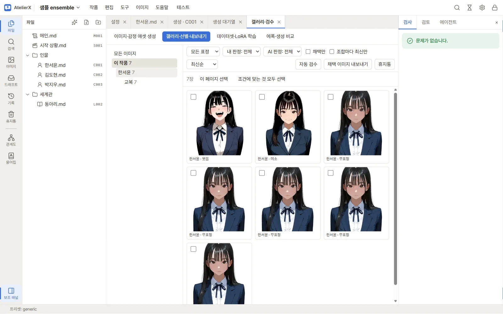
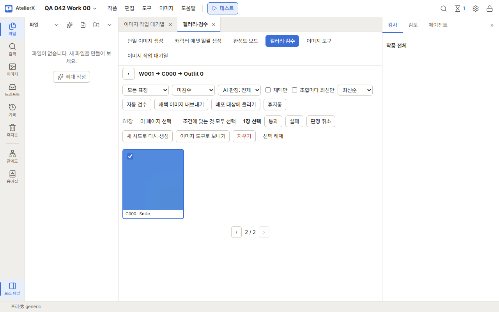
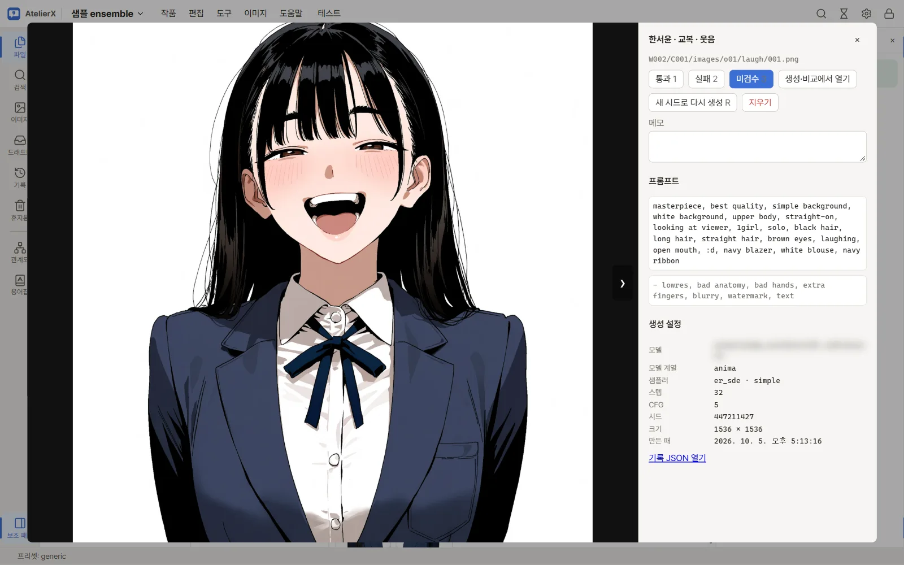
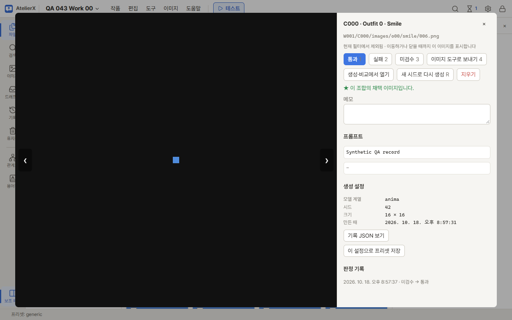
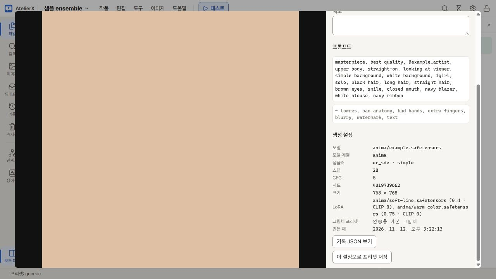

# 갤러리와 이미지 내보내기

**이미지 → 갤러리·검수**에서 작품의 생성 결과를 찾고, 캐릭터 애셋 조합마다 대표로 쓸 이미지 한 장을 채택합니다. 캐릭터의 **갤러리** 바로가기로 열면 해당 캐릭터가 먼저 선택됩니다.

## 이미지 찾기

1. 왼쪽 탐색에서 작품·캐릭터·의상 또는 폴더의 **이름**을 눌러 볼 범위를 정합니다. 작품·캐릭터 옆의 화살표는 탐색 가지를 접거나 펼칩니다. **갤러리 탐색 접기**로 왼쪽 패널 전체를 접어도 위쪽에 현재 범위가 표시됩니다.
2. 상단에서 **표정**, **내 판정**, **AI 판정**, **채택만**, **조합마다 최신만**이나 정렬 조건을 고릅니다. **새 이미지 N장 보기**가 나타나면 눌러 새 결과를 불러옵니다.
3. 이미지를 눌러 크게 엽니다. 여러 장을 한꺼번에 처리하려면 카드의 체크 상자, **이 페이지 선택** 또는 **조건에 맞는 것 모두 선택**을 사용하고 선택 장수를 확인합니다.

처음에는 **이 작품 이미지**를 보여 줍니다. 작품의 캐릭터 애셋과 단일 생성 결과가 포함됩니다. 단일 결과만 보려면 왼쪽 **그 밖의 폴더 → _single → 작품 ID**를 고릅니다. 다른 작품이나 **생성·비교**의 `_lab`, 이미지 도구의 공용 결과를 보려면 **전체 보관함 불러오기**를 누릅니다. 이미지가 많으면 첫 조회에 시간이 걸릴 수 있습니다. **이 작품으로 돌아가기**로 범위를 다시 좁힐 수 있습니다. 작품이나 캐릭터 이름을 찾을 수 없으면 ID가 표시됩니다.

## 검수하고 채택하기

- **통과**(키 `1`)를 누르면 검토한 이미지에 통과 판정이 붙습니다. 캐릭터 애셋은 그 의상·표정 조합의 채택 이미지가 됩니다. 같은 조합에서 다른 이미지를 통과시키면 ★가 새 이미지로 이동합니다.
- **실패**(키 `2`)를 누르고 필요하면 **탈락 이유**나 **메모**를 남깁니다. **미검수**(키 `3`, 목록에서는 **판정 취소**)로 판정을 되돌릴 수 있습니다. 채택 이미지에 이 동작을 쓰면 채택도 해제됩니다.
- 좌우 화살표 또는 `←`·`→`로 현재 범위·필터·정렬의 결과를 페이지 경계를 넘어 이어서 봅니다. 판정 후 현재 이미지가 필터에서 빠지면 **현재 필터에서 제외됨**이 표시되고, 화살표를 누르면 기존 위치를 기준으로 앞뒤 이미지로 이동합니다. 상세를 닫으면 마지막으로 본 위치의 목록 페이지가 열립니다. 메모나 기록 JSON을 선택·복사하는 동안에는 방향키가 이미지 탐색에 쓰이지 않습니다.

**자동 검수**에서는 생성 대기·검수 중·확인 필요 등의 상태와 자동 재생성 횟수를 확인합니다. **AI 판정**과 이유를 참고해 사람이 **통과**를 눌러 채택합니다. 자동 검수에 사용할 모델은 [LLM 연결](connections.md)에서 확인할 수 있습니다.

## 생성 기록으로 다른 작업 이어가기

- **기록 JSON 보기**를 누르면 최종 프롬프트·시드·설정 등이 읽기 전용으로 펼쳐집니다. 기록 입력란에서 `Ctrl+A`·`Ctrl+C`로 전체를 복사하고, **기록 JSON 접기**로 닫습니다. 상세의 프롬프트는 눌러서 복사할 수도 있습니다.
- **이 설정으로 프리셋 저장**은 기록에서 [그림체 프리셋](style-presets.md)을 만듭니다. 저장 전에 공통 태그와 프리셋에 들어갈 내용을 확인합니다.
- **새 시드로 다시 생성**(키 `R`)은 기록된 설정으로 새 이미지를 요청합니다. 단일 생성과 비교 생성은 각각 원래 생성 이력에 연결됩니다. [이미지 생성](generation.md) · [단일 이미지 생성](single-generation.md)
- **생성·비교에서 열기**는 기록의 프롬프트·설정과 원본 이미지를 비교 화면에 전달합니다. **이미지 도구로 보내기**(키 `4`)는 작업 목록에 추가합니다. 알림의 **이미지 도구**를 눌러 보정을 시작합니다. [이미지 도구와 후처리](image-tools.md)

**생성 설정 → LoRA**에는 기록된 모델 강도와 CLIP 강도가 표시됩니다. 아래는 실제 ComfyUI로 만든 ANM-026 미리보기입니다. LoRA 7개의 모델 강도는 순서대로 0.2, 1, 0.5, 0.1, 0.35, 0.3, 0.25이며 CLIP 강도는 모두 0입니다.

## 완성도 보드에서 부족한 조합 채우기

**이미지 → 완성도 보드**에서 캐릭터별 의상(행) × 표정(열)을 확인합니다. ✓는 채택, 숫자는 채택 전 생성 장수, 빈칸은 미생성, –는 제외입니다. 대기열에 들어간 조합은 파란 테두리로 표시됩니다. 이미지가 있는 칸을 누르면 해당 캐릭터·의상의 갤러리가 열립니다.

- **제외 편집**을 켜고 칸을 누르면 그 조합을 필요 목록에서 뺍니다. 의상 또는 표정 이름을 누르면 줄 전체를 바꿉니다. 제외 조합은 채택 진행률과 ZIP의 누락 목록에서 빠집니다.
- **미생성 N개 생성**은 한 번도 만들지 않은 조합을, **미채택 포함 N개 생성**은 아직 채택하지 않은 조합까지 일괄 생성으로 넘깁니다. 이미 대기열에 있는 조합은 목록에서 뺍니다. [캐릭터 애셋 일괄 생성](batch-generation.md)

## 채택 이미지 ZIP 받기

1. 갤러리 탐색에서 원하는 작품·캐릭터·의상 범위를 고릅니다. 이 범위의 채택 이미지가 ZIP에 들어갑니다. 카드 체크 상자와 표정·판정 필터는 목록 작업에 쓰입니다.
2. 상단 **채택 이미지 내보내기**를 누릅니다. 장수, **ZIP 경로 미리보기**, 채택 이미지가 빠진 조합을 확인합니다. 경로 충돌이 표시되면 조합 ID와 채택을 확인하고 다시 시도합니다.
3. 공유용 파일이면 **생성 정보(프롬프트·설정)를 빼고 내보내기 (공유용)**를 켭니다.
4. **ZIP 받기**를 누르면 브라우저가 ZIP을 다운로드합니다.

ZIP의 경로는 `[작품 ID/]캐릭터 ID/의상 ID/표정 ID.확장자`입니다. 한 작품 범위에서는 작품 ID 폴더가 빠집니다. 예를 들어 원본이 `.../C001/images/o01/smile/001_003.png`이면 ZIP에 `C001/o01/smile.png`로 들어갑니다. `manifest.json`에는 생성 정보를 빼고 내보내도 원본의 상대 경로와 ZIP 안 경로의 대응이 들어갑니다.

채택 이미지를 Cloudflare R2에 올려 URL을 얻으려면 [R2 업로드](deployment.md)를, 학습용으로 쓰려면 [LoRA 데이터셋과 학습](lora.md)을 엽니다. 작품 본문 파일은 [Markdown으로 내보내기](../tutorial/test-and-export.md)를 따라 내보냅니다.

## 지운 이미지 되살리기

상세나 목록에서 **지우기**를 누르면 이미지와 기록이 출력 루트의 `.trash/`로 이동합니다. 상단 **휴지통**에서 해당 이미지를 체크하고 **되살리기**를 누르면 원래 경로와 판정·채택 기록이 복원됩니다. **완전히 지우기**와 **휴지통 비우기**는 휴지통에서 파일을 삭제합니다.
