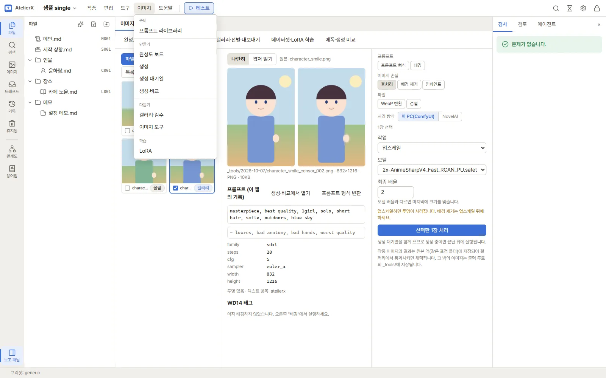
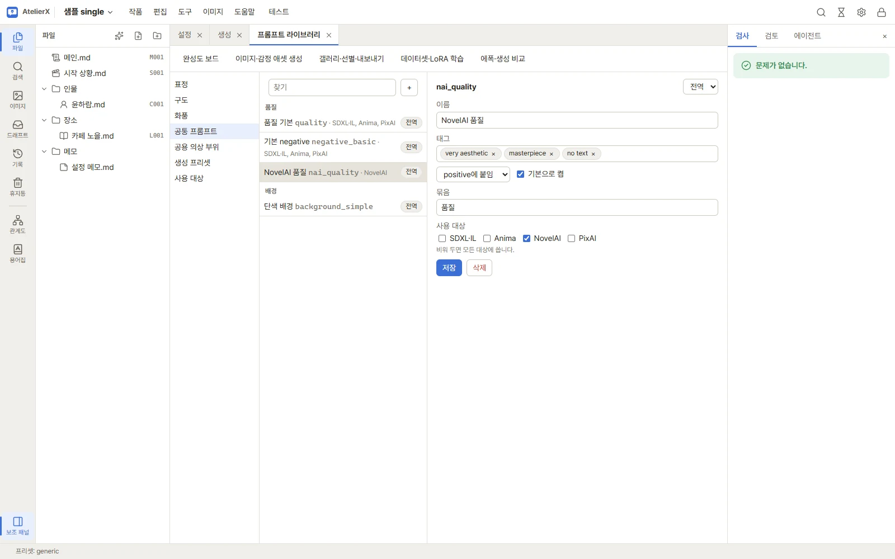
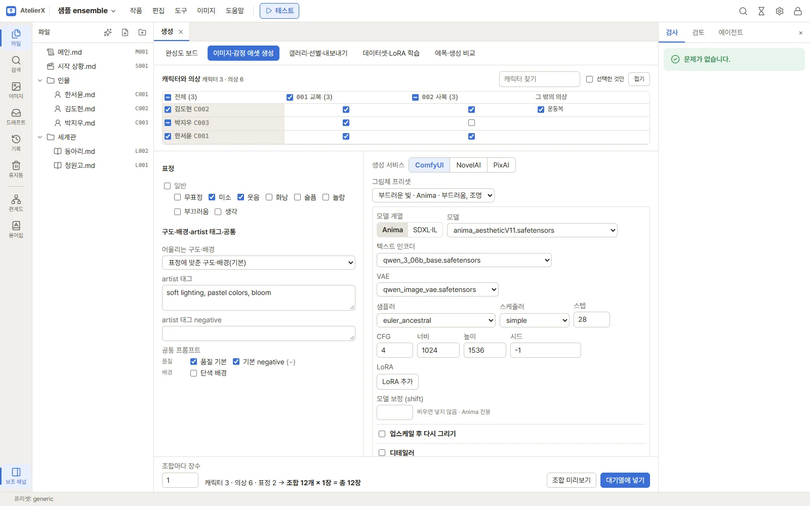
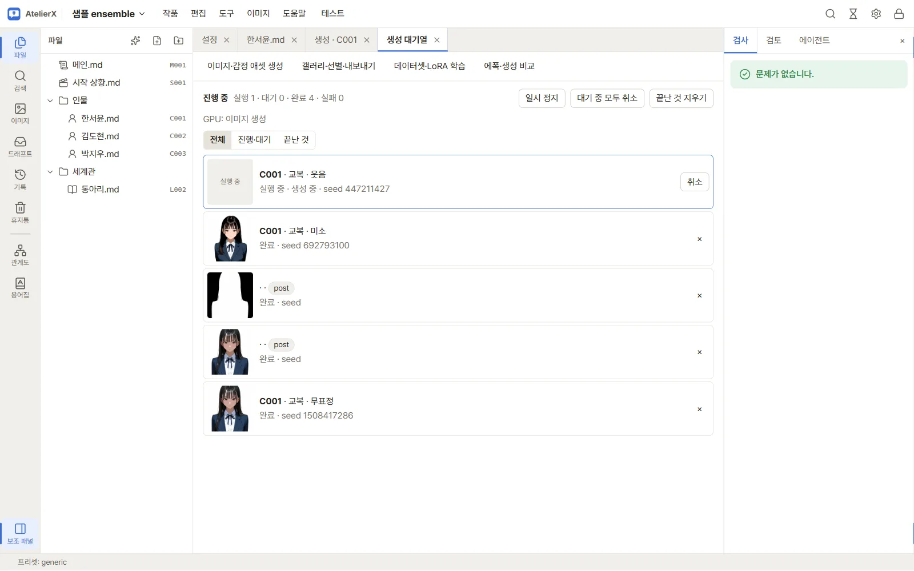

# 이미지 생성

## 단일 이미지 생성 (#242)

**이미지 → 단일 이미지 생성**에서 캐릭터를 등록하지 않고 자유 Positive·Negative 프롬프트로 한 장을 생성할 수 있습니다.
ComfyUI는 설정 → 이미지에서 연결하고, NovelAI·PixAI는 같은 곳에서 각 서비스의 API 키를 연결합니다. 인터넷 서비스는
요청에 비용이 들 수 있으므로 전송 전 서비스와 설정을 확인하세요. 서비스마다 모델과 설정 입력이 따로 유지됩니다.

1. 서비스와 해당 서비스용 그림체 프리셋을 고르고 Positive·Negative를 입력합니다. 그림체 프리셋의 공통 태그는
   입력 앞에, artist 태그는 입력 뒤에 합쳐집니다. 모델·크기·시드 등은 서비스별 실제 설정 목록에서 고릅니다.
2. **1장 생성**을 누르면 작품에 연결된 작업이 공용 이미지 대기열에 들어갑니다. 작업 상태와 오류는 이 화면이나
   **이미지 → 대기열**에서 확인하고, 대기·실행 중인 작업은 취소할 수 있습니다. 실패한 작업은 **같은 요청 재시도**로
   다시 대기열에 넣고 일시 정지된 대기열을 재개합니다.
3. 결과는 `<출력 루트>/_single/<작품 ID>/<날짜>/`에 PNG와 생성 기록으로 남습니다. 화면의 최근 생성 목록에서 지난 결과를
   고를 수 있고, **결과 설정 불러오기**는 실행 당시의 최종 프롬프트·설정·시드를 복원합니다. **같은 설정으로 재생성**은 그 값으로 새 작업을
   제출합니다. 프리셋이 나중에 바뀌거나 삭제되어도 당시 값이 유지됩니다. 결과는 갤러리에도 보입니다.
   갤러리의 **새 시드로 다시 생성**을 사용해도 단일 이미지로 저장되어 이 목록에서 다시 찾을 수 있습니다.
4. **이미지 도구로 보내기**는 결과를 도구 작업 목록에 넣습니다. **생성·비교로 보내기**는 ComfyUI 결과에만 제공하며
   원본과 프롬프트·설정을 비교 화면으로 넘깁니다. 다른 서비스의 설정을 ComfyUI 설정으로 바꾸어 적용하지 않습니다.

최근 생성 목록은 최신 100개까지 표시하고 여섯 개씩 넘겨 볼 수 있습니다. 목록에서 결과를 고르는 것만으로 현재 프롬프트는 바뀌지
않습니다. 미리보기를 누르면 큰 이미지와 당시 생성 정보를 함께 볼 수 있으며, 여기서 설정 복원·재생성·이미지 도구 전달을 할 수
있습니다. 오래된 결과를 포함한 전체 목록은 **갤러리·검수**에서 확인하세요.

**다중 캐릭터** 탭은 준비 중으로 비활성화되어 있습니다. 단일 이미지는 등장인물 한 명만 담는다는 뜻이 아닙니다.

상단 이미지 메뉴와 왼쪽 이미지 패널은 준비 → 만들기 → 다듬기 → 실험·학습 → 작업 관리 순서로 같은 화면을 제공합니다.
기존 생성 화면은 **캐릭터 애셋 일괄 생성**으로 구분하며, 기존 캐릭터별 생성·갤러리·LoRA 바로가기는 유지합니다.
아래의 캐릭터·의상·표정 조합 설명은 기존 **캐릭터 애셋 일괄 생성** 기능에 해당합니다.

## 준비 확인

생성 화면은 작품 상단 **이미지** 메뉴에서 **생성**을 엽니다. 이미지 설계가 있는 캐릭터가 있어야 대상에 체크할 수 있습니다. 이미지는 이 PC의 ComfyUI나 인터넷 이미지 서비스(NovelAI·PixAI) 중 하나로 만듭니다. ComfyUI로 만들려면 연결, 지원 워크플로·모델·필요 노드가 준비되어 있어야 하고([이미지 환경 준비](image-setup.md)), 인터넷 서비스만 쓴다면 키만 등록하면 됩니다([인터넷 이미지 서비스](image-services.md)).

이미지 메뉴는 **준비**(프롬프트 라이브러리), **만들기**(완성도 보드, 생성, 생성 대기열, 생성·비교), **다듬기**(갤러리·검수, 이미지 도구), **학습**(LoRA) 묶음으로 나뉩니다.

## 한 이미지 생성: 버튼 순서

1. 생성 화면 위쪽 **캐릭터와 의상** 표에서 만들 캐릭터·의상을 고릅니다. 표의 행은 캐릭터, 열은 의상입니다.
   - 같은 배포 코드를 가진 의상은 캐릭터가 달라도 한 열로 모입니다(코드 오름차순, 예: `001 평상복`, `002 사복`). 코드가 없는 의상은 같은 이름끼리 모이고, 어디에도 묶이지 않는 의상은 마지막 **그 밖의 의상** 열에 캐릭터별로 보입니다.
   - 칸 하나는 그 캐릭터의 그 의상입니다. **행 머리**(캐릭터 이름)는 그 캐릭터의 의상 전체, **열 머리**(의상)는 그 의상을 가진 캐릭터 전체, 왼쪽 위 **전체**는 모든 캐릭터의 모든 의상을 켜고 끕니다. 일부만 골랐으면 머리 칸이 반쯤 표시됩니다.
   - 예: 모든 캐릭터의 평상복만 → `001 평상복` 열 머리 / 전부 → **전체** / 전부에서 몇 개만 빼기 → **전체** 뒤에 그 행·열·칸을 해제
   - **캐릭터 찾기**, **선택한 것만**으로 줄을 줄이고, 다 고른 뒤 **접기**로 표를 한 줄로 접을 수 있습니다. 이미지 디자인이 없는 캐릭터는 고를 수 없고 "디자인 없음"을 누르면 그 캐릭터 파일이 열립니다.
2. **표정** 영역에서 하나 이상의 표정을 고릅니다. 여러 표정을 고르면 의상×표정 조합마다 생성 대상이 하나씩 만들어집니다.
3. **구도·배경·artist 태그·공통**에서 구도·배경은 기본적으로 표정별 구도·배경을 쓰거나 목록에서 지정합니다(배경을 표정마다 다르게 하는 법은 [프롬프트 라이브러리](image-library.md)의 "표정마다 배경과 의상을 다르게"). 공통 positive/negative 항목을 확인합니다. 공통은 묶음별로 모여 있고, 지금 모델 계열에 맞는 조각만 보입니다. 다른 대상용 조각은 아래 **다른 대상용 N개 보기**로 펼칩니다.
4. **그림체 프리셋**([그림체 프리셋](style-presets.md) 화면에서 만듦)을 선택하면 그 프리셋의 모델 계열·설정과 기본 공통 선택이 화면에 반영되고, 왼쪽 **artist 태그** 칸이 채워집니다. artist 태그는 이번 생성에만 고쳐 쓸 수 있습니다(프리셋은 바뀌지 않음). 목록에는 지금 생성 서비스(ComfyUI·NovelAI·PixAI)용 프리셋만 나옵니다. `프리셋 없이`를 선택하면 프리셋 설정을 적용하지 않습니다.
5. **모델 계열**에서 `Anima` 또는 `SDXL·IL`을 선택합니다. 다음 표의 기본값은 화면 초기값입니다. 실제 모델 드롭다운은 연결된 ComfyUI 카탈로그에서 가져옵니다.

## 인터넷 이미지 서비스로 생성 (NovelAI·PixAI)

생성 화면 오른쪽 위 **생성 서비스**에서 ComfyUI 대신 **NovelAI**나 **PixAI**를 고를 수 있습니다. 키 등록, 서비스별 설정, 비용과 오류 처리는 [인터넷 이미지 서비스](image-services.md)에 정리했습니다.

## 프롬프트 조각의 묶음과 사용 대상

이미지 메뉴 → **프롬프트 라이브러리**에서 표정·구도·공통·공용 의상 부위 조각마다 **묶음**과 **사용 대상**을 정할 수 있습니다. 조각을 만들고 고치는 법은 [프롬프트 라이브러리](image-library.md)에 있습니다.

- **묶음**: 품질, 배경, 조명처럼 이름을 붙이면 라이브러리 목록과 생성 화면에서 같은 묶음끼리 모여 보입니다.
- **사용 대상**: 이 조각을 쓸 모델 계열·이미지 서비스를 여러 개 고릅니다. 비워 두면 모든 대상에 씁니다. SDXL·IL, Anima, PixAI는 같은 SDXL 계열 태그 프롬프트를 쓰므로, 일반 태그 조각은 이 셋을 함께 고르면 됩니다.
- 생성할 때 지금 대상에 맞지 않는 공통·구도 조각은 프롬프트에서 빠지고, **미리보기**에 빠진 조각이 경고로 나옵니다. 표정은 빠지지 않고 경고만 합니다.
- 대상 목록은 라이브러리의 **사용 대상**에서 더하거나 지울 수 있습니다. 대상을 지우면 그 대상만 고른 조각은 모든 대상용이 됩니다.

우측 상단 **작업** 버튼에서 생성 대기열의 **열기**를 누르면 이미 열린 대기열 탭으로 이동합니다. 대기열 탭이 없으면 새로 엽니다. 캐릭터 화면에서 연 대기열도 같은 탭을 사용하며, 진행 중인 작업은 그대로 이어집니다.

| 설정 | 용도 | 초기값/입력 예시 |
|---|---|---|
| 모델 | 체크포인트 또는 Anima 모델 선택 | 현재 서버 카탈로그에서 선택 |
| 텍스트 인코더 | Anima 계열 인코더 | 카탈로그 선택 또는 기본값 |
| VAE | Anima VAE 또는 SDXL VAE 재정의 | 기본값/체크포인트 내장 |
| 샘플러, 스케줄러 | 생성 샘플링 방식 | 계열 기본값 또는 목록에서 선택 |
| 스텝, CFG | 샘플링 계산량과 안내 강도 | Anima 초기 32, CFG 5 |
| 너비, 높이 | 출력 크기, 16 단위 입력 | Anima 초기 1536×1536; SDXL·IL 1024×1024 |
| clip skip | SDXL·IL 텍스트 인코딩 옵션 | 계열 전환 시 2 |
| 시드 | 재현 시드; `-1`은 매 이미지 무작위 | 연습은 `-1` 권장 |
| LoRA | 현재 모델 계열에 맞는 LoRA와 세기(−10~10). 맨 앞 체크를 끄면 목록에 남긴 채 생성에서 뺍니다 | 선택 사항, 세기 예 `0.8`, 선을 얇게 하는 LoRA는 `-0.25`처럼 음수도 됩니다 |
| 모델 보정 (shift) | Anima 모델의 보정값. 그림체 레시피에 따라 3·4·8 등을 씁니다 | 비우면 넣지 않음. SDXL·IL에는 없음 |
| 업스케일 후 다시 그리기 | 생성한 뒤 업스케일 모델로 키우고(최종 배율) 낮은 denoise로 다시 그려 선·질감을 다듬습니다 | 켜면 ×1.5, 12스텝, denoise 0.3. CFG를 비우면 1차와 같음 |
| 디테일러 | 고른 부위(얼굴·눈·입·손)만 부위별 denoise로 다시 그립니다 | 켜면 얼굴 0.35, 손 0.4. 눈은 그림체를 망가뜨릴 수 있어 기본 꺼짐 |
| 조합마다 장수 | 각 대상 조합에서 만들 이미지 수 | `1`; UI 허용 범위 1–50 |

업스케일·디테일러는 이미지 생성 서버의 확장 노드가 있어야 합니다(**설정 → 설치**). 켜면 생성·업스케일·디테일러가 작업 하나로 대기열에 들어가고, 대기열에는 "생성 중 → 업스케일 → 디테일러"처럼 단계가 보입니다. 결과의 생성 기록에 모든 단계 설정이 남고, 그림체 프리셋으로 저장하면 함께 저장됩니다. 인터넷 이미지 서비스(NovelAI·PixAI)에서는 이 칸들이 보이지 않습니다.

숫자 예시는 시작점일 뿐이며, 모델과 워크플로가 허용하는 크기·성능에 맞춰 조정해야 합니다. 계열 전환은 해당 계열의 기본 설정을 다시 적용하므로 전환 후 모델과 옵션을 재확인하세요.

6. 대상이 하나라면 **조합 미리보기**를 누릅니다. 생성된 공통, artist 태그, 구도, 트리거, 외모, 표정, 의상, negative 항목을 검토하고 필요한 칸을 직접 고칩니다. 둘 이상의 조합에서는 프리뷰가 표시되지만 상세 항목을 한 조합씩 편집하는 칸은 제공되지 않습니다.
7. 미리보기 경고를 처리하고 설정을 확인한 다음 **대기열에 넣기**를 누릅니다. 화면 아래 줄의 `캐릭터 N · 의상 N · 표정 N → 조합 N개 × M장 = 총 X장` 표시가 예상 수량과 일치하는지 확인하세요. 조합마다 장수, **조합 미리보기**, **대기열에 넣기**도 이 줄에 있습니다.
   - 한 번에 넣을 수 있는 조합 수에는 제한이 없습니다. 이 PC(ComfyUI)로 500장보다 많이 넣으면 총 장수를 보여 주고 한 번 더 묻습니다.
   - 대기열에는 기다리는 작업을 5,000개까지 둘 수 있습니다. 넘으면 지금 기다리는 수와 넣으려는 수를 알려 줍니다. 대기열을 먼저 돌리거나 나눠서 넣으세요.
   - 인터넷 이미지 서비스는 설정 → 이미지의 **한 번에 넣을 수 있는 장수**를 따릅니다.
8. 완료 안내의 대기열 열기 동작 또는 상단 **이미지 → 대기열**로 진행 상태를 봅니다. 끝나면 갤러리에서 결과를 엽니다.

## 가상 입력 예

다음은 사용법 설명을 위한 가상 예입니다. 앱의 기본 샘플 이름이나 라이브러리 데이터라는 뜻은 아닙니다.

- 캐릭터 `C001` 하나, 의상 `O001`, 표정 `E001` 하나
- 그림체 프리셋 `Anima 기본` (예시 이름), 계열 `Anima`, 장수 `1`, 시드 `-1`
- 프리뷰의 외모/의상 문구를 확인하고, 필요하면 negative에 `blurry`를 추가

성공하면 미리보기에서 `C001 · <의상 이름> · <표정 이름>` 대상 카드와 경고/조합 문구를 볼 수 있고, 대기열에 `1장`이 들어갑니다. 생성 완료 이미지는 해당 캐릭터 갤러리의 생성 기록과 함께 나타납니다.

## 생성·비교 결과를 새 시드로 재생성

**갤러리·검수**에서 생성·비교 결과를 고르고 **새 시드로 다시 생성**하면 원래 비교 실행의 같은 셀에 새 시드 결과가 연결됩니다.
**생성·비교** 화면의 원본 썸네일은 유지되고, 그 아래에 대기 상태나 새 결과가 표시됩니다. 새 결과의 썸네일을 누르면 원본과
나란히 비교할 수 있습니다. 원본과 새 결과는 각각 별도 PNG로 남습니다. 실행·셀 위치를 확인할 수 없는 오래된 기록은
잘못된 셀에 넣지 않도록 다시 생성을 거절합니다.

## 생성·비교 결과를 조합으로 가져오기

**이미지 → 생성·비교**에서 마음에 든 결과를 고른 뒤 **조합으로 가져오기**를 누릅니다. 캐릭터·의상·표정을 고르고 **가져오기**를 누르면 그 이미지가 생성 기록과 함께 그 조합의 이미지로 갤러리에 들어갑니다. **바로 채택**을 켜 두면 가져오면서 채택하므로, 다시 생성하지 않고 완성도 보드와 채택 이미지 내보내기에 반영됩니다. 생성·비교의 원본은 그대로 남습니다.

## 실패했을 때

- **서버에 연결되지 않음**: 설정 → 이미지에서 ComfyUI 주소·연결 상태를 확인합니다.
- **대상 캐릭터가 없음/체크 불가**: 캐릭터 파일에 ID를 주고 **이미지** 탭에서 이미지 설계를 저장합니다.
- **모델 목록이 비거나 미리보기 오류**: ComfyUI가 실행 중인지, 모델 경로와 워크플로를 찾는지 확인합니다.
- **노드/모델 누락**: 설정 → 설치의 노드 상태, 모델 항목과 설치 로그를 확인합니다.
- **작업이 대기 상태**: GPU를 쓰는 다른 작업이 끝날 때까지 대기열에서 기다립니다.
- **작업 실패**: 대기열의 오류 상세를 확인하고, 연결·모델·워크플로 문제를 고친 뒤 재시도합니다.

## 다음 단계

[갤러리와 이미지 내보내기](gallery-export.md)에서 결과를 사람이 확인하고 채택하세요.
