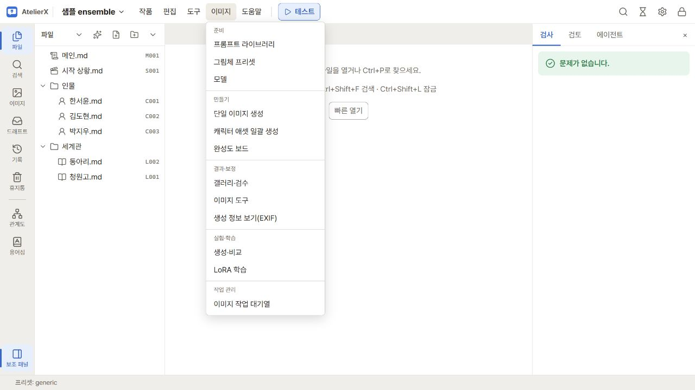
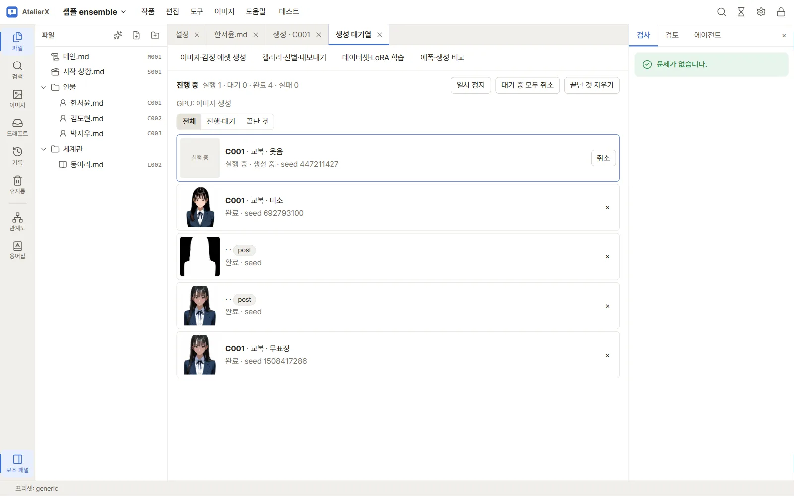

# 이미지 생성

작품을 연 뒤 상단 **이미지** 메뉴에서 만들려는 결과에 맞는 화면을 고릅니다.
작품 없이 한 장만 만들려면 초기 작품 목록의 **이미지만 생성**으로 바로 시작할 수 있습니다.

| 만들려는 것 | 사용할 화면 |
|---|---|
| 자유 프롬프트로 장면 한 장을 만들고 이전 입력을 불러와 변형 | [단일 이미지 생성](single-generation.md) |
| 등록한 캐릭터의 의상·표정 조합을 만들고 채택할 이미지 선택 | [캐릭터 애셋 일괄 생성](batch-generation.md) |
| 같은 프롬프트로 시드·샘플러·LoRA 등을 바꿔 결과 비교 | **생성·비교** |

## 서비스 준비

- **ComfyUI**를 쓰려면 **설정 → 이미지**에서 연결을 확인하고 모델과 필요한 노드를 준비합니다. [이미지 환경 준비](image-setup.md)
- **NovelAI** 또는 **PixAI**를 쓰려면 **설정 → 이미지 → 인터넷 이미지 서비스**에 해당 서비스의 API 키를 등록합니다. 실행 전에 서비스·모델·요청 장수를 확인하세요. [인터넷 이미지 서비스](image-services.md)
- 생성 화면에서 자주 쓰는 모델과 작가 태그·LoRA를 한 번에 불러오려면 [그림체 프리셋](style-presets.md)을 만듭니다.

단일·일괄 생성에서 화면 위 **이미지 집중**을 켜면 작품 탐색 영역과 보조 패널이 접힙니다. 같은 버튼으로 해제하면 이전 패널 배치로 돌아갑니다. 전환하는 동안 입력과 실행 중인 작업은 유지됩니다.

## ComfyUI 생성 설정

기본 영역에서 모델 계열, 모델, 크기와 시드를 정합니다. **세부 설정**을 펼치면 샘플러, 스텝, CFG, LoRA 등을 조절할 수 있습니다. 계열을 바꾸면 해당 계열의 기본 설정이 적용되므로 모델과 옵션을 다시 확인하세요.

| 설정 | 용도와 화면 초기값 |
|---|---|
| 모델 | 연결된 ComfyUI의 카탈로그에서 Anima·MOSS Beta diffusion 모델 또는 SDXL·IL 체크포인트를 고릅니다. |
| 텍스트 인코더·VAE | Anima·MOSS는 인코더와 VAE를 별도로 고릅니다. MOSS는 Qwen3.5 9B·Flux2 VAE를 사용합니다. SDXL·IL은 체크포인트의 VAE를 쓰거나 직접 지정할 수 있습니다. |
| 샘플러·스케줄러 | 모델에 맞는 샘플링 방식을 고릅니다. |
| 스텝·CFG | 초기값은 Anima 32스텝·CFG 5, SDXL·IL 28스텝·CFG 5, MOSS 50스텝·CFG 3입니다. 가속 LoRA는 해당 파일의 권장값을 사용합니다. |
| 너비·높이 | 16 단위로 입력합니다. Anima 초기값은 1536×1536, SDXL·IL과 MOSS는 1024×1024입니다. |
| CLIP skip | SDXL·IL에서 계열 전환 시 초기값은 2입니다. |
| 시드 | `-1`은 이미지마다 무작위입니다. 같은 시드로 요청해도 실행 환경에 따라 결과가 달라질 수 있습니다. |
| LoRA | 모델 계열에 맞는 파일과 세기(−10~10)를 고릅니다. 예를 들어 `0.8`이나 `-0.25`를 입력할 수 있습니다. 체크를 끄면 목록에는 남고 생성에서 빠집니다. |
| 모델 보정 (shift) | Anima·MOSS용 보정값입니다. MOSS 초기값은 5입니다. 비워 두면 모델 보정값을 지정하지 않습니다. |
| Simple SLG | MOSS에서 기본으로 켜집니다. 가속 LoRA의 권장 설정에 따라 끌 수 있습니다. |
| 업스케일 후 다시 그리기 | 업스케일 모델로 키운 뒤 낮은 디노이즈로 다시 그립니다. 켤 때 초기값은 1.5배, 12스텝, 디노이즈 0.3입니다. CFG를 비워 두면 1차 생성과 같은 값을 씁니다. |
| 디테일러 | 얼굴·눈·입·손 중 고른 부위를 다시 그립니다. 초기 디노이즈는 얼굴 0.35, 손 0.4이며 눈은 기본으로 꺼져 있습니다. |

업스케일·디테일러를 쓰려면 **설정 → 설치**에서 필요한 확장 노드와 모델을 준비합니다. 생성부터 후처리까지 대기열의 한 작업으로 처리하며 현재 단계가 표시됩니다. 결과의 생성 기록과 그림체 프리셋에 단계별 설정을 남길 수 있습니다. NovelAI·PixAI의 옵션은 [인터넷 이미지 서비스](image-services.md)에서 확인하세요.

MOSS Beta는 CLIP skip·업스케일 후 다시 그리기·디테일러를 지원하지 않습니다. LoRA는 모델 강도만 적용하며
CLIP 강도는 0으로 기록합니다. 배치 편집은 [단일 이미지 생성](single-generation.md)과
[캐릭터 애셋 일괄 생성](batch-generation.md)에서 사용합니다.

## 생성·비교

**이미지 → 생성·비교**는 ComfyUI 설정으로 이미지를 생성하고 결과를 같은 화면에서 비교합니다. [단일 이미지 생성](single-generation.md)의 ComfyUI 결과는 **생성·비교로 보내기**로 원본과 설정을 가져올 수 있습니다.

1. **한 번 생성**으로 같은 설정에서 시드를 바꾸거나, **값 비교**로 스텝·CFG·샘플러·스케줄러·CLIP skip·LoRA·작가 태그 등을 비교합니다.
2. 프롬프트, 모델과 생성 설정을 정합니다. **값 비교**에서는 **바꿀 값**을 고르고 비교할 값을 줄마다 하나씩 입력합니다. **LoRA 파일·에폭**은 목록에서 파일 2~12개를 고릅니다.
3. **시드 수**와 총 장수를 확인하고 **생성**을 누릅니다. 한 번에 최대 48장입니다. **값 비교**의 한 행은 같은 시드를 공유합니다. 고정 시드를 쓰면 다음 행마다 시드가 1씩 늘어납니다.
4. 결과 격자에서 썸네일을 눌러 **결과**에 놓고, 다른 이미지의 **기준으로**를 눌러 **기준**을 고릅니다. **나란히** 또는 **겹쳐 밀기**로 비교합니다. 마음에 드는 결과의 프롬프트와 설정은 **결과의 설정 불러오기**로 다시 입력에 채울 수 있습니다.

결과는 **갤러리·검수 → 전체 보관함 불러오기 → 그 밖의 폴더 → _lab**에서도 볼 수 있습니다. 갤러리에서 **새 시드로 다시 생성**하면 원래 비교 실행의 같은 셀 아래에 새 결과가 붙습니다. 원본과 새 결과는 각각 PNG로 남습니다. 실행·셀 위치를 확인할 수 없는 예전 기록은 다시 생성할 수 없습니다.

캐릭터 애셋으로 쓸 결과를 선택하고 **조합으로 가져오기**를 누릅니다. 이미지 설계가 있는 캐릭터의 의상·표정을 고르고 **가져오기**를 누르면 생성 기록과 함께 그 조합의 갤러리에 추가됩니다. **바로 채택**을 켜면 완성도 보드와 채택 이미지 내보내기에 바로 반영됩니다.

## 이미지 작업 대기열

**이미지 → 이미지 작업 대기열**에서 생성·비교·후처리 작업의 진행 상태와 오류를 봅니다. 상단 **작업** 버튼에서 대기열의 **열기**를 눌러도 같은 화면이 열립니다.

- **진행·대기** 또는 **끝난 것**으로 목록을 좁힙니다. 캐릭터 애셋의 작품·캐릭터·의상·표정 이름을 찾을 수 없으면 ID가 표시됩니다.
- **일시 정지**는 새 작업 실행을 멈춥니다. 진행 중인 작업을 중단하려면 해당 줄의 **취소**를 누릅니다. **대기 중 모두 취소**는 아직 시작하지 않은 작업을 취소합니다.
- 실패·취소·중단된 작업의 원인을 확인하고 **다시 시도**를 누릅니다. 대기열이 일시 정지되었으면 **다시 시작**을 누릅니다.
- 완료된 작업의 썸네일을 눌러 크게 볼 수 있습니다. 모아 보거나 채택하려면 [갤러리·검수](gallery-export.md)를 엽니다.

대기 작업은 최대 5,000개입니다. 한도를 넘는 경우에는 기존 작업이 끝난 뒤 다시 접수하거나 요청을 나누세요. GPU를 쓰는 다른 작업이 끝나기를 기다리는 경우에는 대기열 위쪽에 대기 사유가 표시됩니다.

모델 목록이 비어 있거나 ComfyUI 작업이 실패하면 **설정 → 이미지**의 연결과 모델 경로를 확인합니다. 노드·모델이 누락되었다는 오류는 **설정 → 설치**의 상태와 로그를 확인하세요. NovelAI·PixAI 오류는 [인터넷 이미지 서비스](image-services.md)의 문제 해결을 참고합니다.
