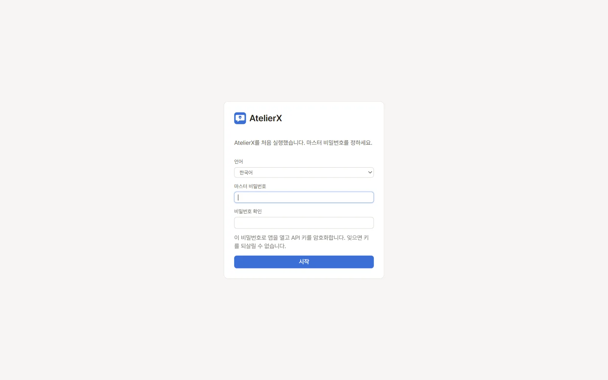
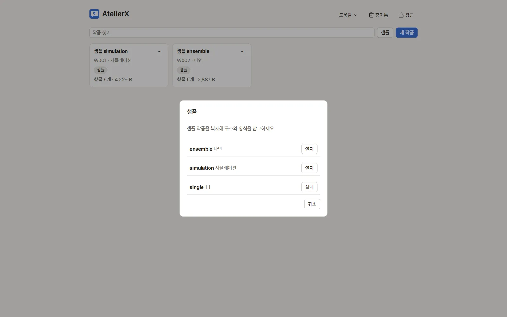

# 설치와 첫 실행

## 준비물

Windows 10/11 x64 PC와 파일을 쓸 수 있는 폴더가 필요합니다. 앱 창을 열려면 Microsoft Edge WebView2 Runtime과 .NET Framework 4.8이 있어야 합니다. Python, Node.js, Git 설치 없이 앱을 실행할 수 있습니다.

## 압축 풀고 실행

1. **Assets**에서 `AtelierX-0.6.0-windows-x64.zip`처럼 `-windows-x64.zip`으로 끝나는 포터블 패키지를 받습니다. [AtelierX 정식 릴리스](https://github.com/kiritype/AtelierX/releases/latest)
2. ZIP 전체를 `D:\Apps\AtelierX`처럼 쓰기 가능한 폴더에 풉니다. `Program Files`는 피하고 `AtelierX.exe`와 `_internal` 폴더를 함께 둡니다.
3. `AtelierX.exe`를 더블 클릭합니다. 관리자 권한은 필요하지 않습니다. 새 설치라면 마스터 비밀번호를 정하는 화면이 열립니다.
4. WebView 오류가 보이면 **Evergreen Bootstrapper** 또는 **Evergreen Standalone Installer**의 x64판을 설치한 뒤 다시 엽니다. 계속 열리지 않으면 .NET Framework 4.8과 앱 폴더의 `state/logs/desktop.log`를 확인합니다. [Microsoft WebView2 Runtime 다운로드](https://developer.microsoft.com/en-us/microsoft-edge/webview2/)

## 언어와 마스터 비밀번호 정하기

1. **언어**에서 **한국어** 또는 **English**를 고릅니다.
2. **마스터 비밀번호**에 8글자 이상의 앱 전용 비밀번호를 적고 **비밀번호 확인**에도 똑같이 적습니다.
3. **시작**을 누릅니다. 작품 목록이 열리면 초기 설정이 끝난 것입니다. 이후에는 잠금 화면에서 정한 비밀번호를 입력하고 **열기**를 누릅니다.

이 비밀번호는 앱 잠금을 풀고 API 키 금고를 여는 데 쓰입니다. 작품 파일은 평문으로 저장되므로 PC 계정과 앱 폴더에 대한 접근을 관리하세요. 비밀번호를 잊으면 금고를 초기화하고 키를 다시 등록해야 합니다. 0.3.0 전에 8글자보다 짧은 비밀번호를 정했다면 기존 비밀번호로 열 수 있습니다. 변경 안내에서 **나중에**를 누르면 지금 설정을 유지합니다. [유지 관리와 문제 해결](maintenance.md)

## 샘플 작품 열기

이미지만 만들려면 작품 목록의 **이미지만 생성**을 누릅니다. 작품을 만들지 않고 프롬프트로 한 장을 생성할 수 있습니다.
열린 화면의 **설정**에서 ComfyUI·NovelAI·PixAI를 연결한 뒤 **단일 이미지 생성**으로 돌아옵니다.
입력은 유지됩니다. [단일 이미지 생성](single-generation.md)

1. 작품 목록에서 **샘플**을 누릅니다.
2. 연습할 샘플의 **설치**를 누릅니다. 샘플이 복제되어 새 작품이 생깁니다.
3. 작품 창 왼쪽 파일 트리에서 메인 또는 캐릭터 파일을 엽니다. 파일이 열리면 [처음 사용하기](../tutorial/first-run.md)를 이어서 따라갈 수 있습니다.

빈 작품으로 시작하려면 작품 목록에서 **새 작품**을 누르고 이름을 입력합니다. 오프라인 설명서는 **도움말 → 사용 설명서(이 PC)** 또는 앱 폴더의 `manual/index.html`에서 엽니다.

## 데이터와 선택 기능

설정, 앱 상태, 작품, 생성 결과는 실행 파일 옆 `config`, `state`, `data`, `output`에 저장됩니다. 이동·업데이트 전에는 앱을 종료하고 네 폴더를 복사합니다. [백업과 업데이트](maintenance.md)

편집은 바로 시작할 수 있습니다. LLM과 이미지 생성에 쓰는 서버·모델은 필요할 때 연결합니다. [설정 한눈에 보기](settings.md), [검증 범위와 출시 상태](release-status.md)
