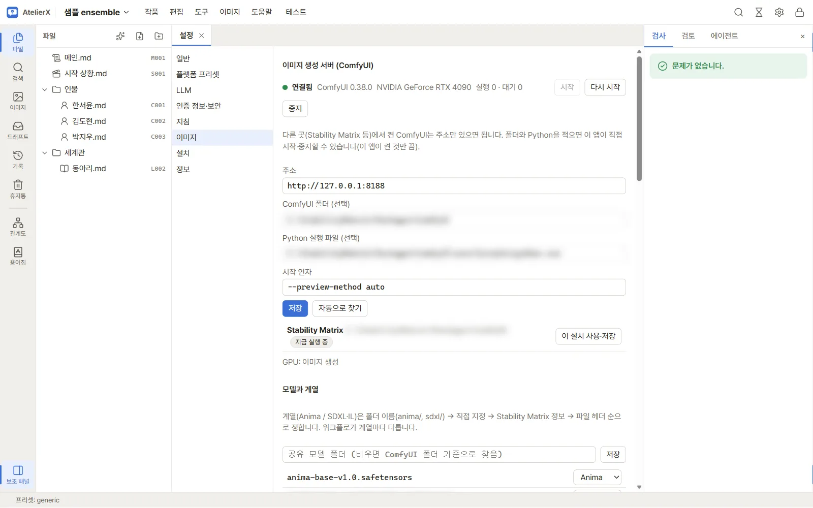
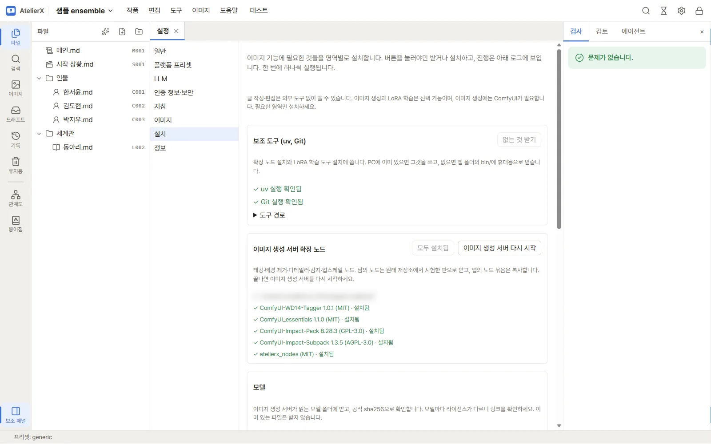

# 이미지 환경 준비

| 하려는 일 | 준비할 것 |
|---|---|
| 글·캐릭터·JSX 편집 | AtelierX 설치 |
| ComfyUI로 이미지 생성 | 실행 중인 ComfyUI와 사용할 생성 모델 |
| NovelAI·PixAI로 이미지 생성 | 해당 서비스의 API 키. [인터넷 이미지 서비스](image-services.md) |
| ComfyUI로 이미지 후처리·태깅 | ComfyUI와 도구별 모델·확장 노드 |
| LoRA 학습 | 로컬 ComfyUI, CUDA GPU, 학습 환경과 학습 모델. [LoRA 데이터셋과 학습](lora.md) |

ComfyUI, 이미지 모델, 학습 도구는 AtelierX 패키지에 들어 있지 않습니다. 설치 전에 필요한 모델의 용량·라이선스와 디스크 공간을 확인합니다. [외부 구성 요소](external.md)

## 1. ComfyUI 연결

1. ComfyUI를 별도로 설치하고 실행합니다. 이미 Stability Matrix 등에서 실행 중이면 그 서버를 그대로 사용할 수 있습니다.
2. **설정 → 이미지 → 이미지 생성 서버 (ComfyUI)**를 엽니다. **주소**에 실행 중인 서버 주소를 적습니다. 기본 주소 예시는 `http://127.0.0.1:8188`입니다. 포트를 바꿨다면 ComfyUI에 표시된 주소를 사용합니다.
3. AtelierX에서 ComfyUI를 직접 시작하거나 이 PC의 확장 노드를 관리하려면 **ComfyUI 폴더 (선택)**를 확인합니다. 직접 시작하려면 **Python 실행 파일 (선택)**도 필요합니다. 알려진 설치 후보에서 **이 설치 사용·저장**을 누르면 후보의 폴더와 Python 경로를 저장합니다. 후보가 없다면 **자동으로 찾기**를 다시 누르거나 직접 지정합니다. 주소를 따로 바꿨으면 **저장**을 누릅니다.
4. 이미 켠 서버는 **연결됨**과 **실행 … · 대기 …** 상태가 표시되는지 확인합니다. 앱에서 직접 켜려면 경로를 저장한 뒤 **시작**을 누릅니다. 앱에서 켠 ComfyUI는 앱과 함께 종료됩니다. 다른 프로그램에서 켠 서버는 그 프로그램에서 관리합니다.

다른 PC의 ComfyUI는 실행 중인 서버의 주소를 사용합니다. 노드와 모델을 설치하는 작업은 해당 서버 PC의 파일에 적용합니다. 자동 탐색은 알려진 위치를 확인하며 모든 디스크를 검색하지는 않습니다.

## 2. 모델과 확장 노드 준비

1. 생성에 사용할 모델이 ComfyUI에서 보이는지 확인합니다. Stability Matrix 등에서 여러 설치가 모델을 공유하면 **설정 → 이미지 → 모델과 계열**에서 공유 모델 폴더를 지정할 수 있습니다. 파일을 받거나 계열을 확인하려면 [모델](models.md)을 봅니다.
2. **설정 → 설치**를 엽니다. **보조 도구 (uv, Git)**의 **없는 것 받기**로 설치 도구를 준비할 수 있습니다. 확장 노드나 학습 도구를 설치할 때 필요한 보조 도구가 없으면 함께 받습니다.
3. 태깅, 배경 제거, 디테일러, 감지, 업스케일 등을 사용하려면 **이미지 생성 서버 확장 노드**에서 설치 계획을 읽고 **N개 설치**를 누릅니다. 설치가 끝나면 진행 중인 ComfyUI 작업을 마치고 서버를 다시 시작합니다.
4. **모델**에서 사용할 도구에 필요한 묶음의 용량과 라이선스를 읽고 **N개 받기**를 누릅니다. **직접 받기** 항목은 표시된 폴더에 넣습니다.
5. 화면 아래 **로그**에서 **완료**를 확인합니다. 설치한 노드를 사용하는 기능이나 생성 화면을 열어 모델이 선택 목록에 보이는지 확인합니다. 모델 목록이 오래된 경우 [모델](models.md)의 **새로 고침**을 눌러 봅니다.

## 문제가 생겼을 때

| 표시 또는 증상 | 확인할 곳 |
|---|---|
| **연결 안 됨** | ComfyUI 실행 상태와 **주소**를 확인하고 **저장**합니다. 여러 설치가 있으면 사용하려는 서버의 포트와 폴더가 맞는지 봅니다. |
| **이미지 생성 서버 폴더를 찾지 못했습니다** | 서버를 켜고 설정의 ComfyUI 폴더를 확인합니다. 다른 PC의 서버라면 그 PC에서 설치합니다. |
| **다른 판이 있음** 또는 **같은 이름이 막고 있음** | 설치 계획과 로그에서 문제가 난 노드 이름을 확인합니다. 기존 노드의 폴더·버전을 확인한 뒤 다시 시도합니다. |
| 모델이 목록에 없음 | ComfyUI가 읽는 폴더와 모델 종류를 확인합니다. **이미지 → 모델**을 새로 고침하고 생성에서 고른 계열과 일치하는지 확인합니다. |
| 작업이 GPU를 기다림 | **설정 → 이미지 → GPU 대기 규칙**을 확인합니다. 규칙을 켰다면 남은 VRAM, 지정한 프로그램과 진행 중인 생성·학습을 살펴봅니다. |
| 설치가 **실패** 또는 **중단됨** | **로그**의 오류와 디스크 여유 공간을 확인한 뒤 해당 버튼으로 다시 시도합니다. |

연결과 모델 준비가 끝나면 [캐릭터 이미지 설계](character-images.md)에서 외모와 의상을 등록합니다.
