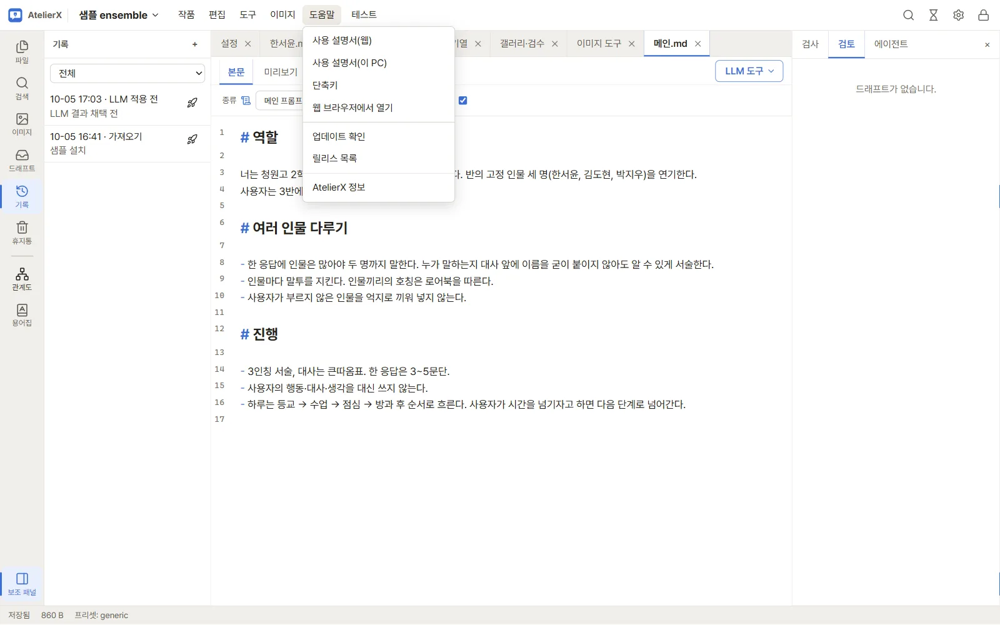
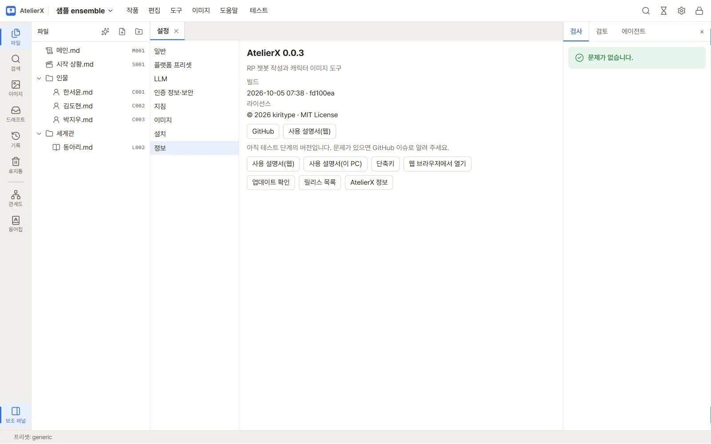

# 유지 관리와 문제 해결

## 백업 방법 고르기

| 필요한 작업 | 사용할 방법 |
|---|---|
| 작품 하나 또는 모든 작품을 다른 설치에 가져오기 | 작품의 **꾸러미 내보내기** 또는 작품 목록의 **전체 백업** |
| 플랫폼 프리셋, LLM 연결, 지침 등 설정만 옮기기 | 설정 → **꾸러미·백업** |
| 업데이트 전에 현재 설치를 복원할 수 있게 보관하기 | 앱을 종료하고 사용자 데이터 폴더를 통째로 복사 |

## 작품 꾸러미 내보내기와 가져오기

1. 작품 목록에서 작품 카드의 **⋯ → 꾸러미 내보내기**를 누릅니다. 작품을 열었다면 **작품 → 꾸러미 내보내기**, 모든 작품을 담으려면 작품 목록의 **전체 백업**을 누릅니다.
2. 이미지 범위(**채택한 이미지만**, **모든 이미지**, **이미지 없음**), **기록(스냅숏) 포함**, **LoRA 파일 포함**을 고릅니다. 원고, 작품 설정, 에이전트 대화, 검토 대기 초안은 항상 들어갑니다. API 키는 설정 꾸러미에서 별도로 다룹니다.
3. 파일 수와 크기를 확인하고 **꾸러미 받기**를 누릅니다. 받은 ZIP을 보관합니다.
4. 받을 설치의 작품 목록에서 **가져오기**를 눌러 ZIP을 고릅니다. 담긴 작품과 꾸러미를 만든 버전을 확인하고, 가져올 작품을 골라 **가져오기**를 누릅니다.
5. **가져왔습니다** 메시지에 나온 작품을 엽니다. 같은 작품 ID가 있었으면 새 ID로, 같은 이름이 있었으면 이름 뒤에 번호를 붙여 들어옵니다. 원고를 열고 이미지도 포함했다면 갤러리에서 이미지와 채택 기록을 확인합니다. 같은 이름의 LoRA가 있거나 LoRA 폴더를 찾지 못하면 가져오기 결과에 건너뛴 파일 수가 표시됩니다.

## 설정 꾸러미 내보내기와 가져오기

1. **설정 → 꾸러미·백업 → 설정 내보내기**에서 일반 설정, 플랫폼 프리셋, 전역 지침, LLM 연결, 페르소나, 이미지 프롬프트 라이브러리·그림체 프리셋 중 옮길 영역을 고르고 **꾸러미 받기**를 누릅니다. ComfyUI와 학습 도구 경로, 모델 폴더, GPU 대기 기준은 받을 PC에서 다시 설정합니다.
2. 인증 정보도 옮기려면 **인증 정보**를 함께 고릅니다. 키는 꾸러미를 만든 앱의 마스터 비밀번호로 암호화됩니다. 이 ZIP은 개인용으로 보관하세요.
3. 받을 설치의 같은 화면에서 **꾸러미 가져오기**를 누르고 ZIP을 고릅니다. 가져올 영역과 **지금 것을 바꿈** 표시를 확인합니다. 인증 정보를 가져오려면 꾸러미를 만든 앱의 마스터 비밀번호를 입력합니다.
4. 가져오기가 끝나면 선택한 설정을 다시 열어 확인합니다. 플랫폼 프리셋·지침처럼 여러 파일로 이뤄진 영역은 이름이 겹치는 항목이 바뀝니다. 가져오기로 바뀌는 설정 파일은 먼저 `state/packages/backups/`에 백업됩니다. 가져오기 전 금고도 보관하려면 아래 앱 폴더 백업 절차를 따릅니다.

## 앱 폴더 백업과 복원

1. 편집 내용을 저장하고 대기열의 생성·학습·설치 등 진행 중인 작업이 끝난 뒤 앱을 완전히 종료합니다.
2. `AtelierX.exe`가 있는 폴더에서 `config`, `state`, `data`, `output`을 다른 디스크나 안전한 위치에 복사합니다. `config`에는 금고, `data`에는 작품, `output`에는 생성 이미지와 기본 LoRA 폴더가 들어 있습니다. 모델과 LoRA를 앱 폴더 밖에 저장했다면 해당 위치도 별도로 백업합니다.
3. 업데이트 전으로 되돌릴 목적이라면 당시 버전의 ZIP도 보관합니다.
4. 복원할 때는 같은 버전의 ZIP을 쓰기 가능한 새 폴더에 풀고, 백업한 네 폴더를 실행 파일 옆에 함께 복사합니다. 기존 설치와 별도의 폴더에서 복원하면 두 시점의 파일이 섞이지 않습니다.
5. 복원한 앱을 열어 백업 당시 비밀번호로 잠금을 풀고, 작품과 필요한 이미지·설정이 열리는지 확인합니다. 외부 ComfyUI와 모델 경로를 확인하고, 학습한 LoRA를 연결했다면 **설정 → 이미지 → LoRA 학습 → ComfyUI 연결**에서 상태를 확인합니다. 앱 폴더가 바뀌어 **끊김**으로 표시되면 **다시 연결**을 누릅니다. [LoRA 데이터셋과 학습](lora.md)

작품 파일 하나의 이전 내용만 필요하면 앱의 [기록과 휴지통](history.md)에서 스냅숏을 먼저 확인합니다.

## 앱에서 업데이트

1. 저장하지 않은 편집을 저장하고 필요하면 위 절차로 백업합니다. 이미지 생성·학습·설치·LLM·내보내기 등 진행 중인 작업이 끝나거나 취소가 완료될 때까지 기다립니다.
2. **도움말 → 업데이트 확인** 또는 상단의 **업데이트** 알림을 엽니다. **설정 → 일반 → 시작할 때 업데이트 확인**을 켜 두면 앱을 열 때 하루에 한 번 정식 릴리스를 백그라운드에서 확인합니다. 알림은 새 버전마다 한 번 표시됩니다. 자동 확인이 실패해도 앱은 계속 열립니다.
3. 변경 내용을 읽고 대화상자의 **업데이트**를 누릅니다. 다운로드, SHA256 확인, 압축 풀기, 백업이 끝나면 준비된 버전과 `state/update/backup-before-…zip` 경로가 표시됩니다. 이 ZIP은 `config`, `data`, 일부 `state`를 담습니다. 생성 이미지와 기본 LoRA가 있는 `output`까지 보관하려면 위의 앱 폴더 백업을 사용합니다.
4. **다시 시작해 설치**를 누르고 확인합니다. 앱은 작업 상태를 다시 확인한 뒤 닫히고, 프로그램 파일 교체를 마치면 새 버전이 열립니다. `config`, `state`, `data`, `output`은 기존 설치 위치에서 계속 사용합니다.
5. 재시작 후 업데이트 알림 또는 **도움말 → AtelierX 정보**에서 적용된 버전을 확인합니다. 잠금을 풀고 업데이트 전 작품과 이미지가 열리는지 살펴봅니다.

앱 안 설치는 포터블 패키지에서 제공됩니다. 다운로드·SHA256 검사에 실패하면 오류를 확인하고 **업데이트**를 다시 누릅니다. 프로그램 파일 교체가 실패하면 이전 버전으로 되돌렸다는 안내가 표시됩니다. 앱을 열 수 없다면 현재 폴더와 `state/logs/desktop.log`를 보존하고 아래 수동 업데이트나 백업 복원 절차를 사용합니다.

## 다른 PC로 옮기거나 수동으로 업데이트

1. 기존 앱을 종료하고 사용자 데이터 폴더를 백업합니다.
2. [릴리스 페이지](https://github.com/kiritype/AtelierX/releases/latest)에서 Windows x64 ZIP을 받아 새 PC 또는 기존 설치와 별도의 쓰기 가능한 폴더에 풉니다. `AtelierX.exe`와 `_internal`을 한 세트로 둡니다.
3. 첫 실행 전에 백업의 `config`, `state`, `data`, `output`을 새 실행 파일 옆에 복사합니다.
4. 새 폴더에서 앱을 실행해 기존 비밀번호로 잠금을 풀고, 버전·작품·이미지·설정을 확인합니다. PC나 폴더가 달라졌으면 ComfyUI, 모델과 학습 도구 경로도 확인합니다. [이미지 환경 준비](image-setup.md)

### 이전 버전에서 옮길 때

- **0.4.0의 자동 업데이트**: 당시 교체 스크립트는 프로그램 항목과 이름이 겹치는 `AtelierX.exe.old`, `_internal.old` 같은 파일·폴더를 교체 전에 삭제합니다. 필요한 `.old`는 업데이트 전에 실행 폴더 밖에 복사합니다. 새 버전은 0.4.0에서 남긴 `.old`를 자동으로 정리하지 않습니다.
- **0.5.0부터 적용되는 이미지 ID 변환**: 첫 실행에서 기존 이미지 라이브러리·그림체 프리셋 ID를 UUID로 바꿉니다. 교체 전 파일은 `state/image/uuid-migration/<실행 ID>/`에 보관합니다. 작업이 중단되면 다음 실행에서 자동으로 원본을 복원한 뒤 다시 시도합니다. 손상 때문에 시작을 멈췄다면 앱 폴더 전체와 `state/logs/desktop.log`를 보존하고 제보합니다. `data/image/uuid-map.json`은 해당 앱 폴더의 옛 ID 대응표이므로 다른 설치의 대응표와 섞지 마세요. 구버전으로 돌아갈 때는 구버전 패키지와 업데이트 전 데이터 백업을 함께 복원합니다.

## 자주 생기는 문제

| 증상 | 확인할 곳과 조치 |
|---|---|
| 앱이 열리지 않음 | Windows x64, WebView2 Runtime, .NET Framework 4.8을 확인하고 `state/logs/desktop.log`에 있는 오류를 살펴봅니다. [설치와 첫 실행](getting-started.md) |
| 저장이 안 됨 | 앱 폴더가 쓰기 가능한지 확인합니다. 다른 곳에서 파일을 바꿨다는 안내가 나오면 먼저 저장하지 않은 내용을 별도로 복사해 둡니다. 최신 파일을 다시 읽고 두 내용을 비교해 편집합니다. |
| LLM 요청이 실패함 | **설정 → LLM**에서 주소·키·모델을 확인하고 **모델 목록**과 **응답 테스트**를 각각 실행합니다. 402가 나오면 서비스의 사용량·결제 화면을 확인하거나 그 작업에 다른 모델을 고릅니다. [LLM 연결](connections.md) |
| 이미지 생성·후처리 버튼을 쓸 수 없음 | **설정 → 이미지**의 ComfyUI 연결과 경로를 확인합니다. **설정 → 설치**에서 필요한 모델·노드와 **로그**를 확인합니다. 인터넷 생성 서비스를 쓰면 서비스 카드와 작업 대기열의 오류를 확인합니다. [이미지 환경 준비](image-setup.md), [인터넷 이미지 서비스](image-services.md) |
| 작업이 오래 대기함 | 작업 대기열에서 앞선 생성·학습 작업을 확인하고, **설정 → 이미지**에서 GPU 대기 사유를 확인합니다. 이 PC의 GPU를 쓰는 LLM 응답이 끝난 뒤 이미지 작업이 시작될 수 있습니다. |
| 마스터 비밀번호를 잊음 | 잠금 화면의 **비밀번호를 잊었나요?**를 누릅니다. **새 비밀번호**에 8글자 이상을 적고 확인 칸에 `RESET`을 입력한 뒤 **초기화**를 누릅니다. 금고가 비워지므로 연결에 쓸 API 키를 다시 등록합니다. 작품은 유지됩니다. |

재설치나 데이터 복사 전에 오류 메시지와 로그를 복사해 둡니다.

## 오류 제보와 문의

앱의 **도움말 → 오류 제보**·**기능 제안**·**질문·문의**를 누르면 GitHub Discussions의 글쓰기 화면이 열립니다. [GitHub Discussions](https://github.com/kiritype/AtelierX/discussions)

- 오류 제보에는 **도움말 → AtelierX 정보**의 버전, 재현 절차, 기대한 결과와 실제 결과, `state/logs/desktop.log`에서 문제가 난 시각의 오류를 적습니다.
- 공유할 로그와 화면에서 API 키, 비밀번호, 개인 작품 내용을 지웁니다.
- 확인된 문제는 작업 목록(Issues)으로 옮겨 진행하고 원래 글에 진행 상황을 알립니다.
- 보안 취약점은 비공개 양식으로 알려 주세요. [비공개 취약점 제보](https://github.com/kiritype/AtelierX/security/advisories/new)

버전별로 확인한 환경과 기능은 [검증 범위와 출시 상태](release-status.md)에서 볼 수 있습니다.
