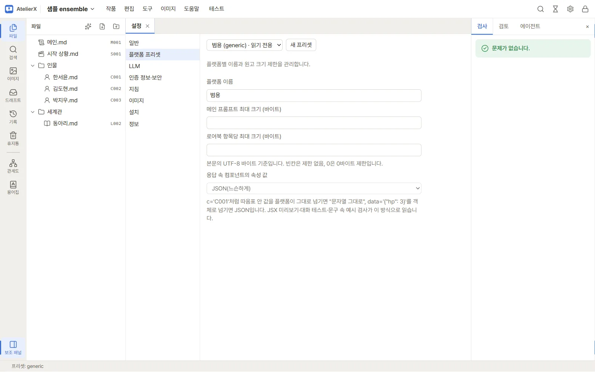

# 플랫폼 프리셋

플랫폼마다 다른 원고 크기 제한이나 JSX 호출 규칙을 프리셋에 저장하고 작품의 **태그**로 연결합니다.

## 프리셋 만들기

1. 작품 창의 **설정 → 플랫폼 프리셋**을 엽니다. 기본 **범용 (generic)** 프리셋은 읽기 전용입니다.
2. 바탕으로 쓸 프리셋을 고르고 **새 프리셋**을 누릅니다. 예를 들어 ID는 `demo-rules`, **플랫폼 이름**은 “예시 플랫폼”으로 정합니다.
3. **메인 프롬프트 최대 크기 (바이트)**와 **로어북 항목당 최대 크기 (바이트)**를 입력합니다. 값은 0 이상의 정수이고 빈칸은 제한 없음, 0은 0바이트 제한입니다.
4. JSX를 쓰는 작품이라면 **응답 속 컴포넌트의 속성 값**도 확인합니다. 속성 값을 문자열로 넘기는 플랫폼에는 **문자열 그대로**, JSON으로 읽는 플랫폼에는 **JSON(느슨하게)** 또는 **JSON(엄격)**을 고릅니다. 설정은 JSX 미리보기, 대화 테스트, 문구 속 예시 검사에서 사용됩니다.
5. **저장**을 누릅니다. 목록은 이름을 먼저 보여 주며 이름이 같으면 ID도 표시합니다. 선택한 ID는 목록 아래에서 확인합니다.

## 작품에 연결하고 확인하기

1. **작품 → 작품 설정**에서 **태그**에 프리셋 ID `demo-rules`를 입력하고 Enter를 누릅니다. 알려진 프리셋 ID는 강조됩니다.
2. **저장**한 뒤 **적용되는 플랫폼 규칙**에서 규칙 값과 출처를 확인합니다.
3. 제한을 넘는 원고를 열면 오른쪽 **검사** 패널에 크기 문제가 표시됩니다. 제한은 각 메인·로어북 본문에 따로 적용되며 UTF-8 바이트 기준입니다. 편집기의 크기 표시를 기준으로 확인하세요.

**설정 → 일반 → 새 작품의 기본 플랫폼 프리셋**에서 지정한 프리셋은 새 작품의 태그에 미리 들어갑니다. 연결이 보이지 않으면 프리셋의 표시 이름 대신 ID를 넣었는지와 작품 설정을 저장했는지 확인합니다.

## 프리셋이 여러 개일 때

앱 기본값에 작품 태그의 순서대로 프리셋을 적용하고, 작품에 따로 지정된 값이 있으면 마지막에 적용합니다. 어떤 값이 적용됐는지는 작품 설정의 출처에서 확인할 수 있습니다. 키워드 매칭이나 로어북 선택 예산처럼 화면에 입력칸이 없는 규칙도 설정을 저장할 때 기존 값이 보존됩니다. 작품이나 앱 기본값에서 쓰는 프리셋은 연결을 해제한 뒤 삭제할 수 있습니다.

LLM 작업이 참고하는 `platform.md`는 프리셋의 지침 폴더에서 관리합니다. 파일 위치와 적용 순서는 [지침](guidelines.md)을 참고하세요.

## 다음 단계

[대화 테스트](chat-test.md)에서 로어북이 선택되는 이유를 확인하고, [파일과 편집기](editing.md)에서 크기와 JSX 검사 결과를 확인하세요.
