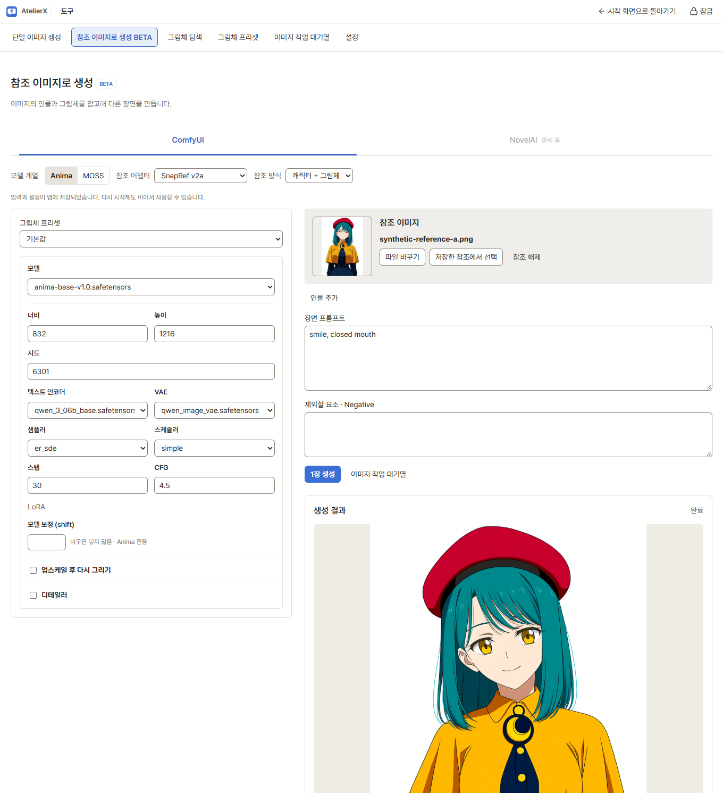

# 참조 이미지로 생성 BETA

기준 이미지의 인물 외형과 그림체를 참조하고, 프롬프트에서 표정·자세·구도·배경을 바꿉니다. ComfyUI의 **Anima**에서는 한 명 또는 두 명의 참조를, **MOSS**에서는 참조 한 장을 사용합니다.

## 준비

### Anima

**설정 → 설치**에서 **Anima Ref Adapter** 확장 노드를 설치하고 ComfyUI를 다시 시작합니다. 같은 노드가 두 어댑터를 실행합니다. **설정 → 설치 → 모델**에서 사용할 가중치를 받습니다.

- **참조 이미지 BETA (Anima)**는 기본 어댑터인 Anima Ref Adapter v2의 가중치입니다.
- **참조 이미지 BETA (SnapRef v2a)**는 SnapRef v2a의 BF16 가중치입니다.

원격 ComfyUI에 연결하거나 직접 설치할 때는 가중치 파일을 해당 ComfyUI의 `models/loras`에 둡니다. [외부 구성 요소](external.md)

### MOSS

1. ComfyUI 0.43.0 이상에서 MOSS-Image-SFT, Qwen3.5 9B 텍스트 인코더, Flux2 VAE를 준비합니다. 모델은 ComfyUI에서 인식해야 합니다. [ComfyUI 예제와 모델](https://github.com/OpenMOSS/MOSS-Image/blob/main/comfyui/README.md)
2. [MossRef v2.0.0](https://github.com/Neon3579/MossRef/releases/tag/v2.0.0)의 소스를 받아 `MossRef` 폴더를 `custom_nodes/` 아래에 놓습니다. 같은 릴리스의 `anime_textref_v2_bf16.safetensors`를 `models/moss_ref/` 아래에 넣습니다.
3. [Moss-Image-Edit 배포처](https://huggingface.co/chinoll/Moss-Image-Edit/tree/3be9c40037e1b89b17aa85ff6f8ee805872aa558)에서 `adapter_config.json`과 `adapter_model.safetensors`를 받아 `models/moss_ref/Moss-Image-Edit/` 아래에 넣고 ComfyUI를 다시 시작합니다. 원격 ComfyUI라면 그 서버에 파일을 둡니다. [MossRef 설치 안내](https://github.com/Neon3579/MossRef/blob/v2.0.0/README.ko.md#설치)

## 작품 없이 시작하기

시작 화면에서 **이미지만 만들기**를 누르고, 상단에서 **참조 이미지로 생성 BETA**를 선택합니다. 작품 안에서 시작할 때는 **이미지 → 참조 이미지로 생성 BETA**를 엽니다.

**파일 선택**으로 참조를 올리면 원본이 앱에 보관됩니다. 다른 파일로 바꿨거나 선택을 해제한 뒤에도 **저장한 참조에서 선택**으로 이전 파일을 다시 고를 수 있습니다. **입력과 설정이 앱에 저장되었습니다**가 표시되면 앱을 다시 열어도 선택한 사진과 입력을 이어서 사용할 수 있습니다.

생성 결과는 **작품 없이 생성한 최근 참조 결과**에 표시됩니다. 앱을 다시 열거나 작업 대기열을 정리한 뒤에도 결과를 선택해 당시 설정을 불러오거나, 같은 시드와 새 시드로 재생성하거나, 재현용 ZIP으로 받을 수 있습니다. 원본도 함께 가져가려면 ZIP을 받기 전에 원본 첨부를 선택합니다.

## 한 장 생성

이미지만 만들기에서 시작했다면 **한 장 생성** 탭을 고릅니다.

1. 화면에서 모델 계열과 모델을 고릅니다. PNG·WebP·JPEG를 참조로 사용할 수 있습니다. 작품 안에서는 갤러리에서 이미지 한 장을 체크한 뒤 **참조 이미지로 사용**을 누르거나, 이미지 상세에서 **이 이미지를 기준으로 변형**을 눌러 시작할 수도 있습니다. 참조 썸네일을 누르면 전체 이미지가 열리고 `Esc`로 닫을 수 있습니다.
2. Anima에서는 **참조 어댑터**를 고릅니다. **Anima Ref Adapter v2**의 참조 가이던스 기본값은 4.5입니다. **SnapRef v2a**는 기본으로 캐릭터와 그림체를 함께 참조합니다. **캐릭터만**을 고르면 그림체는 프롬프트에서 정할 수 있습니다.
3. 장면 프롬프트를 적습니다. Anima에서 두 명을 생성하려면 **인물 추가**를 누르고 각 카드에 원본을 한 장씩 넣습니다. 인물별 외형이나 행동을 덧붙일 수 있습니다. **좌우 교환**은 사진과 설명을 유지하면서 두 인물의 위치를 바꿉니다. MOSS에서는 참조 한 장을 고르고 `Use Picture 1 for the exact character and outfit. The character is reading a book in a quiet library.`처럼 어떤 요소를 쓸지 장면 프롬프트에 적을 수 있습니다.
4. **1장 생성**을 누릅니다. [이미지 작업 대기열](generation.md)에서 진행 상태를 확인합니다. 작품 안의 결과는 [갤러리](gallery-export.md)에서도 확인할 수 있습니다.

생성 버튼 옆에서 현재 선택한 모델, 텍스트 인코더, VAE, 어댑터와 ComfyUI 연결을 확인할 수 있습니다. 두 명을 생성할 때는 Image Stitch도 필요합니다. 누락된 항목을 설치하거나 지원하는 항목을 고른 뒤 **다시 확인**을 누릅니다.

결과를 재시도하거나 같은 시드 또는 새 시드로 다시 생성할 때는 그 결과에 기록된 구성 요소가 필요합니다. 설치가 필요한 항목은 결과의 재실행 버튼 옆에 표시됩니다. 입력 복원과 재현용 ZIP 다운로드는 생성 환경을 준비하기 전에도 사용할 수 있습니다.

두 명을 생성할 때는 원본마다 해당 인물이 선명하게 나온 이미지를 고릅니다. 원본에서 인물의 크기나 촬영 거리가 크게 다르면 합친 입력에서도 차이가 남을 수 있습니다. 생성 결과에서는 인물이 좌우로 뒤바뀌거나 두 인물의 외형·의상·그림체가 섞일 수 있습니다.

실패·취소·중단된 작업은 **같은 요청 재시도**로 다시 접수합니다. 대기열이 일시 정지 중이라면 해당 작업이 대기 상태로 표시됩니다. 대기 중인 작업을 실행하려면 **이미지 작업 대기열 → 다시 시작**을 누릅니다.

## 감정 일괄 생성

같은 인물의 여러 표정이 필요하면 **이미지만 만들기 → 참조 이미지로 생성 BETA → 감정 일괄 생성**을 엽니다.

1. 위쪽에 인물의 외형과 의상이 잘 보이는 참조 이미지 한 장을 넣습니다. 선택한 모든 감정에 같은 사진을 사용합니다.
2. 왼쪽에서 모델 계열·모델·참조 어댑터와 이미지 크기·시드를 고릅니다. 일괄 생성의 모든 작업이 이 설정을 함께 사용합니다. 고정 시드를 지정하면 감정마다 같은 값이 적용됩니다.
3. 오른쪽에서 미소·화남·놀람처럼 만들 감정을 고릅니다. 현재 모델 계열에 맞는 전역 라이브러리 항목이 표시됩니다. 원하는 감정이 없으면 **설정 → 이미지 → 기본 콘텐츠 → 기본 프롬프트 가져오기**에서 추가할 수 있습니다. [이미지 환경 준비](image-setup.md)
4. 구도를 고릅니다. **구도 추가 안 함**이 기본입니다. **표정에 맞춘 구도·배경**을 고르면 감정에 연결된 구도를 각각 쓰고, **라이브러리 공통 구도**를 고르면 선택한 구도를 모든 감정에 씁니다.
5. **조합 미리보기**로 감정별 Positive·Negative와 총 장수를 확인한 뒤 **일괄 대기열에 추가**를 누릅니다. 감정 하나당 한 장을 만듭니다. 예를 들어 미소·화남·놀람을 고르면 세 장이 대기열에 들어갑니다.

최종 프롬프트에는 선택한 감정과 구도의 Positive·Negative만 들어갑니다. 사용할 수 없는 연결 구도는 조합 미리보기에서 **미적용**으로 표시됩니다.

생성 진행은 **이미지 작업 대기열**에서 확인합니다. 결과에는 감정 이름이 붙고, 앱을 다시 열어도 **작품 없이 생성한 최근 참조 결과**에서 한 번에 접수한 결과를 한 묶음으로 확인할 수 있습니다. [이미지 작업 대기열](generation.md)

## ComfyUI에서 다시 열기

결과의 **재현용 ZIP**에는 결과 이미지, 실행·편집용 워크플로, 모델과 참조 설정이 들어 있습니다. 원본을 함께 옮기려면 참조 이미지 첨부를 선택합니다. 두 명을 생성한 결과에서는 두 참조 원본이 첨부됩니다.

1. 대상 ComfyUI에 원래 사용한 모델과 참조 어댑터를 설치합니다. Anima는 별도 릴리스 첨부 **Anima Ref Adapter 노드·예제 워크플로 ZIP**을 사용할 수 있습니다. 업스케일·디테일러를 사용한 결과에는 해당 노드와 모델도 필요합니다. [외부 구성 요소](external.md)
2. 참조를 첨부했다면 ZIP의 `input/`에 있는 `atelierx-reference-…` 파일을 모두 대상 ComfyUI의 `input/` 아래에 복사합니다. 원본을 따로 보관했다면 편집기의 **Load Image**에서 각각 고릅니다. 두 명을 썼다면 **Stitch Images**에 연결된 좌우 순서를 확인합니다.
3. `result.png` 또는 `workflow.json`을 ComfyUI에 열고 참조와 모델을 확인한 뒤 실행합니다.
