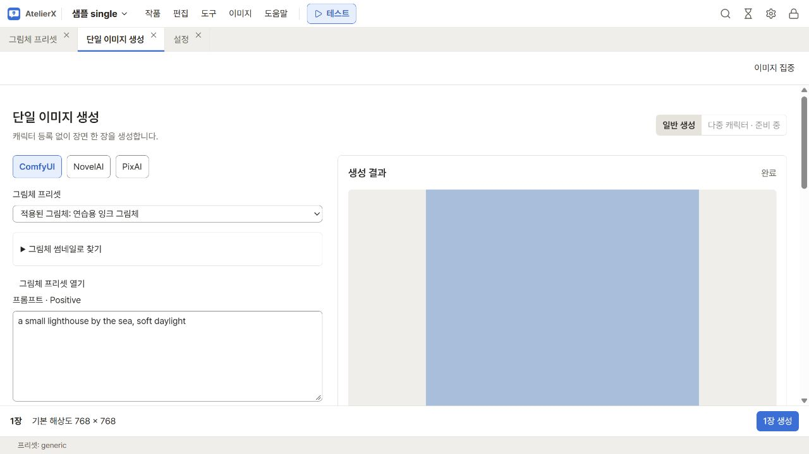
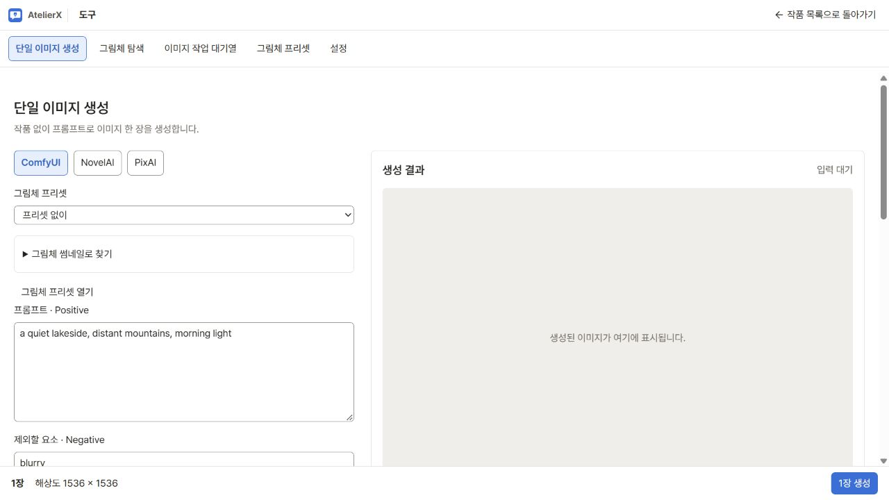
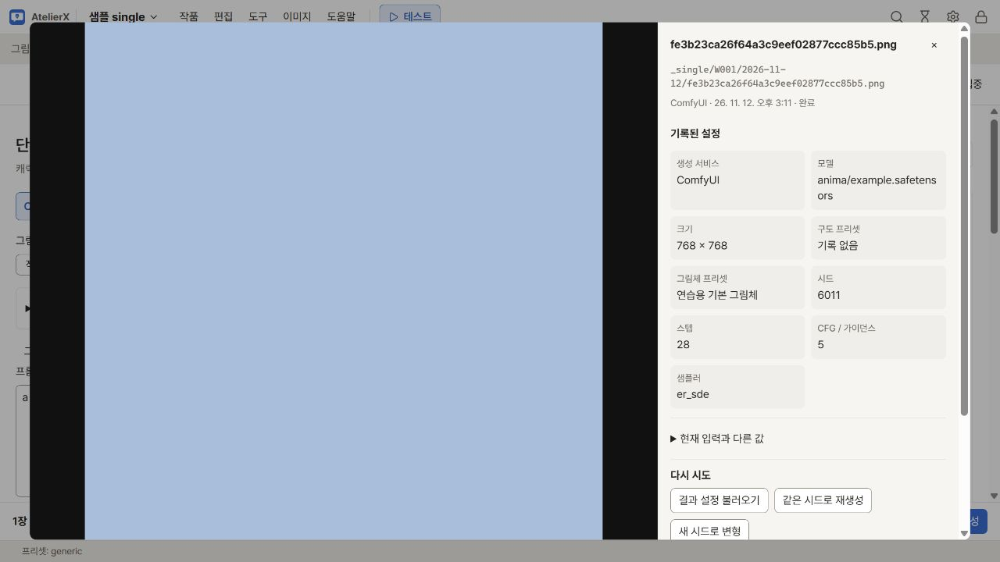

# 단일 이미지 생성

작품 상단 **이미지 → 단일 이미지 생성**에서 캐릭터를 등록하지 않고 자유 프롬프트로 장면 한 장을 만듭니다. 일반 생성에서는 장면에 포함할 인물을 프롬프트에 적습니다. **다중 캐릭터 · 준비 중**은 별도 입력 방식으로 화면에 표시됩니다.

화면 오른쪽은 이전에 실제 ComfyUI로 만든 단일 생성 결과입니다. 왼쪽은 **비교에서 고른 그림체**를 새로 적용한 상태입니다. 프리셋을 바꿔도 이미 완성된 결과는 유지되며, 다음 **1장 생성** 요청에 왼쪽 입력과 설정이 사용됩니다.

## 장면 만들기

### 작품 없이 시작하기

초기 작품 목록에서 **이미지만 생성**을 누르면 같은 단일 생성 화면이 열립니다. **설정**에서 이미지 서비스를
준비한 뒤 **단일 이미지 생성**으로 돌아오세요. 입력을 유지하며, 작품을 만들 필요가 없습니다.
전역 그림체·공통 프롬프트·구도·표정을 사용할 수 있습니다. 캐릭터 재료 선택과 작품별 라이브러리, 갤러리·이미지 도구로 보내기는 이 화면에서 제공하지 않습니다.

위 화면은 가상 데이터와 서비스 대역으로 촬영한 입력 예시입니다. 실제 서비스로 생성한 결과를 나타내지 않습니다.

**입력과 설정이 앱에 저장되었습니다**를 확인하면 앱을 다시 시작해도 이어서 사용할 수 있습니다.
저장에 실패하면 현재 입력을 유지하며 **저장**으로 재시도할 수 있습니다. 다른 창에서 바뀐 초안과 충돌하면
입력을 복사해 둔 뒤 **저장된 초안 다시 불러오기**로 최신 초안을 엽니다.
**작품 목록으로 돌아가기**를 누르면 초기 화면으로 돌아갑니다. 미저장 입력이나 진행 중인 생성이 있으면 확인을 받습니다.

**작품 없이 생성한 최근 이미지**는 기존 작품의 기록과 구분됩니다. 완료한 이미지는 대기열을 정리하거나 앱을 다시 시작해도
다시 표시되고, 당시 프롬프트·설정으로 재생성할 수 있습니다. 파일은 `output/_standalone/<날짜>/`의 PNG와 JSON에 저장됩니다.
이 폴더를 백업할 때는 둘을 함께 보존하세요.

### 한 장 생성하기

1. **생성 서비스**에서 연결된 ComfyUI·NovelAI·PixAI 중 하나를 고릅니다. 서비스별 모델과 설정 입력은 따로 기억합니다. 연결과 키 등록은 [이미지 생성](generation.md)에서 확인하세요.
2. **프롬프트 · Positive**에 원하는 장면을, **제외할 요소 · Negative**에 피할 요소를 적습니다. 예를 들어 Positive에 `a quiet lakeside, distant mountains, morning light`, Negative에 `blurry`를 넣어 볼 수 있습니다. **예시 프롬프트 추가**는 입력 끝에 예시 장면을 붙입니다.
3. 필요하면 **그림체 프리셋**, **프롬프트 재료**, [구도 선택](composition.md)을 사용합니다. **조합된 프롬프트 확인**을 펼쳐 합쳐진 Positive·Negative를 확인하세요. 서비스별 자동 설정은 요청할 때 적용됩니다.
4. **생성 파라미터**에서 모델·크기·시드를 확인합니다. 샘플러·스텝·CFG 등을 조절하려면 **세부 설정**을 펼칩니다. 접어 두면 제목 옆에 현재 설정 요약이 표시됩니다.
5. 하단에서 해상도와 장수를 확인하고 **1장 생성**을 누릅니다. 결과 영역과 **이미지 → 이미지 작업 대기열**에서 상태를 볼 수 있습니다.

작품 안의 단일 생성 입력과 설정은 이 브라우저의 작품별 초안에 자동 저장됩니다. 같은 브라우저 세션에서 작품을 다시 열면 이어서 입력할 수 있습니다. 작품별 초안에서 앱을 종료한 뒤에도 필요한 미생성 프롬프트는 별도로 복사해 두세요. 작품 없는 화면의 초안은 위에서 설명한 앱 저장 방식을 사용합니다.

## 그림체와 프롬프트 재료 적용하기

**그림체 썸네일로 찾기**에서 이름으로 검색하고 그림을 눌러 적용합니다. 갱신이 필요한 썸네일에는 **미리보기 갱신 필요**가 표시됩니다. 프리셋을 만들거나 고치려면 **그림체 프리셋 열기**를 누릅니다. 적용할 때는 서비스에 맞는 공통 프롬프트와 작가 태그, 생성 설정을 가져옵니다. 그림체를 해제한 뒤에는 적용했던 생성 설정이 남으므로 모델과 크기 등을 다시 확인하세요.

**프롬프트 재료**에서 [프롬프트 라이브러리](image-library.md)의 **표정 적용**을 누릅니다. 작품 안에서는 이미지 설계를 저장한 캐릭터의 **외형 적용**도 사용할 수 있습니다. 외형 재료에는 캐릭터 외모 태그가 들어갑니다. 의상은 직접 적고 LoRA는 생성 설정에서 고릅니다. 출처마다 하나씩 적용할 수 있습니다.

**출처별 프롬프트**에서 재료마다 어떤 문구가 붙는지 확인하고, 빼려면 해당 줄의 ×를 누릅니다. 최종 문구는 그림체 공통 프롬프트 → 직접 입력 → 캐릭터 외형 → 표정 → 구도 → 그림체 순서로 합쳐집니다. 주석은 적용할 때 빠지고 가중치, 태그에 붙은 `#`, 이스케이프한 `\#`는 프롬프트에 반영됩니다. 적용한 문구는 초안과 생성 기록에 저장됩니다. 라이브러리에서 바꾼 최신 문구를 쓰려면 해당 재료를 다시 적용하세요. 오래된 초안에 그림체 ID만 저장되어 있으면 그림체를 다시 고르라는 안내가 표시됩니다.

## 결과 확인과 다시 생성

결과를 누르면 이미지와 **기록된 설정**이 크게 열립니다. 모델·크기·구도·그림체·시드·스텝·CFG를 확인하고 **현재 입력과 다른 값**을 펼쳐 비교합니다. 오래된 결과에 빠진 값은 **기록 없음**으로 표시되며, 세부 값은 **기록된 설정 JSON**에 있습니다.

| 버튼 | 하는 일 |
|---|---|
| **결과 설정 불러오기** | 생성 당시의 서비스·프롬프트·출처·설정·시드를 현재 입력에 채웁니다. 출처가 없는 예전 결과는 최종 프롬프트를 직접 입력에 채웁니다. 불러온 뒤 필요에 맞게 편집하고 **1장 생성**을 누릅니다. |
| **같은 시드로 재생성** | 생성 기록의 프롬프트·설정·시드로 새 작업을 접수합니다. |
| **새 시드로 변형** | 생성 기록의 프롬프트·설정에 새 시드를 사용해 새 작업을 접수합니다. |

두 재생성 버튼은 현재 초안을 유지하며, 그동안 그림체 프리셋을 바꾸었어도 생성 당시 설정을 사용합니다. 작업이 실패·취소·중단된 경우에는 결과의 재생성 버튼 대신 **같은 요청 재시도**로 같은 작업을 다시 접수하고 대기열을 재개합니다. 대기·실행 중에는 **취소**를 누를 수 있습니다.

작품 안에서는 **다음 작업**의 **이미지 도구로 보내기**로 결과를 보정할 수 있습니다. ComfyUI 결과의 **생성·비교로 보내기**는 원본과 프롬프트·설정을 비교 화면에 전달합니다.

## 이전 결과 찾기

**이 작품의 최근 생성**에는 최근 기록 100개가 여섯 개씩 표시됩니다. 오래된 이미지까지 보려면 **전체 결과를 갤러리에서 보기**를 누르고 왼쪽 **그 밖의 폴더 → _single → 작품 ID**를 고릅니다. PNG와 생성 기록은 `<출력 루트>/_single/<작품 ID>/<날짜>/`에 저장됩니다.

이전 버전에서 다른 폴더로 분류된 결과는 갤러리의 **기록 JSON 보기**에서 `kind: "single"`과 작품 ID를 확인할 수 있습니다. 기록이 온전하면 **새 시드로 다시 생성**한 결과가 단일 생성 경로에 저장됩니다. 기존 결과를 백업할 때는 PNG와 같은 이름의 JSON을 함께 보존하세요.
