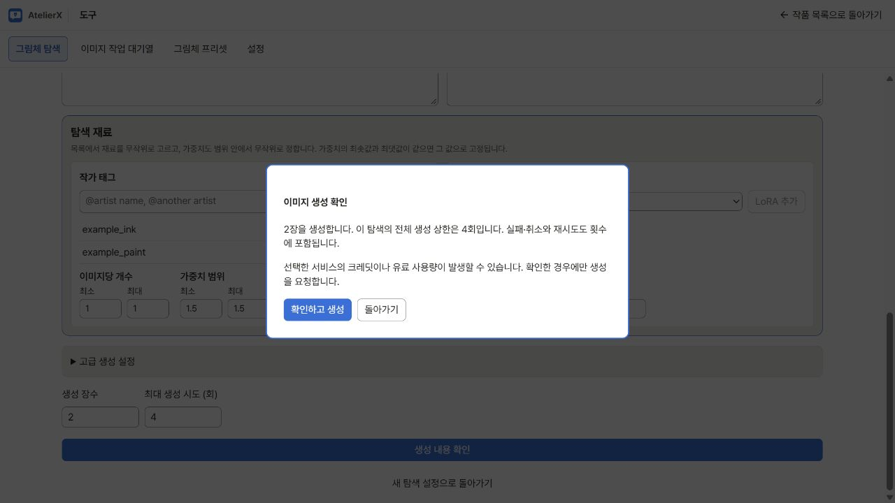
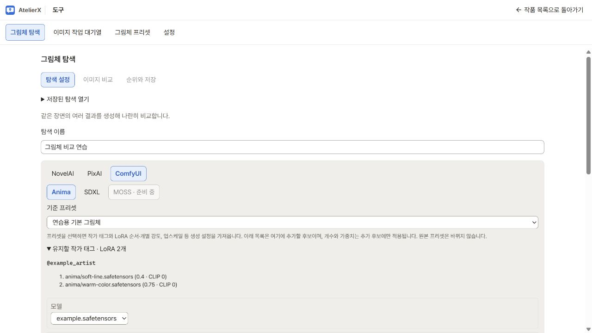
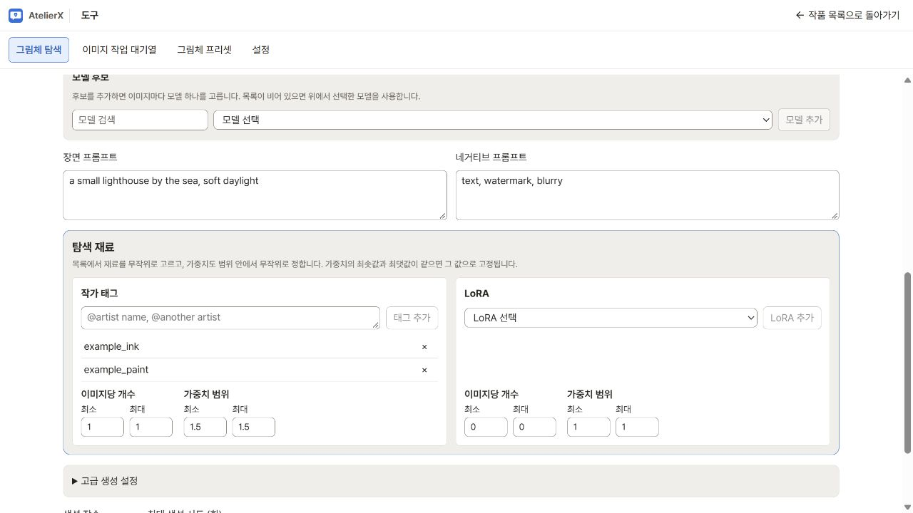
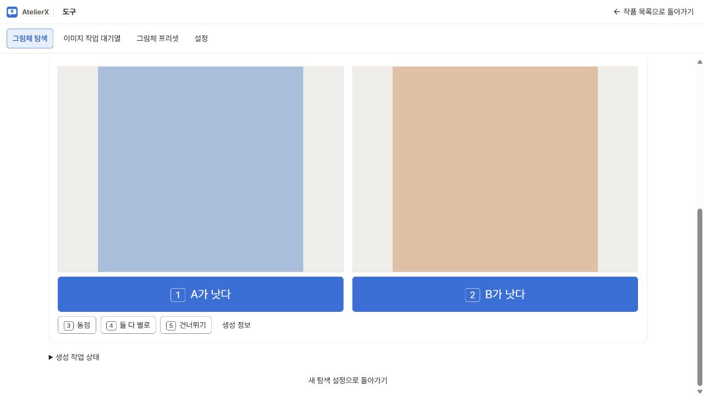
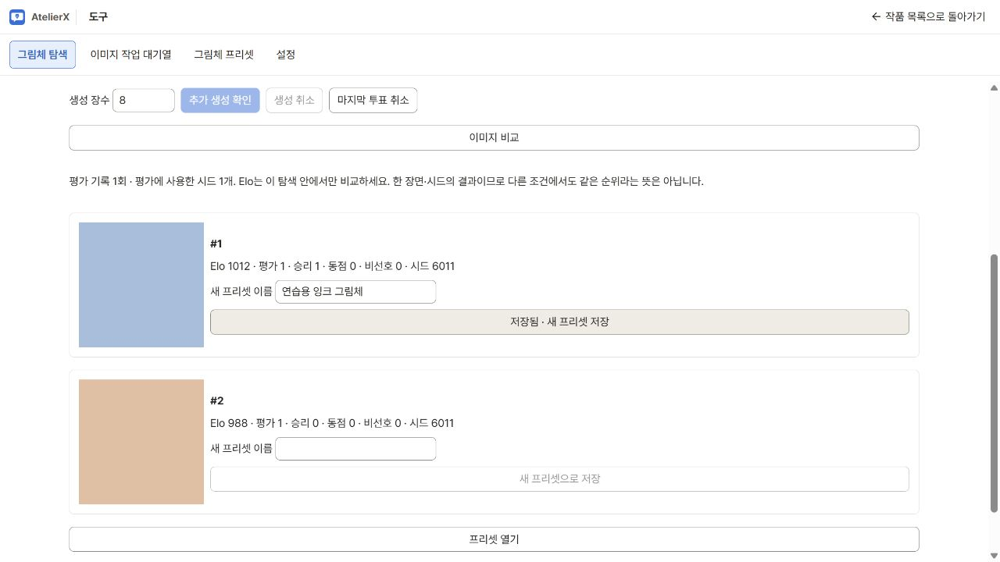

# 그림체 탐색

**개발본 기능.** 정식 0.5.1에는 그림체 탐색이 포함되지 않습니다. [검증 범위와 출시 상태](release-status.md)

상단 **도구 → 그림체 탐색**에서 작가 태그·LoRA·모델 조합을 만들고, 생성된 두 그림을 비교해 마음에 드는 그림체를 찾습니다. 작품 선택 화면에서도 바로 열 수 있는 전역 도구입니다. 작품을 편집하다 열어도 기존 작품 화면은 유지되며, 탐색에서 돌아가 이어서 편집할 수 있습니다. 다른 작품에서도 **저장된 탐색 열기**에서 앱에 저장된 탐색을 이어서 열 수 있습니다.

## 1. 조건을 정하고 생성하기

1. **탐색 이름**을 입력하고 NovelAI·PixAI·ComfyUI 중 하나를 고릅니다. ComfyUI에서는 **Anima** 또는 **SDXL**을 선택합니다. **MOSS**는 준비 중입니다.
2. 기존 그림체에 작가나 LoRA를 더해 보고 싶으면 **기준 프리셋**을 고릅니다. **유지할 작가 태그 · LoRA N개**에서 기준에 들어 있는 재료를 확인합니다.
3. 기본 모델을 확인합니다. ComfyUI와 PixAI에서는 **모델 후보**에서 모델을 검색해 추가할 수 있습니다. 목록을 채우면 이미지마다 그중 하나를 뽑고, 비워 두면 기본 모델을 사용합니다. ComfyUI 모델과 LoRA는 선택한 계열로 분류되어 있어야 합니다. [모델 관리](models.md)
4. **장면 프롬프트**와 **네거티브 프롬프트**에 비교에 공통으로 쓸 문구를 넣습니다. 예를 들어 `a small lighthouse by the sea, soft daylight`와 `text, watermark, blurry`를 입력합니다.
5. **작가 태그**에 비교할 작가 태그를 추가하고, **LoRA 목록**에서 사용할 LoRA를 선택해 추가합니다. 목록에서 빼려면 해당 항목의 삭제 버튼을 누릅니다. NovelAI에서는 artist 태그만 사용합니다.
6. 목록마다 **이미지당 개수**와 **가중치 범위**의 최소·최대를 정합니다. 크기·샘플러·시드는 **고급 생성 설정**에서 정합니다. 시드 `-1`은 탐색을 만들 때 한 번 무작위로 정하고 모든 후보가 공유합니다.
7. **생성 장수**(기본 8장, 한 번에 최대 16장)와 **최대 생성 시도 (회)**(기본 30회, 최대 200회)를 정합니다. **생성 내용 확인**을 눌러 수량을 확인하고 **확인하고 생성**을 누릅니다. 같은 조합은 한 번씩 생성합니다. 가능한 조합이 부족하면 조건을 넓히거나 장수를 줄입니다.

**확인하고 생성**을 눌렀을 때 요청이 제출됩니다. NovelAI·PixAI에서는 비용이나 크레딧이 발생할 수 있습니다. 최대 생성 시도에는 실패·취소·재시도도 포함됩니다.

만든 탐색의 장면·시드·재료 선택 규칙은 고정됩니다. 각 후보를 만들 때 그 규칙에 따라 재료와 랜덤 세기를 뽑고, 실제로 적용한 값도 저장합니다. 조건을 바꾸려면 새 탐색을 만드세요. 입력 중인 설정은 브라우저의 공용 초안으로 남으며, 서비스·모델 계열별 재료와 설정은 별도로 유지됩니다. 기존 작품별 초안은 공용 초안이 없을 때 해당 작품에서 처음 열면 가져오고 원본은 남깁니다. 완료한 탐색은 앱 폴더에 저장됩니다.

### 기준 프리셋에 작가·LoRA 추가하기

**기준 프리셋**에서 현재 서비스·계열의 프리셋을 선택하면 생성 설정을 복사합니다. 기본 작가 태그와
LoRA 목록의 순서·개별 모델 강도·CLIP 강도, 업스케일을 유지한 채 아래 목록의 후보만 추가합니다.
작가만 탐색하려면 추가 LoRA 목록을 비워 두세요. 기준 내용은 접힌 요약을 열어 확인할 수 있습니다.
기준 작가 태그는 입력된 문법을 유지합니다. 새 Anima 작가 후보를 입력하는 법은 아래에서 설명합니다.
장면과 비교 시드는 탐색 화면에서 별도로 정합니다. 프리셋을 선택하면 모델 후보 목록은 비워져 기준 모델을 쓰며,
다른 모델도 비교하려면 이후 모델 후보를 추가하세요. 생성 설정에서 직접 바꾼 값은 탐색에 반영됩니다.

목록의 개수·가중치 범위는 **추가 후보**에만 적용합니다. LoRA 한도는 기준과 추가분을 합쳐 ComfyUI 16개,
PixAI 5개이며, 기준에 있는 LoRA를 추가 목록에 중복해서 넣을 수 없습니다. 원본 프리셋을 나중에 수정하거나
삭제해도 이미 만든 탐색은 당시 복사한 설정을 유지합니다. 기준 선택을 해제하면 고정 작가와 LoRA가 빠지고
나머지 생성 설정은 유지됩니다. 기존 탐색은 이전 규칙대로 재개됩니다.

### 추가 목록과 랜덤 가중치

작가 태그 목록과 LoRA 목록마다 개수와 가중치 범위를 하나씩 지정합니다. 아래 가상 예시에서는 기준의 작가 태그·LoRA에 후보 작가 두 명 중 한 명을 가중치 1.5로 추가합니다. 추가 LoRA의 개수는 0입니다.

예를 들어 artist 태그 5개와 LoRA 3개를 추가한 뒤, 태그는 **1~2개·0.8~1.2**, LoRA는 **1개·0.6~1.0**으로 설정할 수 있습니다. 이미지마다 태그 1~2개와 LoRA 1개를 뽑고, 선택한 각 항목에 범위 내의 세기를 적용합니다. 가중치는 최솟값부터 기본 0.1 간격으로 뽑으며, 그 간격에 맞지 않는 최댓값도 후보에 포함합니다. 두 값을 같게 지정하면 항상 그 세기를 사용합니다. 목록의 모든 항목을 넣고 싶다면 개수의 최소·최대를 목록 길이와 같게 정합니다.

LoRA에 저장된 트리거 단어는 선택된 LoRA에만 적용합니다. ComfyUI에서는 생성 프롬프트에, PixAI에서는 해당 LoRA 요청에 전달합니다. 공통 장면 프롬프트에 직접 쓴 단어는 모든 후보에 남습니다. 서비스별 허용 범위와 효과는 다를 수 있습니다.

ComfyUI의 Anima에서는 새 탐색의 artist 태그를 `@작가명`으로 전달합니다. 이름의 밑줄은 공백으로 바꾸고, 이름에 포함된 괄호는 가중치 문법으로 해석되지 않게 처리합니다. 예를 들어 `homunculus (alchemynote)`는 `@homunculus \(alchemynote\)`로 전달합니다. 이름을 목록에 추가할 때 이 문법을 직접 입력할 필요는 없습니다.

모델 후보 목록도 서비스·ComfyUI 계열별로 유지됩니다. 생성 설정과 시드는 탐색 안에서 공유하므로, 서로 다른 스텝·CFG를 요구하는 모델은 별도 탐색으로 비교하세요. 예를 들어 Anima Turbo와 일반 Anima 모델에는 서로 다른 권장 설정이 있습니다. PixAI는 선택된 모델 유형에 필요한 설정을 표시하고 실제로 뽑힌 모델에 맞춰 요청합니다.

이전 초안에서는 제외한 항목을 빼고 나머지를 후보 목록으로 가져옵니다. 이전 개별 가중치를 포함하는 공통 범위를 표시하므로 생성 전에 목록 아래의 범위를 확인하세요. 기존 초안 원본은 남기고, 이미 저장된 탐색의 선택 규칙·이미지·설정·평가는 변경하지 않습니다.

## 2. 두 그림 비교하기

비교와 순위 화면은 가상 프리셋과 단색 시험 이미지로 캡처했습니다.

두 장 이상 완성되면 A/B 비교가 열립니다. 처음에는 모델·작가 태그·점수를 숨겨 그림 자체를 보고 고를 수 있습니다. **생성 정보**를 펼치면 실제 프롬프트와 설정을 확인할 수 있습니다.

| 선택 | 의미 |
|---|---|
| A / B | 더 마음에 드는 그림을 선택하고 두 후보의 Elo를 갱신 |
| 동점 | 같은 선호도로 평가하고 두 후보의 Elo를 갱신 |
| 둘 다 별로 | 두 후보에 비선호 횟수만 기록 |
| 건너뛰기 | 점수 변화 없이 다음 비교로 이동 |
| 마지막 투표 취소 | 마지막 평가를 취소하고 해당 두 그림을 다시 표시 |

비교 영역을 클릭하거나 `Tab`으로 이동한 뒤 숫자키 `1`(A가 낫다), `2`(B가 낫다), `3`(동점), `4`(둘 다 별로), `5`(건너뛰기)를 쓸 수 있습니다. 버튼에도 해당 숫자가 표시됩니다. 기존 `A` / `B`, `T`, `N`, `S`도 지원합니다. 평가 후에도 포커스가 유지되어 다음 두 그림을 이어서 평가할 수 있습니다.

입력 칸을 편집 중이거나 확인창이 열린 동안, 다른 탭을 보고 있을 때는 평가 단축키가 작동하지 않습니다. 키를 길게 눌러도 평가를 반복하지 않습니다.

아직 덜 비교한 후보를 우선 보여 주고, 그중 점수가 가까운 후보를 비교합니다. 같은 두 이미지의 조합은 반복 평가하지 않습니다. 생성 중에도 완성된 그림을 평가할 수 있습니다. 더 비교할 이미지가 필요하면 장수를 정하고 **추가 생성 확인**을 누릅니다.

실패·취소·중단한 후보는 **생성 작업 상태**의 **실패한 생성 재시도**로 같은 설정과 시드로 다시 요청할 수 있습니다. 재시도도 상한을 사용합니다. 앱을 다시 열어도 새로운 생성 요청을 자동으로 보내지 않습니다. PixAI에 이미 제출된 작업은 기존 작업의 결과만 이어서 받을 수 있습니다.

오류로 공용 대기열이 일시정지되면 안내의 **이미지 작업 대기열**에서 원인을 확인하고 재개하세요. 이미 평가한 이미지 파일이 사라진 경우에는 그 평가를 먼저 되돌리거나 새 탐색에서 다시 생성해야 합니다. 다른 이미지에 이전 평가가 이어지는 것을 방지하기 위한 규칙입니다.

## 3. 순위 확인과 프리셋 저장

**순위와 저장**에서 Elo, 평가 수, 승리·동점·비선호 횟수를 함께 확인합니다. Elo는 해당 탐색의 한 장면과 시드에서 평가한 상대적 선호도입니다.

마음에 드는 후보의 **새 프리셋 이름**을 입력하고 **새 프리셋으로 저장**을 누릅니다. 프리셋에는 실제 서비스·모델·LoRA·생성 설정과 기준·추가분을 합친 작가 태그가 들어갑니다. 장면 프롬프트와 시드는 각 생성 화면에서 정합니다. **프리셋 열기**를 누르고 해당 프리셋에서 **단일 이미지 생성에 적용** 또는 **캐릭터 일괄 생성에 적용**을 고릅니다. 적용할 작품을 먼저 열고, 생성 화면에서 프롬프트와 설정을 확인한 뒤 실행합니다. [그림체 프리셋](style-presets.md)
