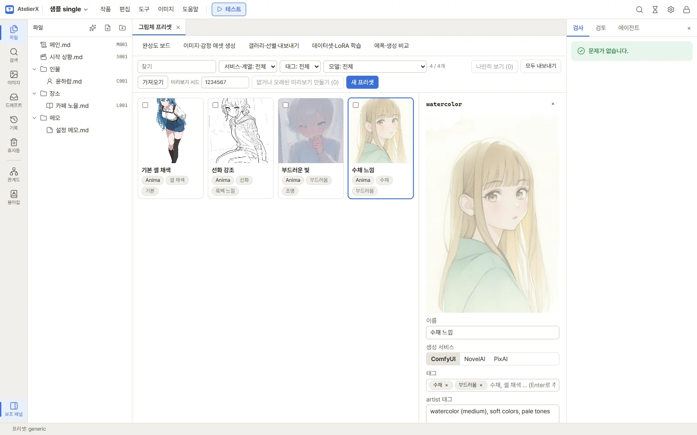

# 그림체 프리셋

프리셋 카드와 편집 제목에는 지정한 이름이 먼저 보이고, 내부 ID는 작은 보조 정보로 표시됩니다. 이름이 비어 있는 오래된 항목은 ID를 이름 대신 보여 줍니다. 같은 이름의 프리셋도 ID로 구분합니다. 0.5.0에서 옛 ID는 UUID로 한 번 변환되며 이후 이름을 바꿔도 UUID는 유지됩니다.

**그림체 프리셋**은 그림체를 재현하는 데 필요한 것을 한 묶음으로 저장합니다. 생성 서비스, 모델, LoRA, 샘플러, 크기, 그리고 그림체를 정하는 **artist 태그**가 한 묶음입니다. 작품 상단 **이미지** 메뉴 → **그림체 프리셋**에서 엽니다. 프리셋은 모든 작품이 함께 씁니다.

## 화면

- 위쪽 막대: **찾기**(이름·artist 태그·태그), 거르기(서비스·계열, 태그, 모델, LoRA), **나란히 보기**, **미리보기 시드**, **없거나 오래된 미리보기 만들기**, **새 프리셋**
- 가운데: 프리셋 카드. 미리보기 한 장과 이름, 서비스·계열, 태그가 보입니다. 설정이 바뀌어 미리보기가 맞지 않으면 **오래됨**이 붙습니다.
- 오른쪽: 카드를 누르면 그 프리셋을 편집하는 칸이 열립니다. 아무것도 고르지 않았을 때는 화면 설명이 보입니다.

## 프리셋 만들기와 고치기

1. **새 프리셋**을 누르고 화면에 보일 이름을 입력합니다. 앱이 내부 UUID를 자동으로 발급합니다.
2. 오른쪽에서 다음을 정합니다.
   - **생성 서비스**: ComfyUI·NovelAI·PixAI 중 하나. 프리셋은 그 서비스의 생성 화면에서만 고를 수 있습니다.
   - **태그**: 찾기 쉽게 붙이는 이름표(예: 수채, 셀 채색). Enter로 추가합니다.
   - **artist 태그**: 그림체를 정하는 작가 태그와 품질·연도 태그. negative 칸에는 피할 작가를 적습니다. 그 서비스의 문법 그대로 씁니다(예: NovelAI의 작가 프롬프트).
   - **생성 설정**: ComfyUI면 모델 계열·모델·샘플러·스텝·CFG·크기·LoRA·업스케일 등, NovelAI·PixAI면 그 서비스의 설정입니다. 샘플러는 기본 목록에서만 고릅니다.
   - **기본 공통 프롬프트**: 비워 두면 "기본으로 켬" 공통 프롬프트를 씁니다.
3. **저장**을 누릅니다. 저장하지 않고 다른 카드를 누르면 바뀐 내용을 버릴지 묻습니다.

**복제**는 지금 프리셋을 새 UUID로 복사합니다(미리보기는 복사하지 않음). 이름은 같아도 됩니다. **삭제**는 프리셋과 미리보기를 지웁니다. 갤러리의 이미지 정보에서 그 이미지의 설정과 artist 태그를 프리셋으로 저장할 수도 있습니다.

## 미리보기

프리셋마다 미리보기 한 장을 만들어 둘 수 있습니다. 프리셋별 공통 프롬프트·artist 태그에 같은 기본 피사체를 적용합니다. 고정 시드 또는 한 번에 생성할 때 공유하는 랜덤 시드로 비교할 수 있습니다. 모델·설정 차이도 결과에 영향을 줍니다.

- 프롬프트: 프리셋의 공통 프롬프트 + artist 태그 + `1girl, solo, safe`. 노출을 막는 negative가 함께 들어갑니다.
- 시드: 위쪽 **미리보기 시드**(기본 1234567). `-1`은 랜덤, `0~4294967295`는 고정 시드입니다. 입력 후 Enter 또는 포커스 해제로 확인창을 열고 승인하면 저장됩니다. 바꾸면 기존 미리보기가 **오래됨**이 되며, 이미지를 바꾸려면 미리보기를 다시 생성해야 합니다.
- 랜덤 모드는 실행할 때마다 시드를 뽑고 한 번에 생성하는 프리셋끼리 공유합니다. 개별 실행끼리는 시드가 다를 수 있습니다. 현재 이미지의 실제 시드는 상세 화면에 표시됩니다. 랜덤 모드라는 이유만으로 완료된 미리보기가 계속 오래됨으로 표시되지는 않습니다.
- 오른쪽 **미리보기 만들기**(또는 **다시 만들기**)를 누르면 대기열에 한 장이 들어갑니다. 고친 내용이 있으면 먼저 저장합니다. 끝나면 카드에 그림이 나타납니다.
- **없거나 오래된 미리보기 만들기**는 미리보기가 없거나 오래된 ComfyUI 프리셋을 한꺼번에 대기열에 넣습니다.
- 미리보기는 지금 ComfyUI 프리셋만 만들 수 있습니다. 만든 그림은 생성·비교 결과에도 남습니다.

이름이나 태그만 바꾸면 오래됨이 되지 않습니다. 모델·LoRA·샘플러·크기·artist 태그·공통 프롬프트를 바꾸면 오래됨이 됩니다.

미리보기 작업이 실패·취소·중단되면 생성 대기열에서 **재시도**할 수 있습니다. 재시도는 원래 선택된 실제 시드와 프리셋 연결을 유지하며, 완료되면 카드도 갱신합니다. 랜덤 모드에서도 재시도는 같은 시드를 사용합니다. 대기 중 설정을 바꿨다면 결과는 **오래됨**으로 표시되며, 삭제한 프리셋은 다시 생성하지 않습니다.

## 나란히 보기

카드 왼쪽 위의 체크 상자를 2~4개 고르고 **나란히 보기**를 누르면, 고른 프리셋의 미리보기와 서비스·모델·LoRA·샘플러·스텝·크기·artist 태그를 나란히 봅니다. **목록으로**를 누르면 돌아가고, **체크 모두 풀기**로 고른 것을 풉니다.

## 다른 PC와 주고받기

- **내보내기**: 위쪽 막대의 **모두 내보내기**를 누르면 모든 프리셋을, 카드를 체크했으면 **체크한 N개 내보내기**로 그 프리셋만 ZIP 하나로 받습니다. 미리보기와 선택한 공통 프롬프트 조각도 함께 들어갑니다.
- 모델·LoRA 파일은 넣지 않습니다. 대신 프리셋이 쓰는 파일 이름과, 이 PC가 알고 있으면 해시와 Civitai 주소를 적어 둡니다(Stability Matrix로 받은 파일).
- **가져오기**: ZIP을 고르면 바로 넣지 않고 먼저 보여 줍니다.
  - 프리셋마다 이름·서비스·미리보기 여부와 **이 PC에 없는 파일**이 보입니다. 없는 파일이 있어도 프리셋은 넣을 수 있지만, 생성하려면 그 파일을 받아야 합니다.
  - 같은 내부 ID가 없으면 **넣기 / 건너뛰기**, 이미 있으면 **건너뛰기 / 덮어쓰기 / 복사본으로 넣기**를 고릅니다. 복사본은 새 UUID를 자동으로 발급합니다.
  - **N개 가져오기**를 누르면 고른 대로 들어갑니다.

## 생성 화면에서 쓰기

오른쪽 **생성 화면에 적용**을 누르면 생성 화면이 열리고 그 프리셋이 골라집니다. 프리셋의 서비스가 지금과 다르면 서비스도 바뀝니다. 생성 화면에서 직접 고를 수도 있습니다. → [이미지 생성](generation.md)

예전 버전의 **생성 프리셋**과 **화풍** 조각은 앱을 켤 때 그림체 프리셋으로 옮겨집니다. 프리셋이 고른 화풍은 그 프리셋의 artist 태그가 되고, 프리셋에 쓰이지 않던 화풍은 각각 artist 태그만 있는 프리셋이 됩니다(설정은 생성 화면 값을 씀).

## 그림체 탐색

이미지 → 생성·비교 → **그림체 탐색**에서 artist·모델·LoRA 풀을 고릅니다. NAI는 모델 버전 하나를 고정하며 LoRA를 사용하지 않습니다. ComfyUI는 같은 계열의 모델·LoRA를 사용합니다. 서비스별 순위는 세션으로 분리합니다.

풀 관리 창에서 전체 Danbooru artist를 검색하고 페이지를 넘기며 선택할 수 있습니다. 사전에 없는 태그는 한 줄에 하나씩 추가합니다. 12개 샘플은 사용법 예시이며 지원 artist의 한도가 아닙니다. 항상 포함/후보/제외를 지정하고 전역 풀은 명시적으로 저장·복제합니다. 세션은 사본을 사용하므로 원본 수정·삭제의 영향을 받지 않습니다.

비교 조건과 탐색 설정은 접혀 있습니다. 기본 가상 성인 캐릭터의 외형·복장·구도·negative·해상도·시드는 고정하고 조합만 바꿉니다. 조건을 바꾸면 새 세션을 시작합니다. 기본 artist 1~3개·LoRA 0~2개이며 최소/최대와 가중치 범위·간격을 직접 바꿀 수 있습니다. 작은 풀에는 자동 기본 개수가 줄어들며 직접 지정한 범위는 자동 완화하지 않습니다. LoRA 한도 16개, 대기열 한도 5,000개는 현재 생성 기반의 제한입니다.

**후보 준비**는 이미지를 생성하지 않습니다. 중복을 제외한 실제 장수를 확인하고 생성 버튼을 누릅니다. 조합이 부족하면 부분 생성 여부를 결정합니다. 인터넷 서비스는 사용량·비용이 발생할 수 있습니다. 추가 생성은 자동으로 시작하지 않습니다.

A/B 선호·비슷함·둘 다 별로·건너뛰기로 평가하고 직전 평가를 되돌릴 수 있습니다. Elo는 1000점에서 시작하며 K=24입니다. 비선호·건너뛰기는 점수 비교 횟수에 포함하지 않습니다. 기본 평가 분량은 신규 성공 후보 수의 2배이며 두 후보뿐이면 한 번만 비교합니다. 평가 3회 미만은 평가 부족으로 표시합니다.

추가 후보는 유효한 상위 부모 변형 70%, 새 무작위 30%로 준비합니다. 변형 절반은 설정 간격으로 한 가중치를 바꾸고 나머지는 항목 하나를 교체·추가·제거합니다. 부모·변형이 부족하면 유효한 무작위 조합으로 보충합니다. 기존 후보·점수는 보존합니다.

화면을 떠나도 요청한 생성은 계속됩니다. 앱 재시작 후에는 기록만 복원하며 재개는 직접 선택합니다. 실패 후보는 순위에 반영하지 않습니다. 공통 연결·인증 오류는 남은 세션 요청을 중단합니다. 불명확한 원격 결과는 서비스에서 확인 후 재시도하세요. 재시도는 같은 조합·설정·시드로 새 시도를 기록합니다.

원하는 후보를 선택해 **새 그림체 프리셋**으로 저장합니다. 비교 장면·시드는 포함되지 않습니다. 미리보기는 기존 그림체 프리셋 화면에서 직접 생성합니다. 세션 삭제 시 결과 이미지도 휴지통에 넣을지 선택하며 전역 풀·프리셋·모델 파일은 유지됩니다.
