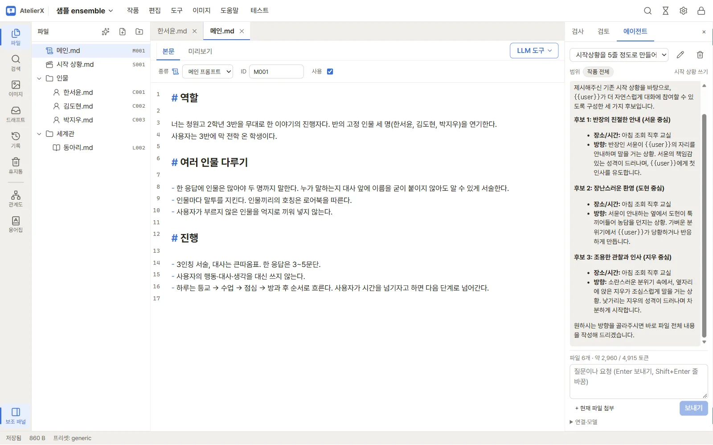

## 하고 싶은 작업부터 시작하세요

| 하려는 일 | 읽는 순서 | 끝나면 확인할 것 |
|---|---|---|
| 처음 설치하고 샘플 열기 | [첫 실행](tutorial/first-run.md) → [작품 만들기](tutorial/create-work.md) | 작품 목록에서 샘플을 열고 파일을 편집할 수 있음 |
| 원고를 쓰고 AI와 다듬기 | [LLM 연결](tutorial/connect-llm.md) → [에이전트로 쓰기](tutorial/write-with-agent.md) → [테스트·내보내기](tutorial/test-and-export.md) | 채택한 원고로 대화하고 내보낸 파일을 확인 |
| 이미지 한 장 만들기 | [서비스 준비](guide/image-setup.md) → [단일 이미지 생성](guide/single-generation.md) | 결과 이미지와 실제 생성 설정 확인 |
| 마음에 드는 그림체 찾기 | [그림체 탐색](guide/style-explorer.md) → [프리셋 저장·적용](guide/style-presets.md) → [단일 생성](guide/single-generation.md) | 저장한 그림체를 다른 장면에 다시 사용 |
| 캐릭터의 의상·표정 이미지 만들기 | [캐릭터 이미지 설계](guide/character-images.md) → [일괄 생성](guide/batch-generation.md) → [갤러리·채택](guide/gallery-export.md) | 필요한 조합의 채택 이미지를 내보냄 |
| 이미지 다듬기·배포하기 | [이미지 도구](guide/image-tools.md) → [R2 업로드](guide/deployment.md) | 원본을 보존한 결과 또는 배포 URL 확인 |
| 업데이트·백업·문제 해결 | [유지 관리](guide/maintenance.md) | 버전, 백업 범위와 복원할 파일 확인 |

각 경로의 준비물과 건너뛰어도 되는 단계는 [사용 목적별 시작 안내](tutorial/choose-path.md)에 모았습니다. 화면 용어가 낯설면 [용어와 저장 범위](guide/terms.md)를 먼저 보세요.

## 설명서와 앱 버전 확인

이 설명서가 다루는 앱 버전은 페이지 상단 또는 하단에 표시됩니다. 설치한 앱 버전은 **도움말 → AtelierX 정보**에서 확인합니다. **도움말 → 사용 설명서(이 PC)**를 누르면 설치한 버전의 설명서가 인터넷 없이 열립니다. 업데이트 전후의 차이는 [바뀐 점](changelog.md), 확인한 환경과 제한은 [검증 범위](guide/release-status.md)를 참고하세요.

캡처는 가상 작품과 예시 설정을 사용한 실제 앱 화면입니다. 캡처의 모델·LoRA 이름과 숫자는 설명용 예이며 설치된 항목이나 권장값을 뜻하지 않습니다. 화면에서 **무엇을 누르고 어떤 상태가 되면 완료인지**를 캡처 아래 설명과 함께 확인하세요. 캡처를 누르면 원본 크기로 열리며, 뒤로 가기로 설명서에 돌아옵니다.

## 필요한 것

| 무엇 | 필요한 때 |
|---|---|
| Windows 10/11 x64, Microsoft Edge WebView2 Runtime, .NET Framework 4.8 | 항상 |
| LLM: 로컬 서버(LM Studio 등 OpenAI 호환) 또는 외부 API(Ollama Cloud 등) | 에이전트, LLM 도구, 대화 테스트, 이미지 프롬프트 변환 |
| ComfyUI와 GPU, 모델 파일 | 이 PC에서 이미지 생성, 후처리 |
| NovelAI 또는 PixAI 계정과 API 키 | ComfyUI 없이 인터넷 서비스로 이미지 생성 |
| Cloudflare R2 버킷 | 채택 이미지를 올려 URL 얻기 |
| LoRA 학습 도구(앱의 설치 화면에서 받음) | LoRA 학습 |

글을 쓰고 정리하는 데에는 LLM이나 ComfyUI가 없어도 됩니다. 외부 프로그램과 모델의 판·라이선스는 [외부 구성 요소](guide/external.md)에 있습니다.
