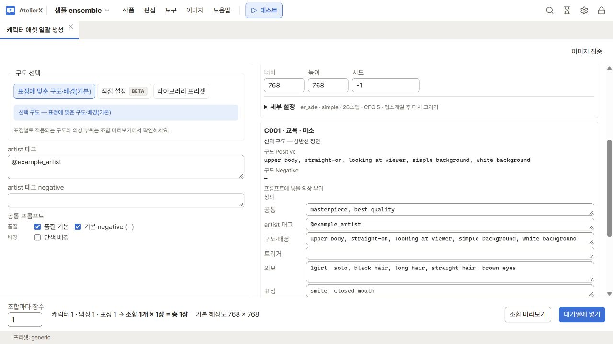
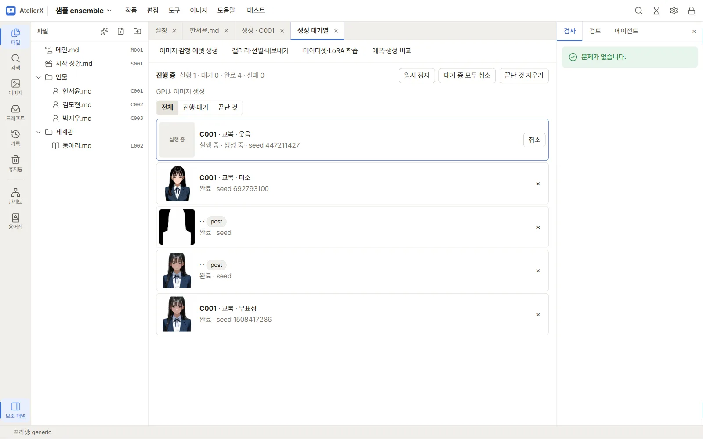
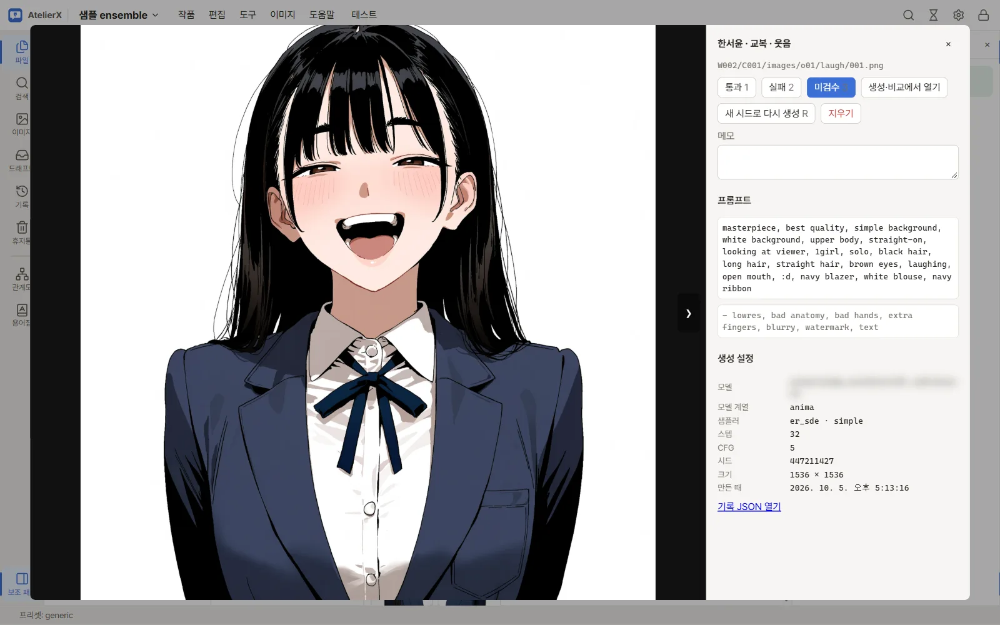

# 6. 캐릭터 이미지 만들기

샘플 **한서윤**(`C001`)의 교복과 표정을 조합해 두 장을 만듭니다. [이미지 환경 준비](image-setup.md)에서 생성 서비스를 준비합니다. 샘플에는 교복 이미지 설계가 들어 있으므로 그 태그로 바로 생성할 수 있습니다. 본문에서 태그를 다시 만드는 과정을 따라 하려면 [LLM 연결](connect-llm.md)에서 **이미지 프롬프트** 작업을 준비하세요.

## 이미지 설계 확인·편집하기

1. `인물/한서윤.md`의 **이미지 프롬프트** 탭을 엽니다. 외모와 교복 태그를 바로 고칠 수 있습니다.
2. **의상 추가**와 **부위 추가**로 새 의상을 만들 수 있습니다. 변경한 뒤 **저장**을 누릅니다. LLM 연결 없이도 입력과 저장이 가능합니다.
3. 트리거는 **추가 정보**, 의상 전체의 제외 태그는 **의상 제외 태그**를 펼쳐 확인합니다.

## LLM으로 본문을 변환하기 (선택)

1. `인물/한서윤.md`의 ID가 `C001`인지 확인하고 **이미지 프롬프트** 탭을 엽니다.
2. **LLM 보조**를 펼칩니다. **이번 실행 설정**에서 연결과 모델을 확인하고 **본문 전체 변환**을 누릅니다. 이미지 설계를 수정했다면 먼저 저장하거나 되돌립니다.
3. 완료 알림의 **열기** 또는 보조 패널의 **검토**에서 외모와 의상별 태그를 원문과 비교합니다. 기존 설계가 있으면 **변환 결과 적용**에서 바꿀 항목을 고릅니다. **적용**을 누릅니다.
4. **이미지 프롬프트** 탭에서 외모 태그와 **교복** 의상을 확인합니다. **추가 정보**에 있는 **트리거**는 LoRA에 쓰는 캐릭터 식별 태그입니다.

교복이 없다면 본문에서 교복 묘사를 선택한 뒤 우클릭하고 **이미지 프롬프트로 → 의상 → 새 의상…**으로 추가할 수 있습니다. [캐릭터 이미지 설계](../guide/character-images.md)

## 조합 두 장 생성하기

1. **이미지·감정 애셋 생성**을 누릅니다. 작품 창의 **이미지 → 캐릭터 애셋 일괄 생성**으로도 같은 화면을 엽니다.
2. 위쪽 표에서 **한서윤**과 **교복**을 고르고 왼쪽에서 표정 두 개(예를 들어 미소와 웃음)를 고릅니다. 필요하면 구도와 공통 프롬프트를 더합니다.
3. 오른쪽에서 **생성 서비스**와 쓸 **그림체 프리셋** 또는 생성 설정을 확인합니다. 이 PC의 ComfyUI라면 모델 계열과 모델도 확인합니다.
4. **조합마다 장수**를 1로 두고 **조합 미리보기**를 누릅니다. 조합별 프롬프트와 총 2장인지 확인합니다. [캐릭터 애셋 일괄 생성](../guide/batch-generation.md)

그림은 미소만 선택했을 때의 예시입니다. 미소와 웃음을 함께 고르면 미리보기에 두 조합이 나옵니다.

5. **대기열에 넣기**를 누릅니다. **이미지 → 이미지 작업 대기열**에서 해당 요청이 **완료**될 때까지 진행 상태를 확인합니다. 실패하면 작업의 오류 내용을 열어 서비스 연결과 모델을 확인합니다. [이미지 생성](../guide/generation.md)

## 결과 검수하기

1. **이미지 → 갤러리·검수**를 열고 작품, 한서윤, 교복으로 결과를 좁힙니다.
2. 이미지를 눌러 크게 보고 **통과**(`1`), **실패**(`2`), **미검수**(`3`)로 표시합니다. 상세 화면에서 생성 설정을 확인하고 `R`로 새 시드로 다시 생성할 수도 있습니다.
3. 통과시킨 이미지에 **채택**(★) 표시가 있는지 확인합니다. 캐릭터·의상·표정 조합마다 한 장이 채택되며, 같은 조합의 다른 이미지를 통과시키면 채택이 바뀝니다. AI 판정이 있다면 참고해 사람이 **통과**를 결정합니다. [갤러리와 내보내기](../guide/gallery-export.md)

## 다음

ComfyUI에서 한 장을 다듬으려면 [7. 후처리](post-processing.md)로, 원고를 이어서 고치려면 [8. LLM으로 다듬기](refine-with-llm.md)로 갑니다.
