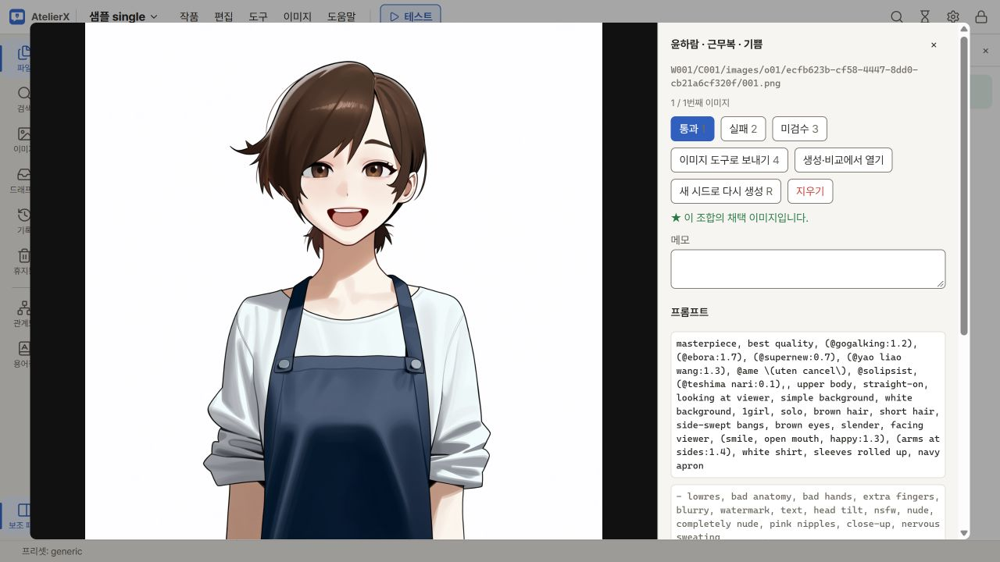
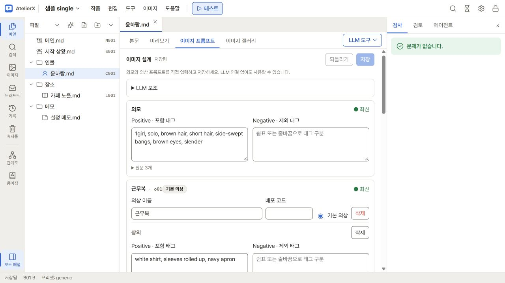
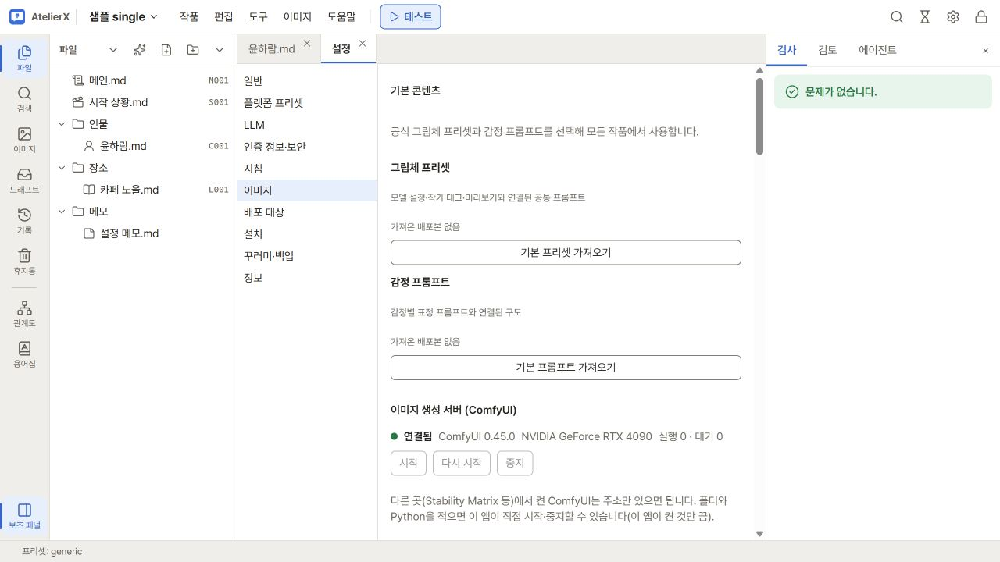
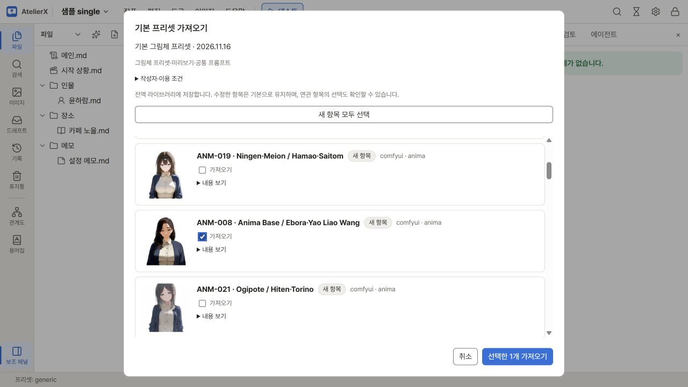
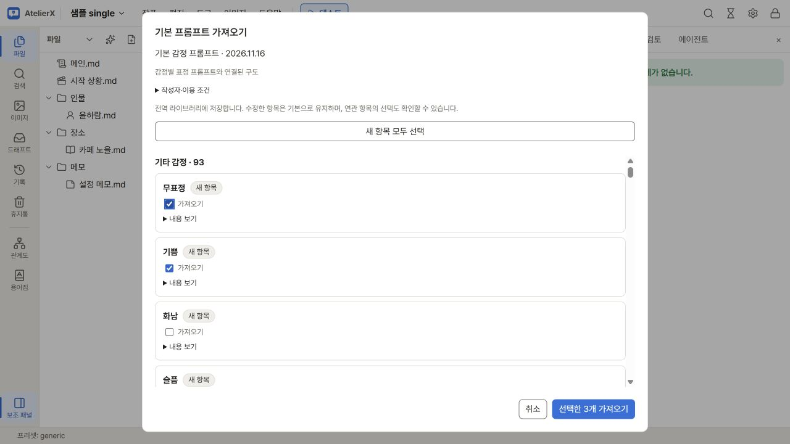
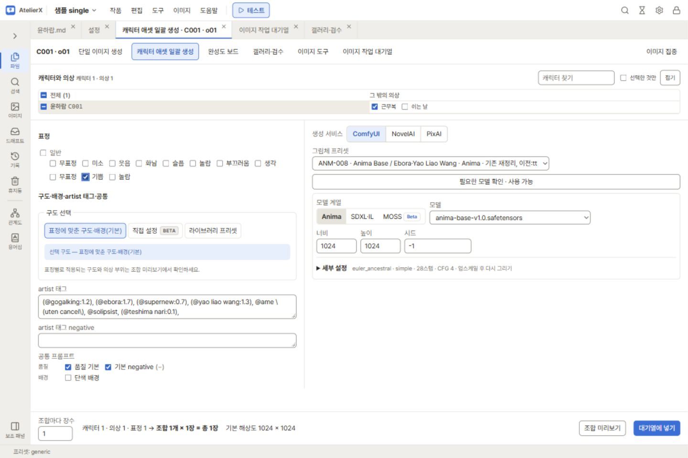
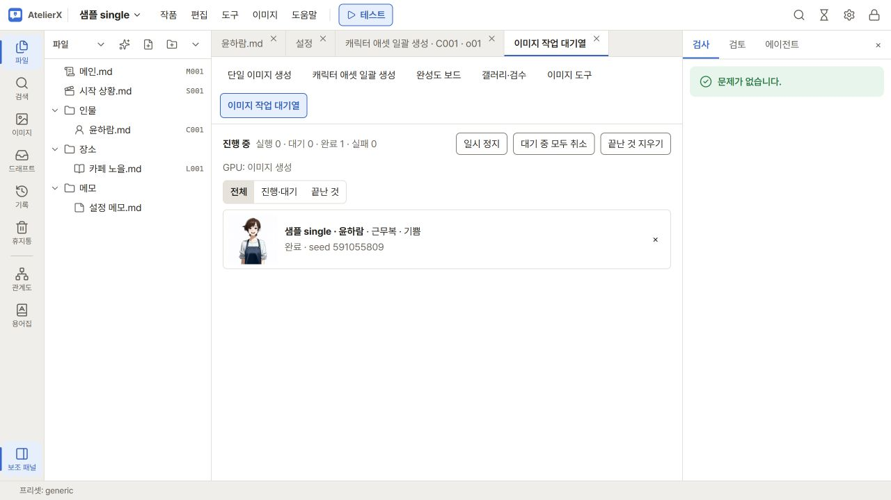
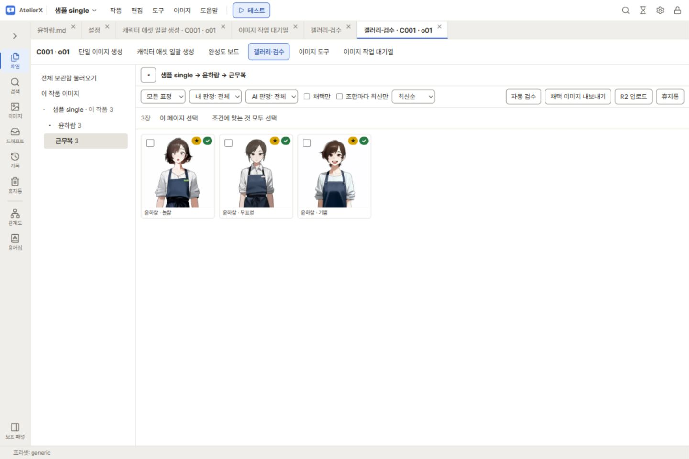
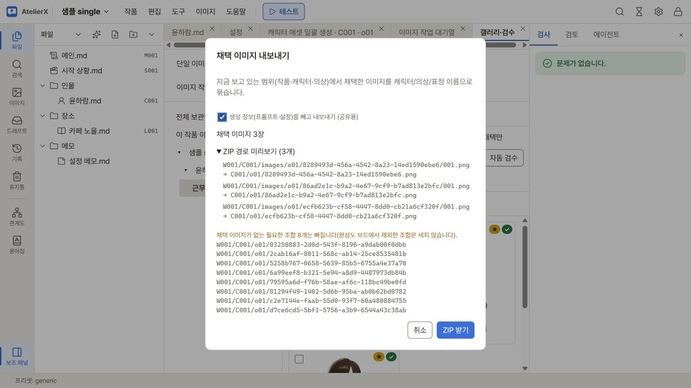

# ComfyUI로 샘플 캐릭터 이미지 만들기

샘플 작품의 **윤하람·근무복**과 기본 그림체·감정 프롬프트를 골라 이미지를 만듭니다. 프롬프트를 직접 쓰거나 LLM을 연결할 필요는 없습니다. **기쁨 1장 → 무표정·놀람 2장 → 검수·채택 → ZIP 받기** 순서로 진행합니다.

갈색 단발, 흰 상의와 남색 앞치마를 입은 인물이 만들어지면 첫 단계가 끝난 것입니다. 시드는 무작위이므로 예시와 똑같은 그림이 나올 필요는 없습니다.

## 준비할 것

| 항목 | 이 실습에서 사용하는 것 |
|---|---|
| AtelierX | 0.8.4 화면 절차 기준. [첫 실행](first-run.md)을 마칩니다. |
| 샘플 | **샘플 → single 1:1**의 윤하람, 근무복 |
| 기본 그림체 | **ANM-008 · Anima Base / Ebora·Yao Liao Wang** |
| 기본 감정 프롬프트 | **기쁨·무표정·놀람** 3개와 함께 가져오는 **상반신 정면** 구도 |
| 생성 환경 | 이 PC에서 실행 중인 ComfyUI와 아래 모델 4개. 별도 LoRA는 사용하지 않습니다. |
| 인터넷 | 기본 콘텐츠와 없는 모델을 받을 때 필요합니다. |

이 실습은 **새 앱 폴더**와 SFW 표정을 기준으로 합니다. 화면 절차는 0.8.4에 맞췄고, 캡처와 실제 생성 결과는 0.8.1 배포판에서 확인한 것입니다. 기존 라이브러리가 있다면 같은 이름의 항목과 사용자 수정본을 확인하세요.

ComfyUI가 없다면 [공식 Windows 설치 안내](https://docs.comfy.org/installation/desktop/overview#install-comfy-desktop-for-your-os)에서 이 PC에 설치하는 로컬 버전을 선택해 실행합니다. 이미 Stability Matrix 등으로 실행 중이라면 그 설치를 사용해도 됩니다. AtelierX 배포판에는 ComfyUI와 모델 파일이 포함되지 않습니다.

## 1. 샘플 작품 열기

1. 시작 화면에서 **작품으로 시작**을 누르고, 작품 목록에서 **샘플**을 누릅니다.
2. **single 1:1** 옆의 **설치**를 누릅니다. **샘플 single**이라는 새 작품이 열립니다.
3. 왼쪽 파일 트리의 **인물 → 윤하람.md**를 열고 **이미지 프롬프트** 탭을 누릅니다.
4. 외모 태그와 **근무복**, **쉬는 날** 의상이 있는지 확인합니다. 이번에는 내용을 고치지 않습니다.

**완료 확인:** `이미지 설계 저장됨`이 보이고, 외모에 갈색 머리·눈 태그가, 근무복 상의에 흰 셔츠·남색 앞치마 태그가 있습니다. **LLM 보조**를 실행하지 않아도 됩니다.

## 2. ComfyUI 연결하기

1. 작품 창 오른쪽 위 **설정**을 열고 **이미지**를 선택합니다.
2. **이미지 생성 서버 (ComfyUI)** 항목의 **주소**를 실행 중인 서버 주소로 맞춥니다. 기본 예시는 `http://127.0.0.1:8188`이며, 설치 방식에 따라 포트가 다를 수 있습니다.
3. 주소를 바꿨다면 **저장**을 누릅니다. 설치 후보가 표시되면 사용할 설치인지 확인하고 **이 설치 사용·저장**을 누릅니다. 후보가 없으면 **자동으로 찾기** 또는 **ComfyUI 폴더 (선택)** 항목을 사용합니다.
4. **연결됨**, ComfyUI 버전·GPU 이름, **실행 0 · 대기 0**을 확인합니다. 다른 작업이 있다면 끝난 뒤 실습합니다.

주소는 실행 중인 서버와 통신할 때, 폴더는 이 PC의 모델 확인·설치 때 사용합니다. 공유 모델 폴더를 쓰는 경우 **모델과 계열**도 확인합니다. 자세한 설정은 [이미지 환경 준비](../guide/image-setup.md)에 있습니다.

## 3. 기본 그림체 가져오기

1. 같은 설정 화면 위쪽 **기본 콘텐츠 → 기본 프리셋 가져오기**를 누릅니다.
2. 배포본을 불러오면 **ANM-008 · Anima Base / Ebora·Yao Liao Wang**을 찾습니다. 새 항목은 처음에 모두 선택되어 있으므로, 이 실습에서는 다른 프리셋의 **가져오기** 체크를 해제합니다.
3. **선택한 1개 가져오기**를 누릅니다.
4. **1개 가져오기 완료**를 확인하고 **다시 확인**으로 필요한 모델을 검사합니다.

이미 가져온 항목은 건너뜁니다. **내가 수정함**이 표시되면 **기존 내용 유지**가 기본입니다. 실습을 위해 자신의 수정본을 덮어쓰지 마세요. 가져오기 정책은 [이미지 환경 준비](../guide/image-setup.md)를 참고합니다.

## 4. 모델 네 개 준비하고 연결하기

이 프리셋에는 기본 생성과 업스케일 설정이 함께 들어 있습니다. 아래 네 파일을 사용합니다.

| 파일 | 일반적인 ComfyUI 저장 위치 | 공식 배포처 |
|---|---|---|
| `anima-base-v1.0.safetensors` | `models/diffusion_models/` | [Anima 기본 모델](https://huggingface.co/circlestone-labs/Anima/tree/main/split_files/diffusion_models) |
| `qwen_3_06b_base.safetensors` | `models/text_encoders/` | [Anima 텍스트 인코더](https://huggingface.co/circlestone-labs/Anima/tree/main/split_files/text_encoders) |
| `qwen_image_vae.safetensors` | `models/vae/` | [Anima VAE](https://huggingface.co/circlestone-labs/Anima/tree/main/split_files/vae) |
| `2x-AnimeSharpV4_Fast_RCAN_PU.safetensors` | `models/upscale_models/` | [2x-AnimeSharpV4](https://huggingface.co/Kim2091/2x-AnimeSharpV4/tree/main) |

공유 모델 폴더를 쓰면 실제 경로가 다를 수 있습니다. 네 파일은 합계 약 **5.7 GB**이며, 설치·생성에 쓸 추가 여유 공간도 필요합니다. 모델의 이용 조건은 각 공식 배포처와 [외부 구성 요소](../guide/external.md)에서 확인하세요.

### 파일이 없는 경우

1. 모델 확인 창의 상태를 읽습니다. 다운로드 가능한 파일은 체크한 뒤 **선택한 모델 다운로드**로 받을 수 있습니다.
2. **파일 연결 필요**로 표시되어 다운로드를 선택할 수 없다면 위 공식 배포처에서 **표에 적힌 정확한 파일**을 받아 해당 모델 폴더에 넣습니다. `ANM-008`의 2026.11.16 배포본은 이 경우에 해당하며, 이 창에서 네 파일을 자동으로 받지는 못합니다.
3. ComfyUI가 새 파일을 인식하도록 모델 목록을 새로 고칩니다. 계속 보이지 않으면 진행 중인 작업이 없는지 확인한 뒤 ComfyUI를 다시 시작합니다.
4. AtelierX의 **필요한 모델 확인 → 다시 확인**으로 돌아옵니다.

### 파일이 이미 있는 경우 또는 방금 받은 경우

1. **파일 연결 필요**인 항목의 **로컬 파일 연결**을 펼칩니다. 파일이 있어도 배포본에 해시·출처 정보가 없으면 이 상태가 표시될 수 있습니다.
2. **파일 선택…** 목록에서 그 행과 정확히 같은 파일을 고릅니다. 다른 모델로 임의 대체하지 않습니다.
3. 아래 **로컬 파일 연결** 버튼을 누르고 검사가 끝날 때까지 기다립니다. 큰 모델은 시간이 걸릴 수 있습니다.
4. 필요한 항목마다 반복하여, 네 파일과 프리셋 전체가 **사용 가능**인지 확인합니다.
5. 하단 닫기 버튼으로 창을 닫습니다. 가져오기 직후에는 **완료·나중에 확인**, 모델 확인 창을 다시 열었다면 **닫기·나중에 확인**으로 표시됩니다.

**완료 확인:** 프리셋의 **필요한 모델 확인 · 사용 가능**이 표시됩니다. 가져오기 완료와 모델 준비 완료는 서로 다른 단계입니다.

## 5. 기본 감정 프롬프트 가져오기

1. **설정 → 이미지 → 기본 콘텐츠 → 기본 프롬프트 가져오기**를 누릅니다.
2. **무표정·기쁨·놀람**만 선택하고 다른 항목의 **가져오기** 체크를 해제합니다. 목록이 길므로 끝까지 선택 상태를 확인합니다.
3. 함께 가져오는 **상반신 정면** 구도를 확인하고 **선택한 3개 가져오기**를 누릅니다.
4. **3개 가져오기 완료**를 확인하고 **완료·나중에 확인**으로 닫습니다.

새 앱에도 내장 **무표정·놀람**이 있어 가져온 항목과 이름이 겹칩니다. 새 앱에서 이 절차대로 가져온 세 항목은 0.8.1 실습의 표정 목록 끝에 표시됐습니다. 목록 순서가 다르면 뒤 단계의 **조합 미리보기**에서 **상반신 정면** 구도와 표정 문구로 확인하세요.

## 6. 기쁨 이미지 한 장 만들기

1. **윤하람.md → 이미지 프롬프트**로 돌아옵니다. **근무복** 안의 **이미지·감정 애셋 생성**을 누릅니다.
2. **캐릭터 애셋 일괄 생성** 화면에서 윤하람의 **근무복**만 선택되어 있고 **쉬는 날**은 해제되어 있는지 확인합니다. 이 화면에서는 한 장만 만들 수도 있습니다.
3. 캐릭터·의상 표 아래 **ComfyUI** 탭을 누릅니다. 왼쪽 **그림체 프리셋**에서 **ANM-008 · Anima Base / Ebora·Yao Liao Wang**을 고릅니다.
4. 오른쪽 **표정**에서 **기쁨**만 체크합니다. 창이 좁으면 표정은 생성 설정 아래에 보입니다. 프리셋을 적용한 뒤 아래 값을 확인합니다.

| 확인할 항목 | 값 |
|---|---|
| 모델 계열·모델 | Anima · `anima-base-v1.0.safetensors` |
| 너비·높이 | 1024 × 1024 |
| 세부 설정 요약 | `euler_ancestral · simple · 28스텝 · CFG 4 · 업스케일 후 다시 그리기` |
| 시드 | -1 (무작위) |
| 구도 | **표정에 맞춘 구도·배경(기본)** |
| 공통 프롬프트 | 내장 **품질 기본**, **기본 negative (−)** 선택 유지 |
| 조합마다 장수 | 1 |

위 캡처는 0.8.1의 배치입니다. 현재 서비스 탭과 좌우 배치는 [캐릭터 애셋 일괄 생성](../guide/batch-generation.md)에서 확인하세요.

5. **조합 미리보기**를 누릅니다. **근무복 · 기쁨**과 **상반신 정면**을 확인합니다. 포함된 의상 부위는 미리보기에 표시됩니다.
6. 외모·표정·의상 문구가 자동으로 채워져 있는지 확인합니다. 기쁨에는 `smile, open mouth, happy`가, 의상에는 `white shirt`와 `navy apron`이 들어갑니다. 입력란을 고칠 필요는 없습니다.
7. 하단 **조합 1개 × 1장 = 총 1장**을 확인하고 **대기열에 넣기**를 누릅니다.
8. **이미지 작업 대기열**에서 **완료 1 · 실패 0**을 확인합니다. 업스케일 단계까지 끝나야 완료입니다.

**완료 확인:** **갤러리·검수**에서 **윤하람 · 기쁨**을 누르면 이미지와 생성 기록이 열립니다. 기본 크기는 1024×1024지만 프리셋의 1.5배 업스케일로 최종 결과는 **1536×1536**입니다.

## 7. 확인하고 채택하기

1. 상세 화면에서 얼굴·머리색·근무복·표정이 실습 목표에 맞는지 봅니다.
2. 사용할 이미지라면 **통과 1**을 누릅니다. **★ 이 조합의 채택 이미지입니다.** 문구를 확인합니다.
3. 맞지 않으면 **실패 2**로 표시하고 **새 시드로 다시 생성 R**을 사용할 수 있습니다. 단순히 생성이 완료됐다고 자동으로 채택되지는 않습니다.

통과는 현재 캐릭터·의상·표정 조합의 대표 이미지 한 장을 정하는 동작입니다. 같은 조합의 다른 이미지를 통과시키면 채택 이미지가 바뀝니다. [갤러리와 이미지 내보내기](../guide/gallery-export.md)

## 8. 무표정·놀람 두 장 추가하기

1. 상세 화면을 닫고 열어 둔 **캐릭터 애셋 일괄 생성** 탭으로 돌아갑니다.
2. **기쁨**을 해제하고, 가져온 **무표정·놀람**만 체크합니다. 이름이 겹치면 아래 조합 미리보기에서 구도와 문구를 확인합니다.
3. 캐릭터·근무복·그림체는 그대로 두고 **조합 미리보기**를 다시 누릅니다.
4. 두 조합 모두 **상반신 정면**인지 확인합니다. 가져온 무표정에는 `expressionless, arms at sides, looking at viewer`, 놀람에는 `surprised, open mouth, wide-eyed`가 들어갑니다.
5. **조합 2개 × 1장 = 총 2장**을 확인하고 **대기열에 넣기**를 누릅니다.
6. 완료 후 **갤러리·검수**로 돌아갑니다. **새 이미지 2장 보기**가 표시되면 눌러 현재 범위·필터·정렬을 유지한 채 목록을 갱신합니다. 갤러리를 처음 열었거나 다른 범위를 보고 있다면 왼쪽에서 **샘플 single → 윤하람 → 근무복**을 선택합니다.
7. 무표정·놀람 결과를 각각 열어 검토하고 **통과 1**로 채택합니다.

**완료 확인:** 기쁨·무표정·놀람 결과가 하나씩 있고, 사용할 세 장에 ★가 표시됩니다. 캐릭터 외모는 같은 프롬프트를 사용하지만 시드와 표정에 따라 세부 묘사가 달라질 수 있습니다.

캡처에서는 파일 탐색기와 보조 패널을 접어 세 결과를 함께 보았습니다. 판정과 내보내기는 패널을 펼친 상태에서도 같습니다.

## 9. 채택 이미지 ZIP 받기

1. 갤러리 왼쪽에서 **샘플 single → 윤하람 → 근무복**을 선택합니다.
2. **채택 이미지 내보내기**를 누릅니다. 내보내기 범위는 왼쪽 탐색에서 정한 작품·캐릭터·의상입니다. 카드 체크 상자나 목록의 표정 필터로 범위를 정하지 않습니다.
3. 채택 이미지 **3장**과 **ZIP 경로 미리보기**를 확인합니다. 다른 표정·의상은 이번 실습에서 만들지 않았으므로 누락 조합 안내가 남을 수 있습니다.
4. 공유용이면 **생성 정보(프롬프트·설정)를 빼고 내보내기 (공유용)** 옵션을 켭니다.
5. **ZIP 받기**를 누르고 저장한 ZIP을 엽니다. 이미지 세 장과 `manifest.json`이 있는지 확인합니다.

ZIP 안의 파일명에는 표정의 내부 ID가 쓰일 수 있습니다. 이상한 이름의 다른 이미지가 아니라 같은 조합의 채택 결과인지 `manifest.json`과 이미지를 확인합니다. 생성 정보를 빼도 manifest의 파일 경로 대응은 남습니다.

## 막혔을 때

| 상태 | 다음 행동 |
|---|---|
| ComfyUI **연결 안 됨** | ComfyUI를 실행하고 주소·포트를 확인한 뒤 저장합니다. |
| 기본 콘텐츠를 불러오지 못함 | 인터넷 연결과 오류 내용을 확인하고 가져오기 버튼으로 다시 시도합니다. |
| 모델이 있는데 **파일 연결 필요** | 해당 행의 **로컬 파일 연결**에서 정확한 파일을 고릅니다. 이 배포본의 파일명만으로 자동 확정하지 않습니다. |
| 모델을 다운로드할 수 없음 | 이 실습의 네 파일은 위 공식 배포처에서 받습니다. 다른 프리셋의 Civitai 파일은 출처·권한·API 키가 필요할 수 있습니다. |
| 연결 목록에 파일이 없음 | 서버가 읽는 모델 폴더와 파일 종류를 확인하고 목록을 새로 고칩니다. [모델](../guide/models.md) |
| 표정 이름이 두 번 보임 | 조합 미리보기에서 **상반신 정면** 구도와 무표정·놀람의 표정 문구를 대조합니다. 다르면 같은 이름의 다른 항목을 선택해 다시 확인합니다. |
| 장수가 0이거나 예상보다 많음 | 근무복 한 개와 실습 표정만 선택했는지, 조합마다 장수가 1인지 확인합니다. |
| 갤러리에 세 장이 보이지 않음 | 두 번째 요청의 결과 두 장이 모두 완료됐는지 확인합니다. 왼쪽 범위가 **윤하람 → 근무복**인지 확인하고, **표정**과 **내 판정** 필터를 풀어 새 결과를 찾습니다. |
| 대기열에서 실패·메모리 부족 | 작업의 오류를 확인합니다. ComfyUI가 모델을 읽는지, 다른 생성 작업이 있는지 확인하고, GPU에 맞는 크기·업스케일 설정은 [이미지 생성](../guide/generation.md)을 참고합니다. |
| ZIP에 이미지가 없음 | 완료 장수와 채택 장수는 다릅니다. 갤러리의 범위와 ★ 표시를 확인합니다. |

## 확인한 환경과 다음 단계

2026-11-16에 **AtelierX 0.8.1 정식 배포 파일**, **기본 콘텐츠 2026.11.16**, **ComfyUI 0.45.0 / NVIDIA GeForce RTX 4090**으로 실습했습니다. 새 AtelierX 폴더에서 샘플 설치·공식 콘텐츠 선택 가져오기·기존 모델 연결·실제 이미지 세 장 생성·검수·채택·ZIP 내보내기를 확인했습니다. 공유용 ZIP에는 1536×1536 PNG 세 장과 경로 대응 manifest가 있었고, PNG의 생성 메타데이터가 제거되었음을 확인했습니다.

ComfyUI와 네 모델은 기존 설치를 사용했습니다. 0.8.1 실습에서는 **새 이미지 2장 보기**를 누른 뒤 목록이 그대로여서 다른 범위를 선택했다가 **근무복**으로 돌아와 세 장을 확인했습니다. 0.8.4의 시작 화면과 갤러리 갱신 절차는 현재 앱 소스와 설명서를 대조했습니다.

같은 흐름을 자신의 작품에 적용하려면 [캐릭터 이미지 설계](../guide/character-images.md)를, 생성 결과를 다듬으려면 [후처리 따라 하기](post-processing.md)를 보세요. NovelAI·PixAI의 연결·설정은 [인터넷 이미지 서비스](../guide/image-services.md)에서 확인할 수 있습니다. 두 서비스의 전용 따라 하기는 후속 작업이며, NAI 그림체 프리셋은 별도 준비 중입니다.
