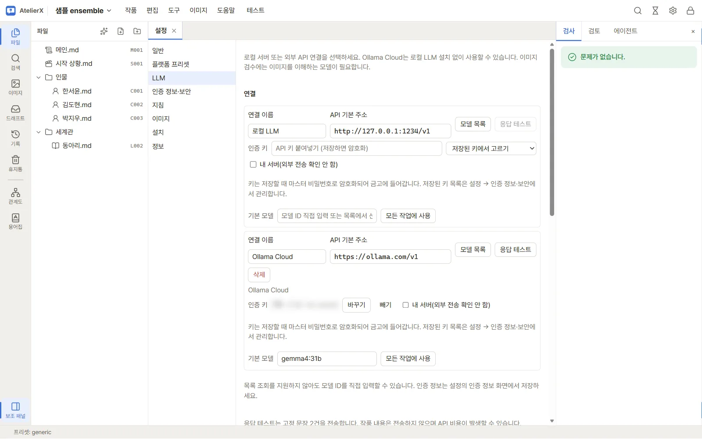
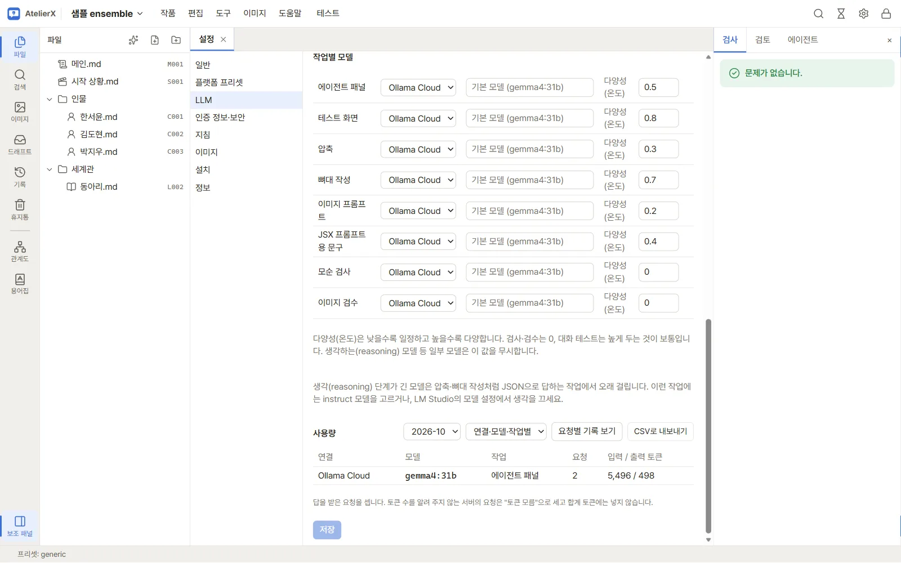

# 3. LLM 연결

에이전트, 원고 압축과 검토, 이미지 프롬프트 변환, 대화 테스트에 쓸 연결을 하나 만듭니다.

## 준비

- **이 PC의 LLM**을 쓸 경우 LM Studio 같은 OpenAI 호환 서버를 실행하고 모델을 준비합니다. LM Studio 주소 입력 예시는 `http://127.0.0.1:1234/v1`입니다. 서버가 이 PC에서 실행되는 주소인지 확인하세요.
- **외부 API**를 쓸 경우 서비스의 인증 정보와 쓸 수 있는 모델 ID를 준비합니다. 처음 요청할 때 작품과 연결마다 전송 동의를 확인합니다.

## 연결 저장하고 시험하기

1. 작품 창 오른쪽 위 톱니바퀴 **설정 → LLM**을 엽니다.
2. 기본 **로컬 LLM** 연결의 **API 기본 주소**를 확인합니다. 외부 연결을 만들려면 **서비스 프리셋**을 고르고 **연결 추가**를 누릅니다.
3. 인증이 필요한 경우 **인증 키**에 값을 붙여 넣거나 **저장된 키에서 고르기**를 사용합니다. **저장**을 누르면 새 키는 암호화되어 저장됩니다.
4. **모델 목록**을 누른 뒤 **기본 모델**에 쓸 모델을 고릅니다. 목록 조회를 지원하지 않는 연결은 모델 ID를 직접 입력합니다. 다시 **저장**합니다.
5. **응답 테스트**를 누릅니다. **일반 응답 · 스트리밍 정상**이 보이면 이 모델로 대화할 준비가 끝났습니다. 외부 API에서는 작품 내용 없이 시험 문장 두 건을 보내며 비용이 발생할 수 있습니다.

6. 아래 **작업별 모델**에서 이번 튜토리얼에 쓸 **에이전트 패널**, **테스트 화면**, **압축**, **이미지 프롬프트**에 연결을 선택하고 **저장**합니다. 모델 칸을 비우면 그 연결의 기본 모델을 씁니다. 한 연결을 모두에 쓰려면 연결 카드의 **모든 작업에 사용**을 누릅니다.

시험 버튼이 비활성화되어 있으면 변경 내용을 저장했는지와 **기본 모델**이 지정되어 있는지 봅니다. 응답이 실패하면 서버 주소, 인증 정보, 모델 ID를 확인합니다. 압축처럼 정해진 형식으로 답하는 작업에서 응답이 오래 걸리면 instruct 모델을 선택할 수 있습니다. [LLM 연결](../guide/connections.md)

## 다음

캐릭터 이미지를 만들려면 [4. 이미지 환경 준비](image-setup.md)로, 원고부터 쓰려면 [5. 에이전트로 원고 쓰기](write-with-agent.md)로 갑니다.
