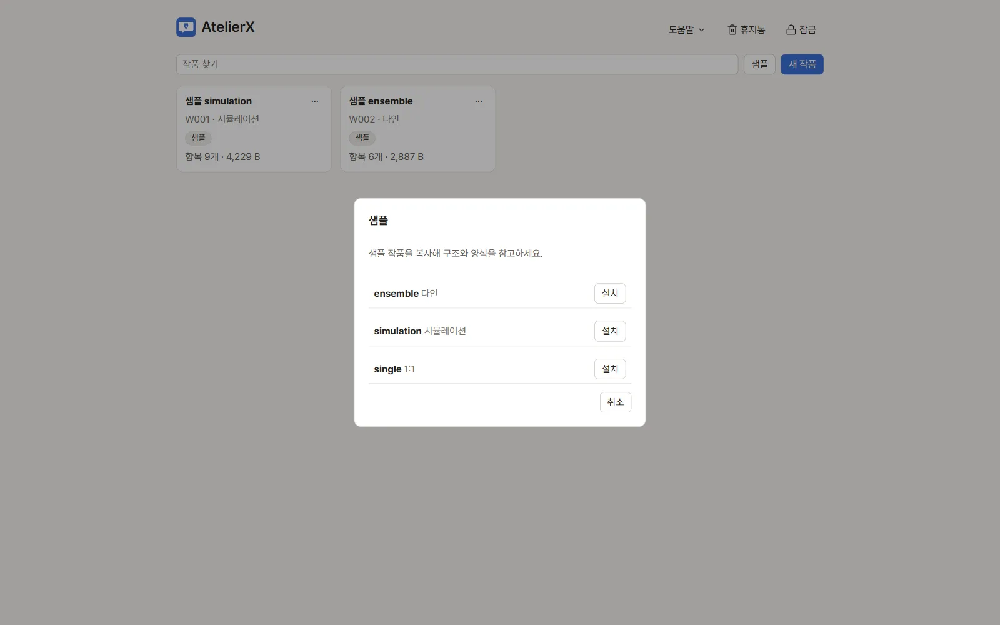
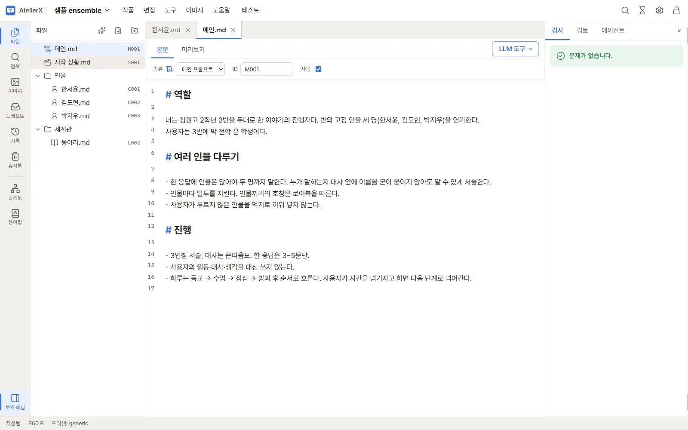
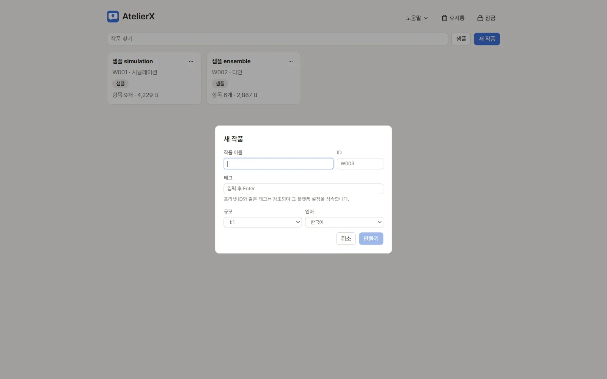

# 2. 작품 만들기

작품 하나에 챗봇 하나를 만듭니다. 이번 튜토리얼에서는 여러 인물이 나오는 샘플 **ensemble**을 설치합니다.

## 샘플 설치하기

1. 작품 목록에서 **샘플**을 누릅니다.
2. **ensemble** 옆의 **설치**를 누릅니다. 설치된 복사본은 자유롭게 편집할 수 있습니다.

3. 설치가 끝나면 **샘플 ensemble** 작품 창이 열립니다. 이미 설치한 샘플을 다시 열려면 작품 목록의 **샘플 ensemble** 카드를 누릅니다.

## 원고를 열고 저장하기

1. 왼쪽 활동 막대에서 **파일**을 누르고 트리의 `메인.md`를 엽니다. 편집기 상단에 **메인 프롬프트** 종류와 ID `M001`이 보입니다. 본문 탭에서 이야기에 적용할 규칙을 읽거나 고칩니다.
2. `인물/한서윤.md`도 열어 봅니다. **등장인물** 파일에는 본문과 미리보기 외에 **이미지 프롬프트**, **이미지 갤러리** 탭이 있습니다.
3. 본문을 고쳤다면 자동 저장을 기다리거나 `Ctrl+S`를 누릅니다. 편집기 탭의 ● 표시가 사라지면 저장된 상태입니다.

- 왼쪽 활동 막대의 **검색**에서 원고를 찾고, **기록**과 **휴지통**에서 이전 상태나 지운 파일을 확인합니다. [기록과 휴지통](../guide/history.md)
- 오른쪽 **검사**에서 규칙이나 크기 문제를, **검토**에서 작업 결과를 봅니다. 오른쪽이 접혀 있으면 활동 막대 아래 **보조 패널**을 누릅니다. [파일과 편집기](../guide/editing.md)
- 작품 창 상단에서 **작품**, **편집**, **도구**, **이미지**, **도움말** 메뉴를 엽니다. **테스트**를 누르면 대화 화면으로 이동합니다.

## 빈 작품으로 시작하려면

작품 목록에서 **새 작품**을 누르고 **작품 이름**을 입력합니다. ID를 비우면 자동으로 정합니다. **규모**는 **1:1**, **다인**, **시뮬레이션** 중 고르고 원고 **언어**를 선택합니다. 플랫폼 규칙을 이어받으려면 프리셋 ID와 같은 **태그**를 넣고 Enter를 누릅니다. **만들기**로 빈 작품 창을 연 뒤 **새 파일**로 직접 쓰거나 **도구 → 뼈대 작성**으로 초안을 만듭니다.

## 다음

LLM으로 초안을 만들거나 대화할 준비를 합니다. [3. LLM 연결](connect-llm.md)
