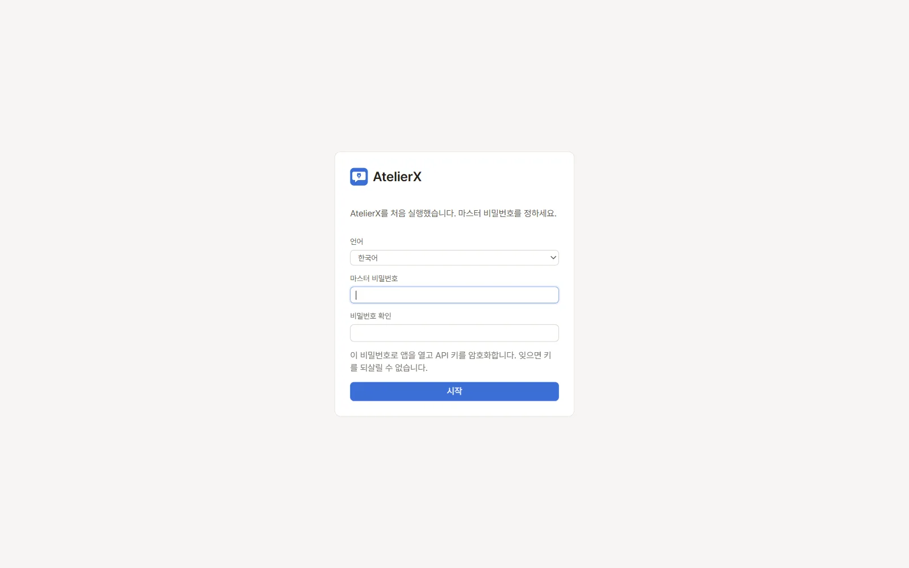
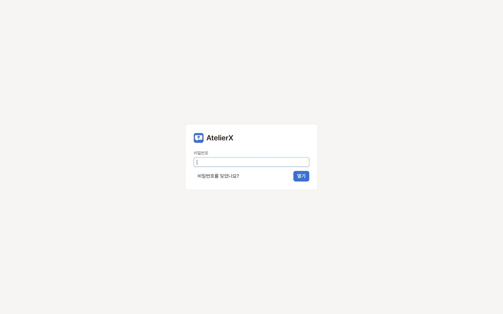

# 1. 설치와 첫 실행

튜토리얼에서는 앱에 들어 있는 **샘플 ensemble**로 원고를 쓰고, 대화 테스트와 내보내기까지 진행합니다. 캐릭터 이미지가 필요하면 이미지 환경 준비, 생성, 후처리도 따라 하세요.

## 준비

- Windows 10/11 x64 PC
- 릴리스의 `AtelierX-<버전>-windows-x64.zip`. [다운로드](https://github.com/kiritype/AtelierX/releases/latest)
- Microsoft Edge WebView2 Runtime과 .NET Framework 4.8. Windows 11에는 WebView2 Runtime이 보통 설치되어 있습니다.

## 설치하고 작품 목록 열기

1. ZIP 전체를 쓰기 가능한 새 폴더에 풉니다. 예를 들어 `D:\Apps\AtelierX`에 풉니다. 쓰기 권한이 제한되는 `Program Files`는 피합니다.
2. 압축을 푼 폴더에서 `AtelierX.exe`를 실행합니다. 실행 파일과 `_internal` 폴더는 같은 위치에 있어야 합니다.
3. **언어**를 고른 뒤 **마스터 비밀번호**에 8자 이상 입력합니다. **비밀번호 확인**에 같은 값을 넣고 **시작**을 누릅니다.

4. **새 작품**과 **샘플** 버튼이 있는 작품 목록이 열리면 준비가 끝났습니다. 다음 실행의 잠금 화면에는 방금 정한 비밀번호를 입력합니다.

실행 창이 열리지 않으면 ZIP 전체를 풀었는지, WebView2 Runtime과 .NET Framework 4.8이 설치되어 있는지 확인합니다. 앱을 열거나 잠금을 푸는 데 계속 문제가 있으면 [유지 관리와 문제 해결](../guide/maintenance.md)을 참고하세요.

## 비밀번호와 데이터 보관

- 마스터 비밀번호로 앱을 열고 API 키와 같은 인증 정보를 암호화합니다. 비밀번호를 잊으면 저장한 인증 정보는 다시 등록해야 합니다. 작품 파일은 앱 폴더에 남습니다.
- 앱 폴더의 `config`, `state`, `data`, `output`에 설정·작품·출력이 저장됩니다. 다른 PC로 옮길 때는 [백업 안내](../guide/maintenance.md)를 참고하세요.
- 잠깐 자리를 비울 때는 오른쪽 위 자물쇠 또는 `Ctrl+Shift+L`로 잠급니다.

## 다음

[2. 작품 만들기](create-work.md)
