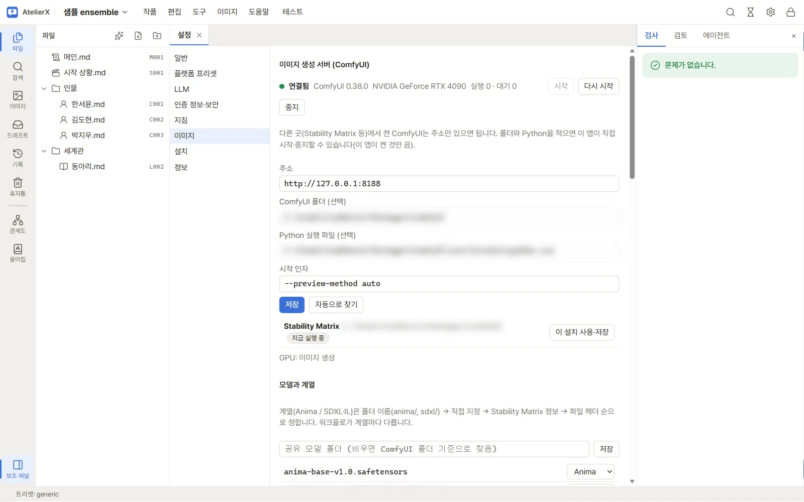
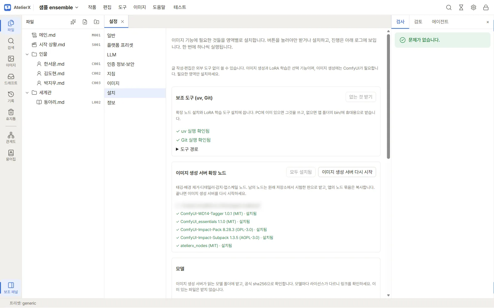

# 4. 이미지 환경 준비

튜토리얼의 캐릭터 이미지 생성과 후처리에는 ComfyUI를 씁니다. ComfyUI 없이 생성하려면 [인터넷 이미지 서비스](../guide/image-services.md)에서 NovelAI 또는 PixAI 키를 등록하고 [5. 에이전트로 원고 쓰기](write-with-agent.md)로 갑니다. [7. 후처리](post-processing.md)의 ComfyUI 작업과 LoRA 학습에는 별도 환경이 필요합니다.

## 준비

로컬에서 이 예제를 따라 하려면 NVIDIA GPU가 있는 PC와 ComfyUI, 그리고 이미지 생성 모델이 필요합니다. Stability Matrix로 설치한 ComfyUI도 쓸 수 있습니다. [이미지 환경 준비](../guide/image-setup.md)

## ComfyUI 연결

1. 작품 창 오른쪽 위 **설정 → 이미지**를 열고 **이미지 생성 서버 (ComfyUI)**의 **주소**를 입력합니다. 기본 입력 예시는 `http://127.0.0.1:8188`입니다.
2. 이미 다른 곳에서 ComfyUI를 실행했다면 주소를 **저장**합니다. 앱에서 실행하려면 **ComfyUI 폴더**와 **Python 실행 파일**을 지정해 저장하거나 **자동으로 찾기 → 이 설치 사용·저장**을 선택합니다. 그 뒤 **시작**을 누릅니다.
3. 위쪽에 **연결됨**이 보이는지 확인합니다. **연결 안 됨**이면 ComfyUI가 실행 중인지, 앱에 저장한 주소와 실제 서버 주소가 같은지 봅니다.
4. **이미지 → 모델**에서 사용할 생성 모델과 계열(Anima 또는 SDXL·IL)을 확인합니다. 모델 목록이 비어 있으면 [모델 관리](../guide/models.md)를 참고하세요.

## 후처리에 필요한 것 설치하기

1. **설정 → 설치**를 엽니다. **보조 도구 (uv, Git)**에서 빠진 도구가 있으면 **없는 것 받기**를 누릅니다.
2. **이미지 생성 서버 확장 노드**에서 설치할 항목을 확인하고 **N개 설치**를 누릅니다. 끝나면 **이미지 생성 서버 다시 시작**을 누릅니다. 다른 프로그램에서 켠 서버라면 그 프로그램에서 다시 시작합니다.
3. **모델**에서 필요한 감지·업스케일 모델을 받습니다. 모델에 표시되는 라이선스를 확인합니다.
4. 필요한 항목에 **설치됨**이 표시되는지 확인합니다. 실패했다면 화면 아래 **로그**를 확인한 뒤 다시 시도합니다. [외부 구성 요소](../guide/external.md)

## 다음

[5. 에이전트로 원고 쓰기](write-with-agent.md)
