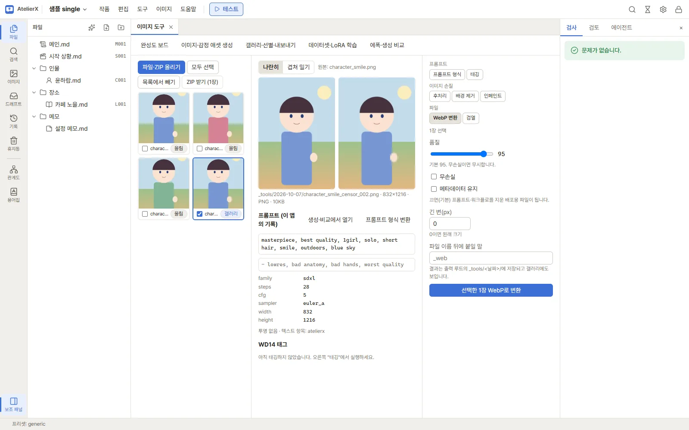
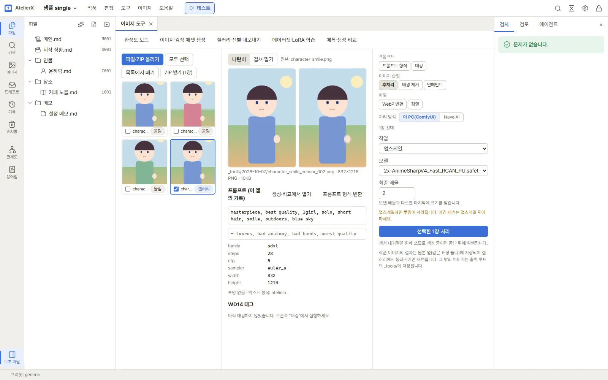

# 7. 후처리

갤러리에서 고른 이미지 한 장을 ComfyUI로 업스케일합니다. [이미지 환경 준비](image-setup.md)에서 업스케일 노드와 모델이 설치되어 있는지 확인하세요.

## 업스케일하기

1. **이미지 → 갤러리·검수**에서 이미지를 눌러 확대한 뒤 **이미지 도구로 보내기**를 누릅니다. 알림의 **이미지 도구**를 누르면 왼쪽 목록에 **갤러리** 배지가 붙은 이미지가 보입니다. 내 파일로 해 보려면 **이미지 → 이미지 도구 → 파일·ZIP 올리기**를 사용합니다.

2. 작업할 이미지 한 장을 체크합니다. 오른쪽 **이미지 손질 → 후처리**에서 **처리 방식**을 **이 PC(ComfyUI)**로 둡니다.
3. **작업**에서 **업스케일**을 고르고 설치한 모델과 **최종 배율**을 지정합니다. 얼굴·손을 다시 다듬으려면 생성 기록이 있는 이미지에서 **디테일러**를 선택할 수도 있습니다.
4. **선택한 1장 처리**를 누릅니다. **이미지 → 이미지 작업 대기열**에서 완료를 확인합니다. 업스케일 버튼을 쓸 수 없으면 **설정 → 설치**에서 노드와 모델을 확인하고, 노드를 새로 설치했다면 ComfyUI를 다시 시작합니다.

5. 이미지 도구 목록에 추가된 결과를 열어 원본과 **나란히** 또는 **겹쳐 밀기**로 비교합니다. 갤러리 원본에서 만든 결과를 채택하려면 **이미지 → 갤러리·검수**에서 결과 이미지를 **통과**시킵니다.

## 다른 도구 고르기

| 묶음 | 탭 | 하는 일 |
|---|---|---|
| 프롬프트 | 프롬프트 형식 | 기존 프롬프트의 형식 변환 |
| 프롬프트 | 태깅 | WD14로 이미지 태그 읽기 |
| 이미지 손질 | 배경 제거 | 투명 배경 만들기. 업스케일 후에 실행 |
| 이미지 손질 | 인페인트 | 마스크 영역만 다시 그리기 |
| 파일 | WebP 변환 | 배포용 WebP로 변환하고 필요하면 메타데이터 제거 |
| 파일 | 검열 | 감지 모델로 가릴 부분 처리 |

[이미지 도구와 후처리](../guide/image-tools.md)

## 다음

[8. LLM으로 다듬기](refine-with-llm.md)
