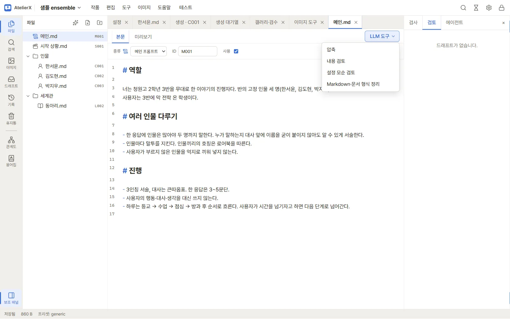
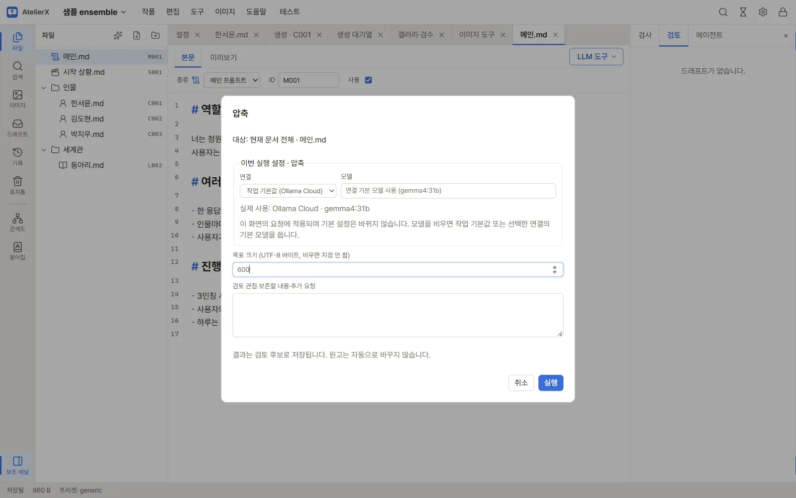
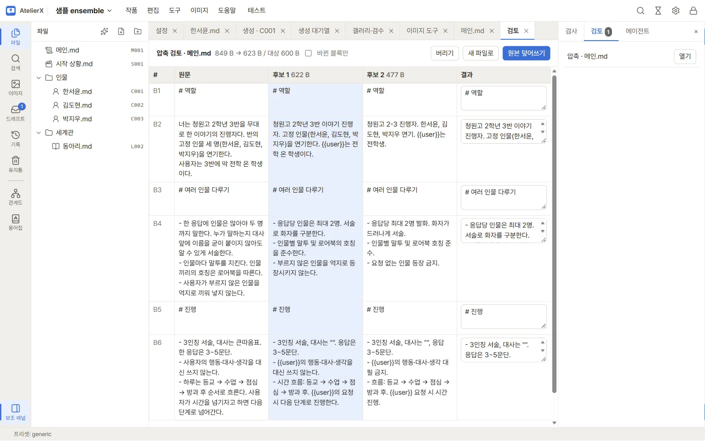
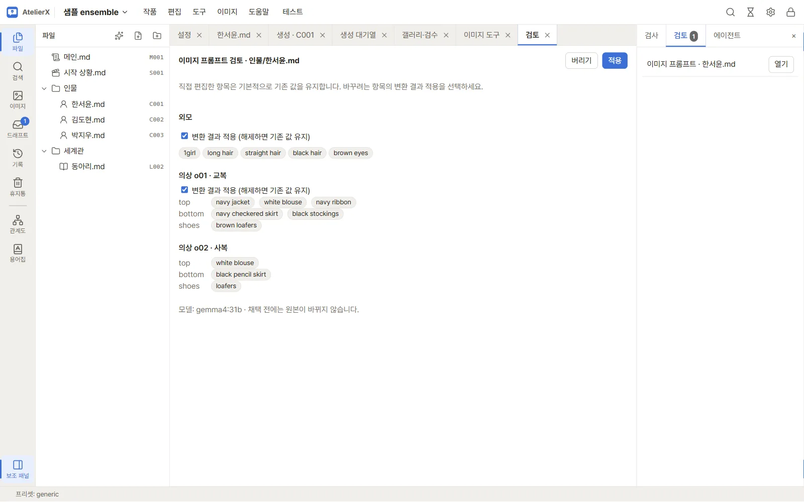

# 8. LLM으로 다듬기

메인 프롬프트의 분량을 줄이고, 캐릭터 본문을 고쳤다면 이미지 프롬프트도 업데이트합니다. 먼저 [LLM 연결](connect-llm.md)을 확인하고 편집하던 파일을 저장합니다.

## 메인 프롬프트 압축

1. `메인.md`를 열고 편집기 위쪽 **LLM 도구 → 압축**을 고릅니다.

2. **목표 크기**에 플랫폼이 허용하는 UTF-8 바이트 수를 입력합니다. 샘플에서는 600을 넣어 봅니다. **검토 관점·보존할 내용·추가 요청**에는 “학교 이름, 등장인물의 호칭, 대화 규칙은 유지해 줘.”처럼 지킬 것을 적습니다. **이번 실행 설정**을 확인하고 **실행**합니다.

3. 완료 알림의 **열기** 또는 보조 패널 **검토**에서 결과를 엽니다. 문단별로 원문과 후보를 비교하고 쓸 문구를 고릅니다. **결과**에서 직접 고칠 수도 있습니다. 결과 크기가 목표 안에 들어가는지, 꼭 남겨야 할 설정이 빠지지 않았는지 확인합니다.
4. 결과로 원고를 바꾸려면 **원본 덮어쓰기**, 따로 보관하려면 **새 파일로**를 고릅니다. 사용하지 않을 후보는 **버리기**를 누릅니다. 적용 후 파일을 다시 열어 내용을 확인합니다.

원본이 바뀌었다는 안내가 뜨면 최신 원고로 압축을 다시 실행합니다. 적용한 결과는 [기록](../guide/history.md)에서 이전 상태와 비교할 수 있습니다.

## 이미지 프롬프트 업데이트

6장에서 태그를 만든 뒤 `인물/한서윤.md`의 교복 묘사를 고쳤다면, 변경된 문장을 저장하고 **이미지 프롬프트** 탭을 엽니다. 교복만 다시 만들려면 본문에서 해당 묘사를 선택해 우클릭하고 **이미지 프롬프트로 → 의상**에서 교복을 고릅니다. 외모와 여러 의상을 함께 다시 보려면 **이미지 프롬프트** 탭의 **다시 변환**을 누릅니다.

검토 화면에서 새 태그와 **원문**을 비교합니다. **변환 결과 적용**은 바꿀 항목만 선택한 뒤 **적용**합니다. 직접 손본 항목은 전체를 다시 변환해도 기본적으로 기존 값이 선택됩니다.

**내용 검토**, **설정 모순 검토**, **Markdown·문서 형식 정리**는 같은 **LLM 도구** 메뉴에 있습니다. 대화하며 고치려면 에이전트의 **모순·누락 찾기** 같은 모드를 선택하세요. [AI 도구와 결과 검토](../guide/ai-tools.md)

## 다음

[9. 테스트와 내보내기](test-and-export.md)
