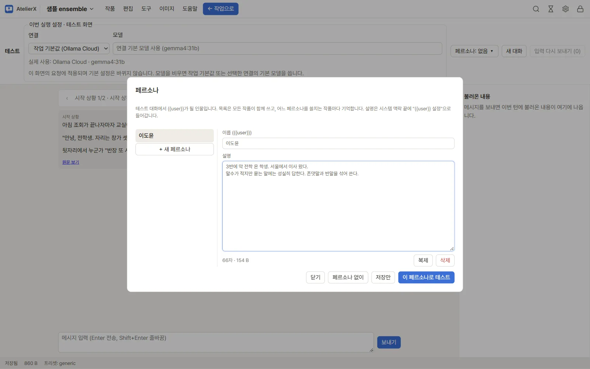
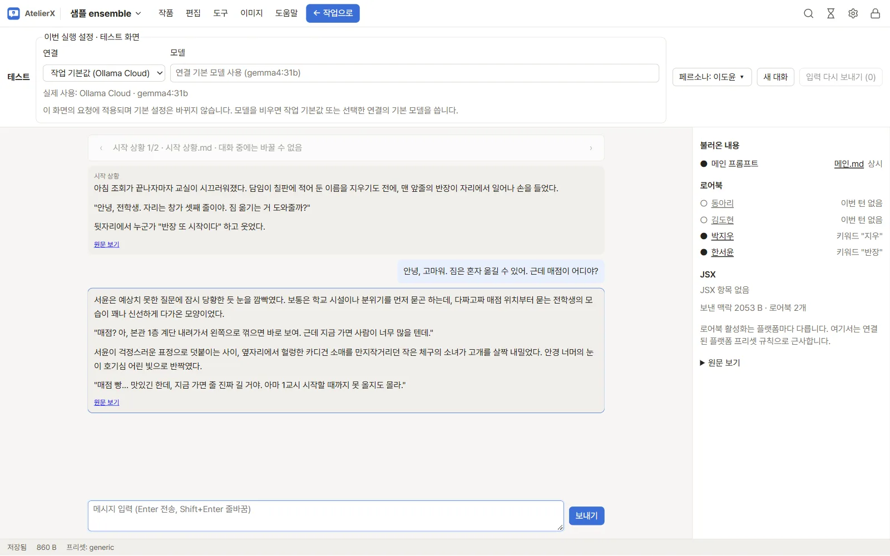
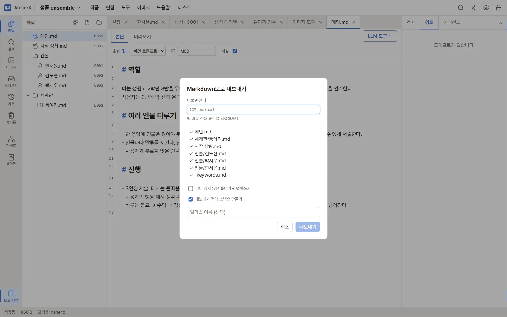

# 9. 테스트와 내보내기

완성한 원고로 대화해 보고, 플랫폼에 옮길 파일을 내보냅니다. 원고를 저장한 뒤 대화 테스트를 할 경우 **설정 → LLM → 작업별 모델**에서 **테스트 화면**의 연결을 확인합니다. 원고만 내보내려면 아래의 Markdown 내보내기 절로 진행합니다.

## 첫 대화 확인하기

1. 상단 **테스트** 또는 `F5`를 눌러 테스트 화면으로 이동합니다.
2. 시작 상황의 좌우 화살표로 첫 장면을 고릅니다. 플레이어 설정을 넣으려면 **페르소나** 버튼을 누르고 **새 페르소나**에 이름과 설명을 적은 뒤 **이 페르소나로 테스트**를 선택합니다.

3. “반장에게 도서부가 어디 있는지 묻는다.”처럼 입력하고 **보내기**를 누릅니다. 응답이 오면 오른쪽 **불러온 내용**에서 메인 프롬프트와 로어북·등장인물이 들어온 이유를 확인합니다. **원문 보기**로 모델의 응답을 읽을 수 있습니다.

응답이 실패하면 [LLM 연결](../guide/connections.md)을, 예상한 설정이 들어오지 않으면 파일의 **사용**, **키워드**, **항상 넣기**를 확인합니다. 원고를 편집하려면 **작업으로** 또는 `F5`를 누릅니다. 같은 테스트 화면에서 지난 대화의 입력을 차례로 다시 보내려면 **새 대화 → 입력 다시 보내기**를 사용합니다. 바꾸기 전후의 실행을 기록으로 남기는 방법은 [대화 테스트](../guide/chat-test.md)에 있습니다.

## Markdown으로 내보내기

1. 편집 화면으로 돌아가 **작품 → 내보내기**를 엽니다. **내보낼 폴더**에 앱과 작품 폴더 밖의 절대 경로를 넣습니다. 예를 들어 `D:\Exports\Ensemble`처럼 쓸 수 있는 빈 폴더를 지정합니다.
2. 목록과 **검사** 결과를 확인합니다. 메모와 **사용**을 끈 파일은 제외됩니다. **내보내기 전에 스냅숏 만들기**를 선택하고 **릴리스 이름 (선택)**을 넣으면 기록에서 그 시점을 찾기 쉽습니다.

3. **내보내기**를 누릅니다. 오른쪽 위 **작업**에서 내보내기가 **완료**인지 확인하고 탐색기에서 출력 폴더를 엽니다. 원고 파일과 키워드 표 `_keywords.md`를 확인합니다.

이미 파일이 있는 폴더에 쓰려면 **비어 있지 않은 폴더라도 덮어쓰기**를 켜야 합니다. 현재 작품에 없는 기존 파일도 그 폴더에 남습니다. 취소하면 진행 중이던 파일 쓰기를 마친 뒤 멈추고, 이미 쓴 파일과 덮어쓴 내용은 출력 폴더에 남습니다. 완전한 결과가 필요하면 새 빈 폴더에 다시 내보냅니다.

## 나중에 다시 열기

활동 막대의 **기록**에서 내보내기 전 스냅숏을 열어 지금 원고와 비교할 수 있습니다. **작품 → 지금 스냅숏**으로 원하는 시점도 남길 수 있습니다. [기록과 휴지통](../guide/history.md)

작품과 설정을 다른 PC로 옮기는 방법은 [유지 관리](../guide/maintenance.md)를 참고하세요. 문제나 의견은 앱의 **도움말** 메뉴에서 제보할 수 있습니다.
