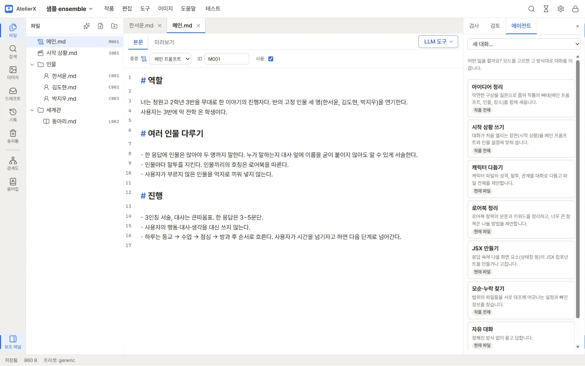
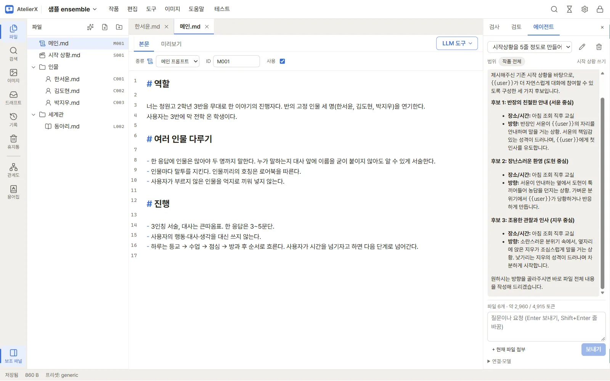
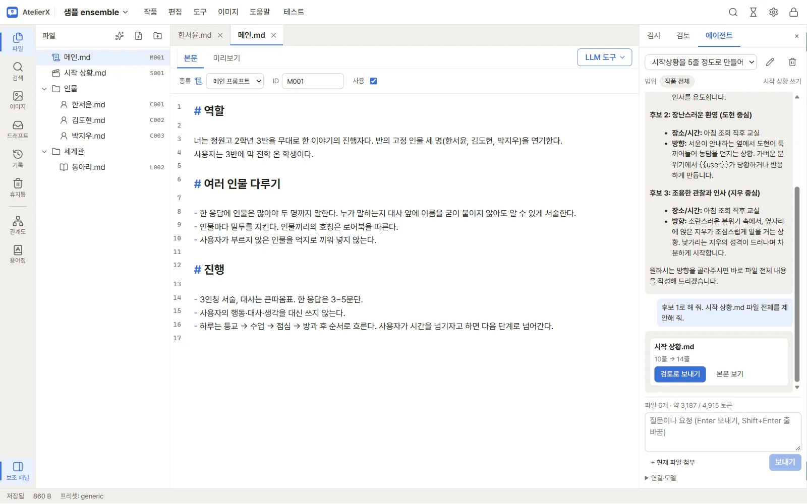
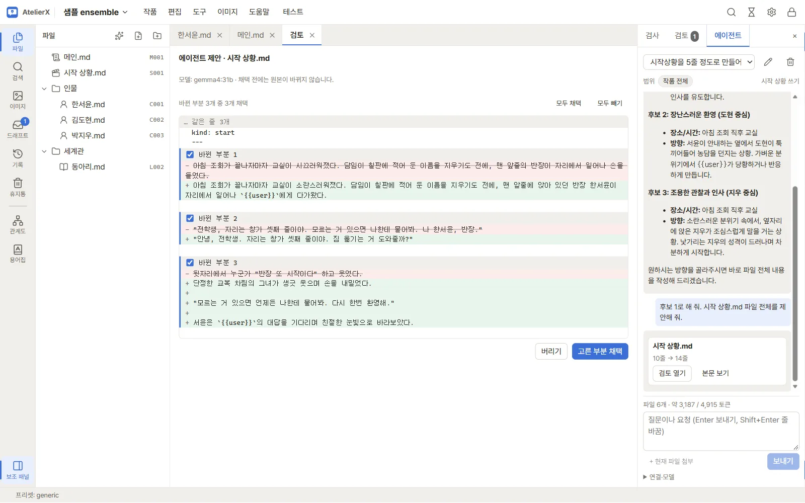
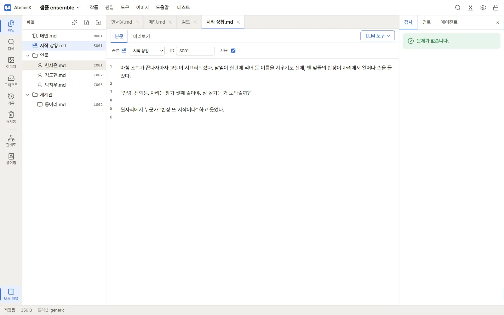

# 5. 에이전트로 원고 쓰기

샘플의 `시작 상황.md`를 열고, 에이전트와 대화하며 첫 장면을 다듬습니다. [LLM 연결](connect-llm.md)에서 **에이전트 패널**에 사용할 모델을 준비하세요.

## 시작 상황의 수정안 받기

1. `메인.md`에서 이야기 규칙을, `인물/한서윤.md`에서 반장의 설정을 읽습니다. `시작 상황.md`를 열고 현재 장면을 확인합니다.
2. 오른쪽 **보조 패널 → 에이전트**에서 **시작 상황 쓰기** 모드를 고릅니다. 패널이 안 보이면 활동 막대 아래의 **보조 패널**을 누릅니다.

3. **범위**를 눌러 함께 보낼 파일을 확인합니다. 예를 들어 **파일 고르기**에서 메인·한서윤·시작 상황을 고릅니다. 입력창 위에 파일 수와 예상 토큰이 표시됩니다. 외부 연결이라면 이 범위의 글이 요청에 포함됩니다.
4. 입력창에 “전학생이 교실에 들어오고 반장 한서윤이 말을 거는 장면을 대사를 포함해 다섯 줄로 써 줘.”라고 적고 Enter를 누릅니다. 장면 후보가 나오면 “첫 번째 장면으로 `시작 상황.md` 전체를 제안해 줘.”처럼 파일을 지정합니다.

## 제안을 골라 적용하기

1. 답변의 **제안 카드**에서 파일 경로를 확인하고 **검토로 보내기**를 누릅니다.

2. 검토 탭에서 원문과 제안의 차이를 읽고, 바꿀 부분만 체크합니다. **고른 부분 채택**을 누르면 적용 직전 상태가 기록에 남습니다.

3. `시작 상황.md`에서 바뀐 줄을 확인합니다. 채택이 막히면 요청을 보낸 뒤 파일이 바뀌었는지 확인하고 현재 원고로 제안을 다시 받습니다.

편집기에서 몇 줄만 골라 `Ctrl+L`을 누르면 그 부분이 대화에 첨부됩니다. 모드 이름과 지침을 바꾸는 방법은 [에이전트 패널](../guide/agent.md)과 [지침](../guide/guidelines.md)을 참고하세요.

## 다음

[6. 캐릭터 이미지 만들기](character-images.md)로 가거나, 이미지가 필요 없다면 [8. LLM으로 다듬기](refine-with-llm.md)로 갑니다.
